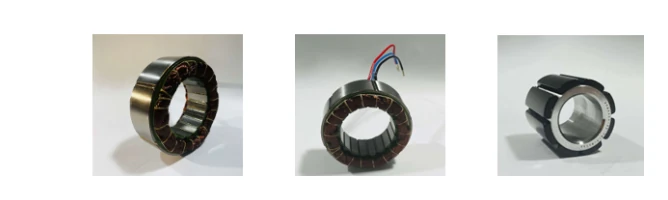

杭州三相创新技术有限公司专注**高速一体化电机**，产品覆盖机床主轴、精密转台、机器人关节和高速风机等方向。

## 电主轴、直驱转台与机器人关节

| 产品方向 | 主要应用 |
|---|---|
| 高速电主轴电机 | 高端数控机床、自动化设备 |
| DD直驱电机 | 精密转台、摆头等转动机构 |
| RTM机器人关节电机 | 协作机器人、人形机器人关节 |
| 燃料电池高速离心风机电机 | 燃料电池空气系统 |
| 高速离心风机 | 污水处理、纺织、水泥等行业 |
| 大功率高速特种电机 | 大型工业与能源设备 |

## RTM无框关节电机

RTM系列采用无框、中空结构，可与机器人关节机构组合。其产品介绍强调紧凑定子结构、稀土永磁转子，以及低转动惯量与动态响应，面向机器人关节的驱动和定位。

<figure class="company-photo company-photo--wide">

<figcaption>RTM无框关节电机 · 图：<a href="https://szaicx.com/hydt/19577.html">3Φ／深圳市人工智能产业协会</a></figcaption>
</figure>

三相的研发与生产体系覆盖电磁设计、样机开发、精密加工、电机装配和检测；高速电机方向结合散热结构与灌封材料处理温升，直驱转台方向则侧重低速大力矩与精密运动。

## 资料来源

- [深圳市人工智能产业协会：杭州三相创新技术有限公司](https://szaicx.com/hydt/19577.html)
