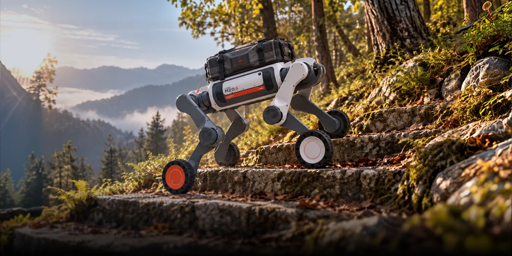

2025 年 95% 以上的收入来自四足与轮足本体，客户以国家电网、南方电网、消防与警务系统为主；人形 DR 系列同期只卖出 1 台，占收入 0.24%。这个结构决定了技术优先级：先解决雨雪、油污、强电磁环境下的可靠巡检，再谈通用智能。

## 从浙大实验室到科创板申报

公司 2017 年成立于杭州，名字取自"远上寒山石径斜，白云深处有人家"。创始人朱秋国是浙江大学控制学院副教授、博士生导师，联合创始人兼 CTO 李超同样出自浙大。2025 年 11 月完成股份制改造，2026 年 5 月 18 日科创板 IPO 申请获上交所受理，拟募资 25.03 亿元，保荐机构为中信建投。

招股书披露的财务曲线最直接地印证了这条 B 端路线：2023 至 2025 年营业收入 0.50 亿元、1.03 亿元、3.37 亿元，复合增长率 159.51%；归母净利润 -2585 万元、-1329 万元、+2868 万元，2025 年首次扭亏；毛利率从 33.48% 升到 52.83%。2025 年销量首次破千，达 2908 台。

<figure class="company-photo company-photo--wide">

<figcaption>山猫 M20 轮足机器人 · 图：<a href="https://www.deeprobotics.cn/">云深处科技官网</a></figcaption>
</figure>

## 产品线与 2025 年实际销售结构

官网把产品分成四足、轮足、人形、组件四个门类。四足为绝影 X 系列（X20、X30）与绝影 Lite 系列，轮足为山猫 M 系列，人形为 DR01／DR02，组件是 J60、J80／J100 系列关节。

| 系列 | 定位 | 2025 年销量 | 单价 | 毛利率 |
| --- | --- | --- | --- | --- |
| 绝影 X 系列 | 行业级四足 | 681 台 | 28.75 万元 | 54.35% |
| 绝影 Lite 系列 | 科研教育与商业服务 | 1850 台 | 2.77 万元 | 38.52% |
| 山猫 M 系列 | 行业级轮足 | 377 台 | 19.76 万元 | 57.50% |
| DR 系列 | 行业级人形 | 1 台（两年累计 4 台） | 82.30 万元 | 68.74% |

表中数字来自招股书申报稿，是这套产品线唯一可核的量化口径。真正赚钱的是 X 系列与山猫 M 系列，两者合计贡献八成收入；Lite 系列卖得多但不赚钱，单价不到 X 系列的十分之一。人形 DR 系列毛利率虽高，样本只有个位数，不构成趋势。

官网公布的整机参数如下（各型号以详情页为准）：X30 站立尺寸约 1000×470×695 mm、整机 56 kg、持续负载 20 kg、空载续航约 4 h、防护 IP67、工作温度 -20 至 55 ℃、最大斜坡 30°、最大楼梯 20 cm、4 线激光雷达；山猫 M20 约 820×430×570 mm、35 kg、负载 15 kg、空载约 3 h／15 km、IP66、极限测试速度 5 m/s、最大高台 80 cm、最大斜坡 45°；DR02 约 1800×558×400 mm、68 kg、持续负载 10 kg、21 个主动自由度、IP66、-20 至 55 ℃、标配 275 TOPS 算力、可选 2070 TOPS。[X30](https://www.deeprobotics.cn/index.php/products/detail/6.html)　[DR02](https://www.deeprobotics.cn/index.php/products/detail/5.html)

## 电力巡检为什么是主战场

四足在巡检场景的价值不在"像狗"，而在能走台阶、跨电缆沟、过碎石路——这几件事轮式底盘做不到。云深处 2019 年前后从南方电网的具体需求切入，2023 年杭州亚运会期间机器狗进入地下 8 米电缆沟执行无人巡检；同年与国家电网签订为期 5 年、总额 10 亿元的框架协议。2024 年新加坡能源集团的电缆隧道里出现绝影 X30，是行业级四足首次进入海外电力系统；沙特 NEOM 新城的沙滩户外巡检也用了 X30。

招股书援引沙利文数据：2025 年四足机器人在行业应用领域的收入全球第一，电力巡检市占率 85%，消防行业市占率超 90%；行业应用收入 2.67 亿元，占主营收入 79.33%。

## 产业链角色

自研的是本体、关节与算法。J60、J80、J100 系列关节在官网单独设"组件"门类对外销售，说明关节模组已做到可外供；导航、建图、自主充电、避障也自己做。2026 年 10 月公司集中发布"具身大脑"系列成果，把算法层从巡检扩到更通用的任务。

外购部分，官方页面唯一明示的是算力：DR02 脚注写明 AI 处理器标配 NVIDIA AGX Orin（275 TOPS），可选 AGX Thor（2070 TOPS）。激光雷达与相机为外购件，官网只写数量（如 X30 配 4 线激光雷达），不写品牌。**

与宇树的对照绕不开：同城、同起于四足、同在 2026 年冲科创板，但一个把货铺向科研与消费，一个卖给电网和消防。

## 官方资料

- [云深处科技官网](https://www.deeprobotics.cn/)
- [绝影 X30 产品页（整机参数）](https://www.deeprobotics.cn/index.php/products/detail/6.html)
- [DR02 产品页（含算力配置脚注）](https://www.deeprobotics.cn/index.php/products/detail/5.html)
- [山猫 M20 系列产品页](https://www.deeprobotics.cn/index.php/products/detail/1.html)
- [《财经》：科创板 IPO 获受理，拟募资 25 亿元](https://www.mycaijing.com/article/detail/568866)
- [《中国经营报》：拆解招股书，机器狗营收占比 95%](https://www.toutiao.com/article/7641767203854877235/)
