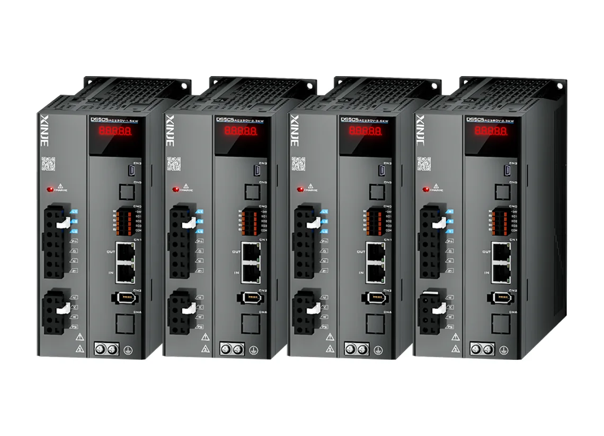

信捷电气做的是工业自动化控制部件：PLC、伺服驱动器与电机、变频器、步进、HMI、机器视觉。它的招牌是小型 PLC，国产品牌里销量第一；伺服是增长最快的一块，2025 年首次超过 10 亿元。它原本不碰编码器，2025 年开始自己做电感式编码器，并用投资方式覆盖光电式，等于把手伸进了伺服系统最里层的那个器件。

## 无锡的 PLC 厂，2016 年上市

公司全名无锡信捷电气股份有限公司，上交所上市（603416.SH），2016 年上市，办公地在无锡市滨湖区建筑西路 816 号信捷大厦。2025 年营业收入 20.14 亿元（+17.87%，首次破 20 亿），归母净利润 2.54 亿元（+11.21%），扣非 2.36 亿元（+16.40%）；研发费用 1.99 亿元（+18.94%），占营收 9.90%，研发人员 808 人占 30.33%；有效专利 237 项、软件著作权 53 项。年度现金分红占归母净利润 95.05%，是上市以来力度最大的一次。[2025 年年度报告](https://big5.sse.com.cn/site/cht/www.sse.com.cn/disclosure/listedinfo/announcement/c/new/2026-04-17/603416_20260417_1MLC.pdf)

<figure class="company-photo company-photo--wide">

<figcaption>信捷 DS5C5 系列旗舰型伺服驱动器 · 图：<a href="https://www.xinje.com/web/productInfo/index?seriesId=49&indexGroup=0">信捷电气官网</a></figcaption>
</figure>

## 四条产品线，驱动已过半

| 产品线 | 2025 年收入 | 同比 | 公开信息 |
| --- | --- | --- | --- |
| 驱动系统 | 10.19 亿元（占 50.72%） | +26.39% | DS6、DS5 系列伺服配 MS6、MF5 电机；分小体积、PROFINET 总线、低压三大类共 8 个子系列 |
| 可编程控制器 | 7.08 亿元（占 35.21%） | +9.16% | 6 大品类、25 个子系列、400 余种型号；小型 PLC 市占 8%，PLC 毛利率 57.1% |
| 人机界面 | 2.05 亿元 | +5.21% | TS / TG 两大系列，Linux 系统配 A7 处理器 |
| 智能装备（机器人） | 0.68 亿元 | +64.96% | 机器视觉平台、工业机器人、人形机器人核心零部件 |

驱动的增长主要来自光伏、锂电、半导体设备，DS6、DL6 是 2025 年的主力新品；PLC 在往中大型（XM 系列）走，小型 PLC 守着国产品牌第一的位置，57.1% 的毛利率是它最赚钱的一条线。

## 编码器：为什么要自己做

2025 年报写明：组建人形机器人专项团队，攻克空心杯电机、无框力矩电机、高性能编码器，实现电感式编码器全栈自研；自研无框电机等 17 款产品已落地；参与人形机器人电驱动一体化关节国家标准制定。据公开报道，公司已投资长春荣德光学（做光电编码器与传感器），并投资 8 亿元建设机器人智能驱控系统生产项目，竞得约 5.5 万平方米工业用地。[年报解读](http://gp.zhonghongwang.com/show-8-75794-1.html)

两条线放在一起看，逻辑是清楚的：电感式适合关节内置，对气隙不敏感、抗磁场干扰；光电式精度高但结构厚、怕污染。自研电感式接关节侧的需求，投资光电式补转台与高精度伺服侧的需求，客户在它这里配一套伺服就不用再外采反馈件。

## 在机器人关节/运动控制链上的位置

信捷原本站在"控制＋驱动"两层，编码器是它向上游器件层伸的第一只手。这条路与它的客户结构有关：买 PLC 的设备厂顺手买伺服，买伺服就绕不开编码器，自研之后单轴成本可控，交期不受制于人。

机器人业务 0.68 亿元在 20 亿元里占比很小，但它在这块的动作比收入快——建专项团队、投编码器、投产能、参与国标，是典型的先卡位后放量。

下游决策权在整机与关节设计方。对手分两类：编码器专厂（多摩川、禹衡、弓望）与工控综合厂（汇川、台达、三菱）。

边界：电感式编码器的分辨率位数、精度等级、外径系列都还没有公开型号与参数；对长春荣德光学的投资金额与持股比例，公开报道未给全。

## 官方资料

- [2025 年年度报告（分产品收入、研发投入、编码器自研表述）](https://big5.sse.com.cn/site/cht/www.sse.com.cn/disclosure/listedinfo/announcement/c/new/2026-04-17/603416_20260417_1MLC.pdf)
- [官网首页（五大产品线与行业方案）](https://www.xinje.com/)
- [产品中心（PLC、伺服、机器人）](https://en.xinje.com/web/home?p=5)
- [2025 年报解读（机器人业务增速、长春荣德光学、8 亿元项目）](http://gp.zhonghongwang.com/show-8-75794-1.html)
