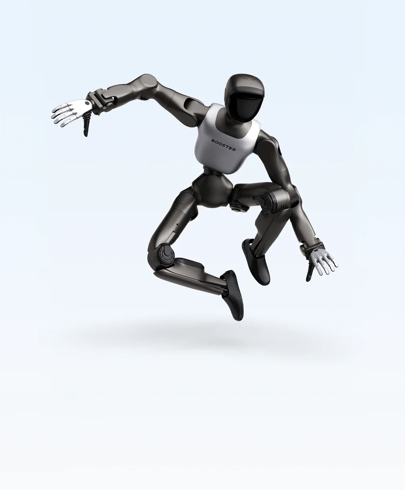

买它的人主要是高校实验室、科创课程和机器人足球队。

## 公司与团队

工商主体为北京加速进化科技有限公司，2023 年 6 月成立，注册地在北京海淀。创始人兼 CEO 程昊毕业于清华大学自动化系，是清华火神机器人足球队成员，此前创办朝夕日历并被字节跳动收购，后任飞书产品副总裁。核心团队来自清华机器人控制实验室与火神队，对外口径是"人形机器人领域超过 20 年技术积累"。[公司简介](https://www.boosterobotics.com/about-us/)

这条出身为产品定了调：火神队是为了踢球造机器人的，走得稳、摔不坏、恢复快优先于精细操作。2025 年 RoboCup 巴西赛场，用 T1 的清华火神队拿下 AdultSize 组冠军，是该赛事创办 28 年来中国团队首次在这个组别夺金；K1 在 KidSize 组包揽冠亚军。2026 年 RoboCup 上，用 Booster 机器的 38 支队伍包揽双足人形全部组别的 3 金 2 银 3 铜。

<figure class="company-photo company-photo--wide">

<figcaption>Booster T2 人形机器人 · 图：<a href="https://www.booster.tech/">加速进化官网</a></figcaption>
</figure>

## 产品线

官网销售页为前端渲染，静态页面读不到完整参数表，因此下表只写官方明确表述过的定位与价格，具体规格以合同附件为准。

| 产品 | 官方定位 | 公开信息 |
| --- | --- | --- |
| Booster T1 | 专为开发者打造 | 2024 年 8 月世界机器人大会亮相；118 cm 级双足；2025 年 RoboCup AdultSize 冠军机型 |
| Booster K1 | 具身开发入门级平台 | 2025 年 10 月生态大会发布；官网标价 3.99 万元起；首批 100 台限时 2.99 万元，20 分钟售罄 |
| Booster T2 | 具身开发旗舰平台 | 2026 年 7 月 WAIC 发布；专业版搭载 NVIDIA Thor 计算平台 |

第三方渠道对 T1 的口径较一致：约 30 kg、基础构型 23 自由度、NVIDIA Jetson AGX Orin、续航约 2 小时、ROS 2 兼容；K1 约 95 cm、19.5 kg、22 自由度，分三档算力。这些数字在官方静态页上没有对应表格，采购应以官方规格书为准。

软件侧是它区别于纯硬件厂的部分：Booster Studio 集成开发环境（2026 年 6 月上线，覆盖 Agent 开发、仿真调试与真机部署）、Booster Gym／Booster Lab 工具链、Agent Store 与 Booster APP。它把这些工具做成默认配置，让课题组不必从零搭 sim-to-real 环境。

## 商业进展

官方披露的节奏是：2025 年 11 月累计交付超过 700 台人形机器人、客户超过 200 家、海外占比过半；2025 年 12 月首次实现单月经营性现金流转正；2026 年一季度出货量同比增长 500%，1 至 2 月新签订单同比增长超过 800%。融资方面，2024 年完成 Pre-A（水木创投、源码资本等），2025 年 7 月完成 A+ 轮（北京机器人产业发展投资基金、北京人工智能产业投资基金领投），2026 年 4 月完成近 10 亿元融资，由北京高精尖产业基金、京国盛基金、华控基金联合领投。

海外占比过半意味着收入以美元计价的教育与科研预算为主，优点是回款快、决策链短，缺点是单价被 K1 这类入门机型往下拉。

## 产业链角色

自研的部分是本体结构、关节模组与运动控制算法。地方科技主管部门的报道称其为"国内少数具备正向设计人形机器人本体能力的团队之一"，这句话出自政府新闻稿而非第三方评测，但和它把关节、结构、运控一起迭代的产品节奏吻合。

外购的部分，公开信息能确认的只有算力：T1 与 K1 的主控用的是 NVIDIA Jetson 系列，T2 专业版升级到 Thor，这在官方发布信息里写得很明确。深度相机、IMU、麦克风阵列属于外购件，官方页面没有逐一列出型号。**

## 官方资料

- [加速进化官网](https://www.booster.tech/zh)
- [公司与历程（融资、交付量、赛事）](https://www.boosterobotics.com/about-us/)
- [文档中心](https://docs.booster.tech/zh-CN)
- [北京市科委报道：完成近 10 亿元融资](https://www.ncsti.gov.cn/kjdt/scyq/zgckxc/zgcdt/202604/t20260422_244584.html)
