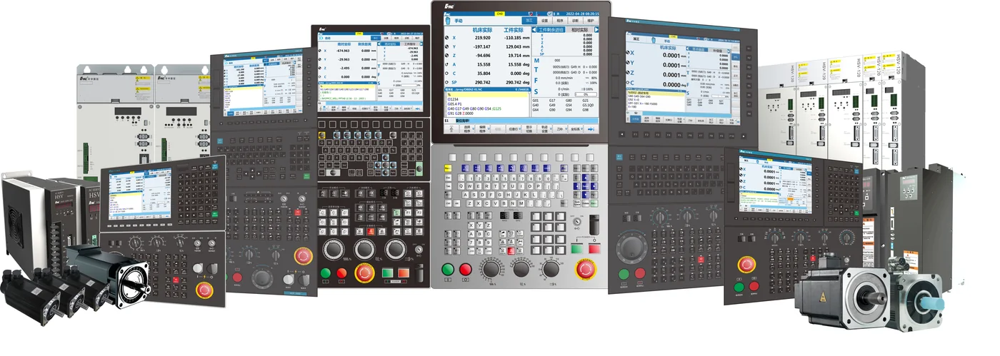

华中数控是武汉的数控系统厂商，卖的是机床的"大脑"加配套的驱动与电机，2025 年营收 15.64 亿元。它不生产编码器，但在国产这条链上有特殊分量：编码器要给出什么信号、能接多少位、怎么做全闭环，标准由它这类系统厂来定。

## 一核三军：15.64 亿元，利润靠补助

公司全名武汉华中数控股份有限公司，深交所创业板，代码 300161，与华中科技大学共建国家数控系统工程技术研究中心。战略表述为"一核三军"：数控系统技术为核心，机床数控系统、工业机器人及智能产线、新能源汽车配套（6 米全铝轻量化电动小巴）为三个业务主体。[官网](https://www.huazhongcnc.com/)

2025 年营业总收入 15.64 亿元（同比 −12.24%），归母净利润 1632.01 万元（上年亏损 5536.62 万元），但扣非净利润仍亏 1.26 亿元——当期非经常性损益 1.43 亿元，其中政府补助 1.68 亿元。研发投入 4.30 亿元，占营收 27.46%，近三年平均 22.81%。数控系统及配套业务毛利率 42.76%，同比提升 1.29 个百分点，是三块业务里最赚钱的。2026 年一季度营收 2.26 亿元（同比 +11.39%），数控系统 1.74 亿元，增幅近 30%。

客户名单是它最能说明身位的地方：武重机床、天水星火、宁江机床、秦川集团这些机床厂，加上新能源汽车关键部件、轴承、齿盘、3C 精密结构件的加工厂。数控系统这个市场长期由发那科、西门子、海德汉把持，国产同行主要是广州数控。

<figure class="company-photo company-photo--wide">

<figcaption>华中数控 HNC-8 系列数控装置、伺服驱动单元与伺服电机 · 图：<a href="https://www.huazhongcnc.com/portal/article/index/id/2141/cid/46.html">华中数控官网</a></figcaption>
</figure>

## 产品与它对编码器提出的要求

数控系统分两代：华中 8 型（HNC-808 普及型、HNC-818 中档、HNC-848 高档）与 2025 年 4 月发布的华中 10 型——后者把 AI 芯片与大模型嵌进系统，入选"2025 世界十大智能制造科技进展"，联合 18 家企业做了 20 台智能机床工程样机。伺服侧有 HSV 系列驱动与 GK6、华大 HEE／LEE／STL／HB／HBB／HDD／STP、华中 LB 共九个电机系列。

反馈接口的口径集中在两处官方资料：

| 公开参数 | 出处 | 选型时怎么读 |
| --- | --- | --- |
| 支持 TTL 万波（方波）、1 Vpp 正弦、串行绝对式（样本写作"汉德汉绝对式"）全闭环 | 华中 8 型综合样本 | 三类信号都能接，老机床改造要留方波与正弦两路 |
| 支持 1600 万线高精度编码器 | 同上 | 细分倍频后可读线数，不是码盘刻线数 |
| HSV-160U 位置反馈分辨率最高 23 位，支持双编码器接口 | 华中 8 型样本伺服驱动章节 | 驱动器能解到的上限；双接口用于电机端＋光栅端的全闭环 |
| 华中 8 型 D 系列配 LDD 电机，23 位绝对值编码器 | 官网英文产品新闻 | 整机默认档位，不是可选项清单 |

## 在编码器链上的位置

它站在链条中下游：往上是编码器与光栅尺，往下是驱动器与电机，自己在最外层做插补与工艺。它做三件事——定协议（自研 NCUC 总线，兼容 EtherCAT）、定门槛（2000 至 20000 点螺距误差补偿、热变形补偿都建立在反馈可信的前提上）、定验收（全闭环接光栅尺，半闭环接电机编码器，调试流程不同）。

对编码器厂，这意味着两件事。一是兼容性比极限指标更重要：能进它的适配清单，比在实验室多跑几位更有价值。

## 官方资料

- [华中数控官网](https://www.huazhongcnc.com/)
- [数控系统产品分类](https://www.huazhongcnc.com/portal/list/index/cid/32.html)
- [伺服电机产品系列](https://www.huazhongcnc.com/portal/list/index/cid/77.html)
- [华中 8 型高性能数控系统综合样本（接口与全闭环口径）](http://www.huazhongcnc.com/UploadFiles/Files/yuhao/201807/8%E5%9E%8B%E7%BB%BC%E5%90%88%E6%A0%B7%E6%9C%AC.pdf)
- [HNC8 D 系列英文产品新闻（LDD 电机与 23 位编码器）](https://en.huazhongcnc.com/news/sustaining-innovations-hnc8-d-series-high-performance-cnc-controller)
