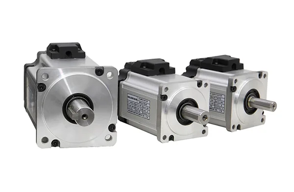

卧龙电驱的老本行是电机：防爆、工业、暖通三大类电驱加新能源交通电驱，合计占 2025 年营收九成以上。机器人在它的报表里叫"机器人组件及系统应用"，2025 年收入 5.16 亿元、占营收 3.34%——这是公司自己在业绩说明会上点明的比例。它不做整机，也不做减速器：无框力矩电机、伺服驱动器、关节模组是它供的三样东西，减速器在模组里是外购件。位置搞清楚了，剩下的是"电机厂怎么把四十年的绕线、叠片、灌封搬到关节里"这个问题。

## 三大类电驱是基本盘，机器人是第五块

公司注册地在绍兴上虞，集团 1984 年创建，股份公司 1998 年设立、2002 年 6 月在上交所上市。官网口径全球 40 多个制造基地、1.5 万名员工，集团销售额 549 亿元。2025 年营收 154.54 亿元（同比 -4.88%，主因出售子公司导致合并范围变化，剔除该影响后 +2.59%），归母净利润 11.26 亿元（+42.04%），扣非 8.23 亿元（+29.58%）。收入下滑与利润大增同时出现，是剥离资产与毛利率修复叠加的结果。

| 业务（2025 年） | 收入 | 占比 | 同比 | 毛利率 |
| --- | --- | --- | --- | --- |
| 暖通电驱动系统解决方案 | 49.58 亿元 | 32.08% | +7.95% | 17.53% |
| 防爆电驱动系统解决方案 | 46.33 亿元 | 29.98% | -1.37% | 32.18% |
| 工业电驱动系统解决方案 | 40.95 亿元 | 26.50% | +0.79% | 30.00% |
| 机器人组件及系统应用 | 5.16 亿元 | 3.34% | +14.13% | 26.21% |
| 新能源交通电驱动系统解决方案 | 4.33 亿元 | 2.80% | +11.09% | 6.06% |

2025 年一季度，公司以约 7.26 亿元出售龙能电力、卧龙储能、英耐德氢能与上虞舜丰四家新能源资产，把光伏、储能、氢能整体出表。同年筹划发行 H 股，2025 年 8 月递交申请材料。

<figure class="company-photo company-photo--screen">

<figcaption>卧龙电驱伺服电机系列 · 图：<a href="https://www.wolong.com.cn/products-solutions/automation-solutions/motion-control/servo-motor">卧龙电驱官网</a></figcaption>
</figure>

## 机器人这条线卖什么

按公司自述与展会公开资料，机器人相关产品分四层：无框力矩电机（定子外径 38–132 mm，拼圆结构，主打高槽满率与高转矩密度，作为客户自研一体化关节的动力源）；通用关节模组（行星减速器 + 无框力矩电机 + 伺服驱动器 + 高精度编码器）；高精度关节模组（谐波减速器 + 低齿槽转矩电机 + 伺服驱动器 + 高精度双编码器）；以及伺服驱动器本体。灵巧手是另一支：空心杯无刷电机配微型行星滚柱丝杠构成微型电缸，配自研触觉传感器，官方给出的耐久口径是空载连续运动超过 100 万次、电缸空载抓取超过 250 万次。

一个容易被忽略的细节：通用模组用行星减速器，高精度模组才用谐波减速器。两条产品线并行，说明它面向两类关节——机器狗与轮式底盘要成本与过载，人形上臂要精度与低齿槽转矩。减速器供应商公开资料未给出。

## 智元这层关系该怎么读

2025 年 3 月，卧龙电驱与上海智元新创（智元机器人）完成战略投资签约，成为其战略股东，公司公众号与证券时报均有报道；此前智元已通过增资扩股入股卧龙旗下的希尔机器人，双方属于互相持股而非单向甲乙方。2026 年 4 月，由上虞区政府主导、卧龙与智元按市场化方式共建的杭州湾具身智能创新中心发布，卧龙以链主身份参与。

资本关系不等于订单。截至 2025 年报，机器人组件及系统应用 5.16 亿元里同时装着工业机器人系统解决方案与仿生机器人零部件，公司没有拆分披露，业绩说明会的原话是"占比较低，不会对公司目前经营业绩产生重大影响"。公开渠道流传的关节电机锁量数字（如百万台级、对应数十亿元）未见于公司公告，只能当市场说法看。

## 在机器人执行器链上的位置

卧龙供的是两层：电机（零件）与关节模组（总成）。无框力矩电机在关节里解决"出力"，与减速器是串联关系而不是替代关系——它提供低转速大扭矩的转子与定子，减速器再把扭矩放大并把转速降到关节需要的量级。

编码器在它这一层是被"集成"的：官方只写"高精度编码器"与"高精度双编码器"作为模组内置件，没有公布品牌、型号或分辨率。双编码器通常意味着电机端与输出端各一只，输出端那只装在减速器之后直接测关节角——这属于结构推断，具体配置须查产品手册。

它的强项是大扭矩关节（腰、髋、腿），弱项是灵巧手里的微型电机与传动，后者要跟空心杯电机厂与微型丝杠厂比。

## 官方资料

- [卧龙电驱官网](https://www.wolong.com.cn/)
- [卧龙电驱入股智元机器人（公司新闻）](https://www.wolong.com.cn/media-center/company-news/325)
- [杭州湾具身智能创新中心发布（卧龙集团）](https://www.wolong.com/index.php/news/info/204.html)
- [2025 年年度业绩说明会（上证路演中心）](https://roadshow.sseinfo.com/activityDetails/37781)
- [世界机器人博览会展商页（机器人产品线口径）](https://www.worldrobotconference.com/expo/company/418.html)
