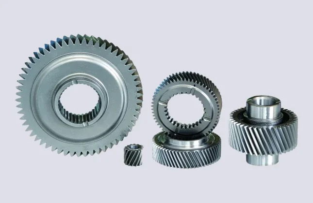

双环传动是一家齿轮公司，机器人只是它众多下游之一。2025 年营收 91.12 亿元里，乘用车齿轮占六成，减速器及其他业务 2025 年上半年为 3.49 亿元、占比约 8%。

## 四十年只做齿轮

公司 1980 年以五台仪表车床起步，2010 年 9 月在深交所上市，管理总部在杭州，注册地在台州玉环。官网口径：13 家以上全球子公司，跨中国、匈牙利、越南三国，员工 8,000 余人，专利与软著超 500 项，世界 500 强客户销售占比近 60%，主要客户包括采埃孚、康明斯、卡特彼勒、上汽、一汽等。产能规模按官网表述为 120 亿元级。

2025 年半年报的分业务结构最能说明问题：乘用车齿轮与工程机械齿轮在增长，商用车承压，减速器增速最高。

| 业务（2025 年上半年） | 收入 | 同比 | 说明 |
| --- | --- | --- | --- |
| 乘用车齿轮 | 26.69 亿元 | +13.0% | 新能源电驱动为主 |
| 智能执行机构 | 4.26 亿元 | +51.7% | 扫地机器人、Ebike 等 |
| 工程机械齿轮 | 3.55 亿元 | +12.05% | 下游景气回升 |
| 减速器及其他 | 3.49 亿元 | +35.7% | 毛利率同比 +13.4 个百分点 |
| 商用车齿轮 | 3.23 亿元 | -29.7% | 受下游采埃孚影响 |

2025 年全年营收 91.12 亿元，归母净利润 12.62 亿元。减速器业务毛利率的大幅修复（半年报口径 +13.4 个百分点）比收入增速更值得看：RV 减速器是重资产、长周期验证的生意，毛利率回正说明产线利用率和良率都过了拐点。

<figure class="company-photo company-photo--portrait">

<figcaption>双环传动齿轮与减速器零部件 · 图：<a href="https://www.gearsnet.com/product1.html">双环传动官网</a></figcaption>
</figure>

## 环动科技这条腿，与它的资本市场插曲

环动科技 2020 年 5 月成立，专做机器人关节高精密减速器，主产品是 RV 减速器，已入选工信部首台（套）重大技术装备、国家级专精特新"小巨人"。RV 减速器国内市占率从 2021 年的 10.11% 升到 2024 年的 24.98%，仅次于纳博特斯克，客户包括埃斯顿、埃夫特等工业机器人厂商。公司对外给的能力口径是覆盖 3–1000 kg 负载范围的机器人关节解决方案。

资本路径有过一次折返：2024 年 3 月双环公告拟分拆环动科技至上交所科创板，同年 11 月 IPO 获受理，经历两轮问询后，2026 年 9 月因公司及保荐人撤回申请，上交所终止审核，公司给出的原因是市场环境较筹划之初发生较大变化。产能一侧的公开信息是：近 14 亿元的机器人精密传动智能制造基地已结顶，建成后形成年产 32 万套 RV 减速器的能力。人形机器人方向的谐波减速器处于小批量阶段，公开报道提到的客户框架与认证情况未见公司公告确认。

## 在机器人执行器链上的位置

双环（通过环动）供的是零件层里的传动件：RV 减速器，以及正在补位的谐波减速器。RV 在关节里的位置是"电机之后、臂体之前"，靠摆线针轮 + 行星两级减速实现大速比、高刚性与抗冲击，典型用在机器人基座、大臂、肩部这些承受弯矩与冲击的部位；谐波则用在腕、手、小臂这类要求轻与薄的部位。

所以它在链条上的议价权来自两处：齿轮加工的工艺积累（磨齿、热处理、批量一致性）与 RV 这条路线本身的进入门槛。代价是价值量被锁在零件里，关节的精度上限仍由整机厂选谁家的电机与编码器决定。

编码器与它的产品无关——减速器不采集位置信号，位置反馈由整机或模组厂自行配置。

## 官方资料

- [双环传动官网](https://www.gearsnet.com/)
- [关于双环（子公司与全球布局）](https://www.gearsnet.com/about.html?m/2026012230257951_qdkibba.shtml)
- [2025 年半年度报告解读（分业务收入）](https://m.hexun.com/money/2025-08-28/221172873.html)
