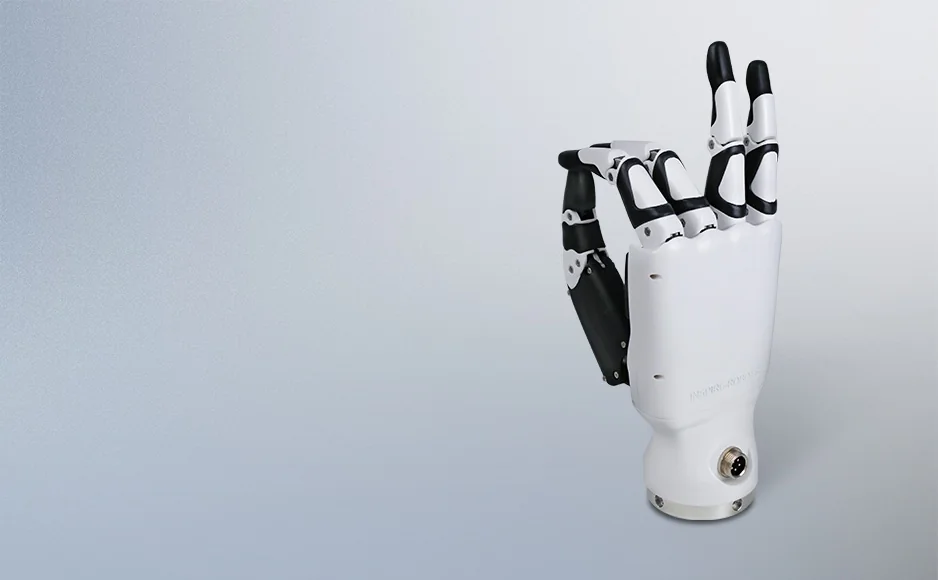

因时机器人是从"一根能自己走直线的细杆"起家的：微型伺服电缸，把空心杯电机、行星减速器、位置传感器、丝杠和闭环驱动塞进一个拇指粗的壳子里。灵巧手是这根杆的下游应用——六根杆推五根手指，就是一只手。这个次序很重要：它先是一个执行器厂，然后才是灵巧手厂；它在人形机器人链条上的价值，一半在手上，一半在这些可以单独卖的微型直线执行器上。

## 从北航实验室出来的一家公司

北京因时科技股份有限公司成立于 2016 年 5 月 25 日，创始人蔡颖鹏为北京航空航天大学机器人方向出身，此前做过项目制的机器人业务，2015 年底收掉后转向标准化运动控制部件。公司 2026 年 10 月 21 日由"北京因时机器人科技有限公司"整体变更为股份有限公司，注册资本 156.10 万元。三地分工：北京是研发总部（2025 年入驻石景山首钢园，近 7000 平方米），苏州子公司 2019 年成立、承担制造，深圳子公司 2022 年成立、负责销售。

发展节点按官网历程：2017 年第一代微型伺服电缸获北京市新技术新产品认定；2018 年仿人五指灵巧手入选"中国机器人十大科技进展"；2021 年电缸累计销量破万台；2024 年灵巧手交付近 2000 台、苏州因时投产、完成超亿元 B2 轮；2025 年灵巧手销量超万台、入选国家级专精特新"重点小巨人"。融资上，2026 年 2 月完成数亿元 C+ 轮（启明创投、TCL 创投、春华资本等）。

<figure class="company-photo company-photo--portrait">

<figcaption>因时机器人多指灵巧手 · 图：<a href="https://www.inspire-robots.com/dexterous%20hands/">因时机器人官网</a></figcaption>
</figure>

## 两条产品线：电缸是根，灵巧手是枝

微型伺服电缸按结构分五个系列：LA（电机与丝杠同轴，细长）、LAF（LA 加力传感器）、LAS（电机与丝杠平行布置，伸缩方向更短）、LASF（LAS 加力传感器）、BLA（电流、速度、位置、推拉力四闭环，推力与寿命更高）。

| 产品线 | 结构 | 公开规格 |
| --- | --- | --- |
| LA / LAF 系列电缸 | 电机与丝杠同轴，细长型 | 行程 10 / 16 / 30 / 50 mm；最大推拉力 21–80 N；重量 21–50 g；重复定位精度 ±0.02…±0.1 mm；LVTTL 串口或 PWM |
| LAS / LASF 系列电缸 | 电机与丝杠平行，轴向短 | 如 LASF16-104D：16 mm 行程、31.5 N、36 g、±0.03 mm；LASF30-024D：30 mm、80 N、44 g、±0.06 mm |
| RH56 系列灵巧手 | 6 个微型伺服电缸推 5 指 | 6 自由度、12 关节、6 个力传感器；力分辨率 0.5 N；指尖重复定位 0.2 mm；四指握力 10 N（DF）/4 N（BF），拇指 15 N/6 N；24 V 供电；RS485 |
| RH56DF3 系列 | 同上，按通信接口分三版 | CAN / RS232 / RS485 三个版本；拇指最大抓握力 15 N、四指 10 N |
| EG2 系列电动夹爪 | 两指/三指夹持 | 官网列为独立品类，未给统一公开参数 |
| RH524J1 | 24 自由度腱绳混驱灵巧手 | 2026 年世界机器人大会首发，官网未给完整参数表 |

一个细节能说明这条产品线的逻辑：RH56 的控制指令集里有 POS_ACT（各自由度电缸位置实际值）、ANGLE_ACT（角度实际值）、FORCE_ACT（各手指实际受力）三组寄存器——手的所有反馈都是从六根电缸上读回来的，手指本身没有独立传感。也就是说，这只手是"六根电缸 + 直线驱动结构"，不是每个关节各带一套驱控的架构。

## 在机器人执行器链上的位置

因时供两层：**微型直线执行器**（电缸）与**末端执行器**（灵巧手整手）。前者是通用件，卖给做灵巧手、医疗设备、3C 装配、锂电设备的厂；后者直接卖给整机厂。官网列出的合作伙伴里有宇树、银河通用、智元、优必选、松延动力、北京人形机器人创新中心等，但**logo 墙不等于供货声明**，具体到某款人形机器人用不用 RH56，公开资料没有逐条对应关系。

编码器这一层：**公开资料没有给出电缸内部位置传感器的类型与供应商。**官网只写"内置位置传感器""闭环控制"，用户手册给出的是位置/角度/电流/温度的寄存器接口，没有 BOM 级信息。力感知这条路倒是有明确说法——RH56 内置压力传感器，抓握力分辨率 0.5 N，通过阈值设定适配不同硬度物体；这是它的手与"只有位置环"的低价灵巧手的主要差别。

它的位置有点像十年前的谐波减速器：单品小、单价低、但一旦被整机设计固化就很难替换，因为手指的结构、走线、通信协议都绑在这六根电缸的尺寸上。风险也在这里——电缸路线的响应速度与自锁特性不如"电机 + 减速器"的旋转关节方案，腱绳驱动（RH524J1 走的就是这条）则是另一个方向，两者在它内部并存。

## 官方资料

- [公司官网](https://www.inspire-robots.com/)
- [关于我们（发展历程、资质、合作伙伴）](https://www.inspire-robots.com/e/action/ListInfo/?classid=7)
- [微型伺服电缸产品参数表](https://inspire-robots.com/e/action/ListInfo.php?page=2&classid=56&line=25&tempid=23&orderby=&myorder=0)
- [仿人五指灵巧手 RH56 系列用户手册](https://www.inspire-robots.com/d/file/p/2023/11-17/%E5%9B%A0%E6%97%B6%E6%9C%BA%E5%99%A8%E4%BA%BA%E4%BB%BF%E4%BA%BA%E4%BA%94%E6%8C%87%E7%81%B5%E5%B7%A7%E6%89%8B--RH56%E7%94%A8%E6%88%B7%E6%89%8B%E5%86%8CV1.09cn%20.pdf)
