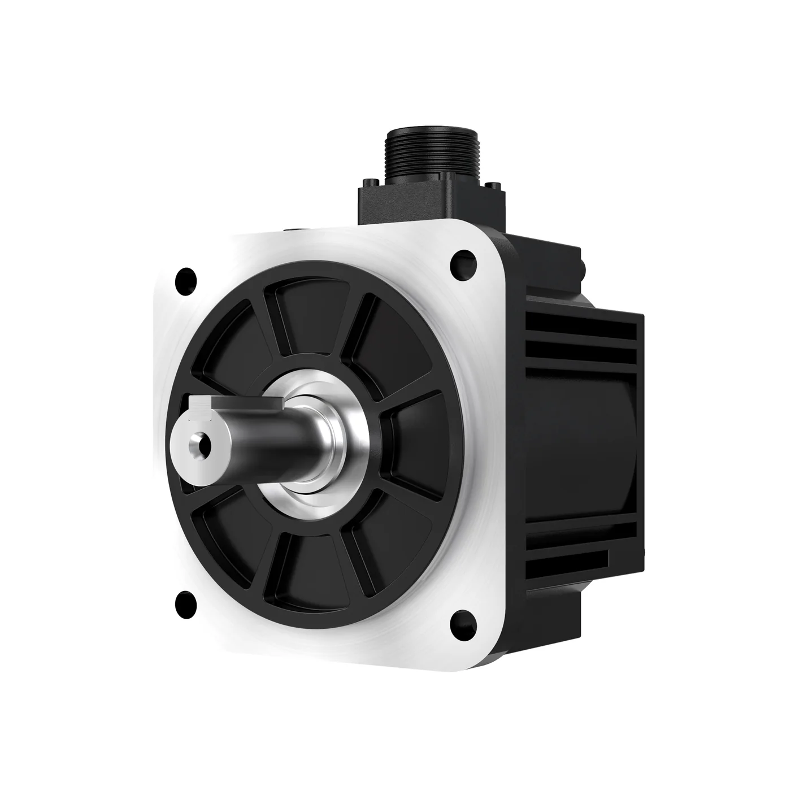

埃斯顿是南京的工业机器人与运动控制厂商，2025 年在中国工业机器人市场的出货量排到第一（含内外资），同时自己供控制器、伺服驱动和伺服电机。编码器装在它的电机里随整机出货，不单独对外销售——它是编码器最大的国产用户之一，而不是编码器厂商。

## 48.88 亿元营收，机器人占了八成

公司全名南京埃斯顿自动化股份有限公司，1993 年成立，2015 年深交所上市（002747.SZ），2026 年 3 月 9 日在港交所主板挂牌（02715.HK），是工业机器人领域首家 A+H 上市企业。战略叫"All Made By Estun"，核心部件、整机、解决方案自己全做。[关于我们](https://www.estun.com/gywm/)

2025 年营业总收入 48.88 亿元（同比 +21.93%），归母净利润 4497.22 万元（上年 −8.10 亿元，扭亏），扣非净利润仅 728.06 万元；研发投入 4.76 亿元，占收入 9.74%。工业机器人及智能制造系统 39.97 亿元（同比 +31.80%）。据 MIR 睿工业，2025 年公司中国工业机器人出货量第一、份额 10.6%，连续八年国产品牌第一；同期全国工业机器人产量 77.31 万套（同比 +28%），出口首次超过进口。

2026 年上半年，机器人及智能制造 21.38 亿元（占 82.96%），自动化核心部件及运动控制 4.39 亿元（17.04%）；境外收入 9.36 亿元，占 36.33%。机器人谱系 96 款，负载 3 kg 到 1200 kg，含 SCARA、协作、通用六轴与折弯、码垛、焊接、冲压等专用机型。

<figure class="company-photo company-photo--portrait">

<figcaption>埃斯顿 EM5G 系列中惯量交流伺服电机 · 图：<a href="https://www.estun.com/xgltysfdj/365.html">埃斯顿官网</a></figcaption>
</figure>

## 十一类核心部件，编码器在电机里

官网工业自动化板块列十一类：运动控制器、IPC 控制器、运动控制 PLC、数控系统、伺服驱动器、伺服电机、IO 模块、HMI、变频器、工业安全、激光产品。

| 层级 | 产品 | 与编码器的关系 |
| --- | --- | --- |
| 信息层 | HMI、工业软件、E-Noesis 云平台 | 不接触反馈信号本身 |
| 控制层 | 运动控制器、PLC、数控系统 | 接收反馈做闭环运算 |
| 驱动层 | 伺服驱动器 | 编码器信号的第一站，换相与位置环在此完成 |
| 执行层 | 伺服电机（50 W–200 kW）、直驱电机 | 编码器装在电机尾部，随整机出货 |
| 整机 | 通用／专用／协作机器人 | 每轴一到两个编码器 |

编码器的公开参数只出现在伺服电机页。TRIO 品牌 MXL 系列低惯量电机，参数表"编码器"一栏写的是"17 位绝对值；23 位绝对值"，覆盖 0.05–1 kW（200 VAC）与 1.5–5 kW（400 VAC）两段，最高转速 5000–6000 r/min，防护 IP65。[MXL 系列](https://www.estun.com/trioxglsfdj/374.html)

## 在机器人关节链上的位置

一个关节从内到外是：编码器 → 驱动器 → 电机 → 减速器 → 负载，控制器在最外层闭合。埃斯顿吃下了控制层、驱动层、执行层和整机，四层里只差减速器要外购。这种结构让它对编码器的要求非常具体：外形要配自己的电机法兰，协议要跑自己的串行接口，多圈校准要在自己的驱动器上电即用。

它越强调全链自主，编码器就越倾向内部化；但内部化到什么程度，是买裸片自己封装还是买整只编码器贴牌，从公开资料看不出来。官网"关于我们"把编码器与交流伺服系统并列写进核心部件清单，产品中心却没有独立的编码器页面，也没有型号与规格表——存在，但未对外经营。

竞争面上，它在外资品牌（发那科、ABB、库卡、安川）与国产同行（汇川、新时达、埃夫特）之间抢份额，靠的是价格、交付速度与行业工艺包。2025 年扭亏但扣非只有 728 万元，说明这轮扩张还没转成利润，价格战的成本主要靠核心部件自制来吸收。

## 官方资料

- [埃斯顿官网](https://www.estun.com/)
- [关于我们（A+H 上市、出货量份额、产品谱）](https://www.estun.com/gywm/)
- [工业自动化产品线](https://www.estun.com/gyzdh/)
- [MXL 系列低惯量伺服电机（编码器栏位）](https://www.estun.com/trioxglsfdj/374.html)
