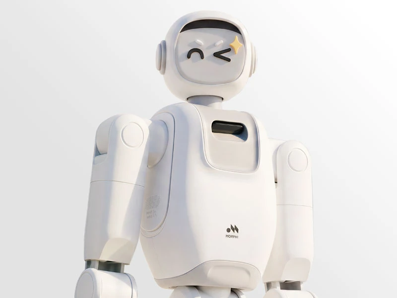

深圳墨奇智能技术有限公司研发**具身智能与服务机器人**，将机器人本体、运动控制与具身模型结合，面向需要移动和操作物品的服务任务。

## KINO服务机器人

MORPHI KINO采用轮式底盘和双机械臂，融合多模态感知、自主导航与双臂协同操作，任务覆盖移动、识别、抓取、递送和整理。

KINO以酒店等商业服务场景为起点，把移动和操作连接成连续作业。墨奇将家庭服务作为长期方向，现阶段着重在商业场景中积累真实任务经验。

<figure class="company-photo company-photo--wide">

<figcaption>KINO服务机器人 · 图：<a href="https://www.worldrobotconference.com/expo/product/1526.html">世界机器人大会</a></figcaption>
</figure>

## MoRA模型与机器人系统

KINO搭载墨奇自研的具身模型MoRA，用于理解任务与环境变化。公司技术布局覆盖数据采集、模型训练与评测、机器人本体、运动控制、端侧部署及场景应用，并通过真实任务反馈持续迭代。

## 资料来源

- [墨奇智能官网](https://www.morphi.com/)
- [2026世界机器人大会：公司与KINO产品介绍](https://www.worldrobotconference.com/expo/company/646.html)
