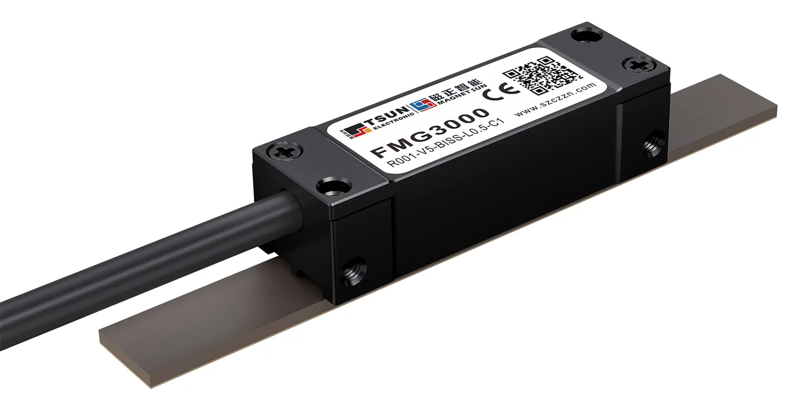

天先数智做直线磁栅，主战场是直线电机模组、丝杆模组、机床、半导体与新能源设备——要长行程、高速度、耐油污的场合，客户拿它替换的是进口光栅尺。

## 两个品牌，一套班子

全称**天先数智科技（深圳）有限公司**，成立于 2011 年 3 月，国家级高新技术企业。旗下全资子公司**深圳磁正智能科技有限公司**单独打"磁正智能 / TSUN"品牌，两家共用研发与产线，母子公司合计约 20,000 m² 研发与生产面积，本科及以上学历占比九成。2025 年前后总部迁入深圳光明区光明凤凰广场。

定位上公司反复讲的一句是"率先在国内实现绝对值磁栅编码器的国产替代进口"，属企业自述。

<figure class="company-photo company-photo--wide">

<figcaption>天先数智 FMG3000 绝对值磁栅编码器读数头与磁尺 · 图：<a href="https://www.szczzn.com/product/">天先数智（磁正智能）官网</a></figcaption>
</figure>

## 产品：AMG 是绝对值线

| 系列/型号 | 类型 | 公开参数 |
| --- | --- | --- |
| AMG（直线绝对式磁栅） | 26 位，2+2 双码道磁栅尺 | 分辨率 0.1 μm、速度 5 m/s、磁栅尺可做到 16.38 m、无需电池记忆、SSI / BiSS-C / RS-485 |
| AMG32S | 双码道绝对值 | 周期编码长度 32 mm、最高分辨率 0.1 μm、CAN 总线、IP67 环氧灌封 |
| AMG2000 | 绝对值 | 面向工业自动化设备 |
| AMG5000 | 绝对值 | 面向超精密加工设备 |
| FMG3000 | 绝对值 | 主打性价比 |
| LMA2000 | 直线绝对式磁栅 | 传动网产品页收录 |

后四个型号只给了定性描述，官网没有参数表。

AMG 的几个工程细节值得单独记：

- **2+2 双码道**：主码道给绝对位置，副码道做协同校验。公司的说法是上电即得绝对位置，不需要回零、不需要找参考点。
- **FPGA 硬件加速**：官方稿写"通过 FPGA 硬件加速算法实现高速信号处理"，这是它能在 5 m/s 下保住 0.1 μm 的关键。这一段用词具体，能对上物理约束。
- **温度补偿**：官方稿给的是分段式补偿、-20…+80 °C 稳定；CIOE 2026 稿件对另一款长行程双码道产品写 -10…+70 °C 补偿域。两个数字对应不同产品。
- **就绪时间**：350 ms 进入就绪状态，断电记忆、上电即用。
- **AI 算法**：官方称内置算法做动态校验与无感误差补偿，未公开算法形式与验证数据。

磁栅的物理特性决定了它的取舍：非接触、不怕油污粉尘、量程几乎不受限、长行程下成本比光栅低；短板是极限精度不如高端光栅，且磁栅尺要磁化与拼接，接缝处理是核心工艺。

## 产线与检测

公司在一篇精细化管理稿里列了五类设备：冷热冲击试验箱、精密恒温干燥箱、老化实验箱、电磁振动台、全自动点胶机。前四台对应环境可靠性、长期稳定性、机械可靠性验证，第五台把点胶量、位置、胶路形态参数化——磁栅读头的灌封一致性直接决定长期漂移。公司另给两条硬指标：自动化产线连续运行 3 年零故障、5 万小时寿命口径，未说明统计样本。

## 在编码器链上的位置

天先数智是"磁栅尺 + 读头 + 解算"的模组厂，处在线性测量这一段，和关节编码器厂不在一个环节：关节要薄环、双编、抗磁，磁栅要长行程、高速度、抗污染，两边共享的只有磁测量原理与信号处理经验。

它真正的对手是光栅：海德汉、雷尼绍、发格，以及国内的禹衡光学一类。磁栅替代光栅的逻辑不成立在"更准"，成立在"更耐造 + 更便宜 + 量程更长"，所以它切进去的是锂电、光伏、木工石材、汽车产线这类工况差的场合，而不是超精密机床。

读它的参数要留两处心：敏感元件是霍尔还是 TMR 官方从未写明（"TMR 磁栅"的归类出自第三方综述）；AMG2000、AMG5000、FMG3000 除定性描述外没有参数，型号数字大小不代表性能排序。

## 官方资料

- [公司介绍（成立年份、面积、专利数）](https://www.szczczn.com/about/)
- [绝对值磁栅编码器技术稿（0.1 μm、5 m/s、双码道、FPGA）](https://www.szczczn.com/news/232.html)
- [AMG32S 产品稿（32 mm 周期、CAN、IP67）](https://www.szczczn.com/news/304.html)
