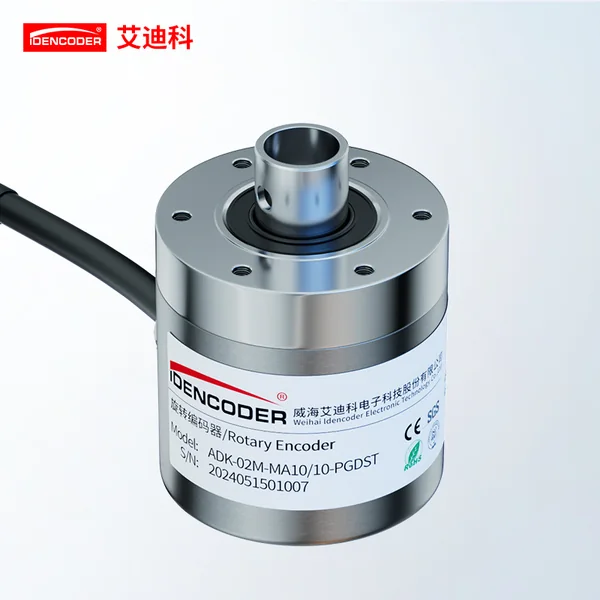

威海艾迪科做工业旋转编码器，卖点是"国产替代进口"：客户在伺服电机、数控机床、起重冶金、智慧物流、纺织印刷这些传统工业场景，人形机器人是 2026 年才切进去的新方向。

## 一家 2013 年成立的股份公司

全称**威海艾迪科电子科技股份有限公司**，成立于 2013 年，[官网](https://www.idencoder.cn/)标注股权代码 100580，注册与生产地址为威海市经济技术开发区统一南路凤巢街 12-5 号。资质口径：13 项发明专利、各类知识产权 63 项、两项"国内领先"科技成果、承担国家及省市重点研发项目 9 项（累计 2,296.97 万元），获山东省工信厅"山东省首件套电子产品"与第六批"首版次高端软件"，另有高新技术企业、山东省专精特新中小企业、瞪羚企业等认定。

<figure class="company-photo company-photo--portrait">

<figcaption>威海艾迪科 ADK-02M 系列旋转编码器 · 图：<a href="https://www.idencoder.cn/h-col-109.html">威海艾迪科官网</a></figcaption>
</figure>

## 产品线：六类，机械多圈是看家本领

官网产品中心分增量式、绝对值、以太网、拉线式、伺服、其他六类；2026 上海工博会的参展稿则归纳为对外主推的四类。

| 类别 | 定位 | 公开参数或说明 |
| --- | --- | --- |
| 机械多圈绝对值 | 纯机械齿轮计数，无需电池，断电位置不丢失 | 已迭代四代；主打抗震与宽温，用于起重、冶金、工程机械 |
| 伺服编码器 | 伺服电机配套 | 宣称可提供全国产化方案；称"替代日本多摩川 TS5700 系列" |
| 工业以太网 | EtherCAT、Profinet、EtherNet/IP、Modbus-TCP | 总线型绝对值，面向智能工厂与成套装备 |
| 机器人关节编码器 | 磁电、电感式两种原理可选 | 体积紧凑；2026 年新品 |
| 增量式 / 拉线式 | 通用工业 | 型号如 I-25C4、I-38K6/8、I-50L8、I-58K10/12/15 |

机械多圈这条线是它的差异点：纯机械齿轮计数、不用电池、断电不丢位置，抗震与宽温表现好，这类结构在起重、冶金、工程机械上是刚需，也是它做了十几年的存量生意。

芯片侧有一个细节值得记：官网写"以一颗国产芯片替代五颗芯片方案，合作方负责光信号接收部分，我们负责信号处理及协议算法"。光电编码器的专用芯片是联合开发，不是完全自研。

## 电感式关节编码器：还在试验台上

信息来源是威海新闻网"直通经开区"2026 年 10 月 29 日的报道，属地方党媒采访，不是企业公告也不是第三方测试报告。总经理房淑伟的表述可以拆成四点：

1. 产品是"今年重磅推出的电感式机器人关节编码器"，形态是掌心大小的薄环，报道称"目前国内还没有批量生产"。
2. 规格按关节部位分档——"可能用在大腿部位""腕关节""甚至还有更小的用在手指上"，是举例语气，报道没给外径、内径、位数、精度。
3. 宣称 100% 全国产化元器件配套并"在今年顺利取得全国产化资质"；发证机构与认定标准报道未说明。
4. 进度：正在做高低温试验、噪声试验，"试验结束后向客户提供样品"，嘉皇机器人已把技术需求发过来，后续对接定制开发。

企业给的理由是电感式比磁环式抗干扰强、精度更高、厚度更薄，磁环有固有厚度做不了关节要的超薄结构。这段对照没有量化数据。

## 在编码器链上的位置

艾迪科是整机厂：自己做结构、信号处理与协议、标定与产线，敏感元件与专用芯片部分自研、部分联合开发。它的存量优势在多圈机械结构与工业总线协议栈，这两块是长年做伺服与起重磨出来的，跟关节要的"薄、小、抗磁"不是同一套能力。

电感式这条路国内入场者不多，弓望、锐鹰、盛耐都在这条线上。艾迪科的差异点不在原理而在供应链：如果"100% 国产元器件"成立，它在军工、央企这类有国产化率要求的场景里有议价空间。

这款关节编码器的分辨率、精度、气隙、通信协议一项数值都未公布，产品也还在试验与送样阶段，选型讨论只能等规格书。

## 官方资料

- [官网首页（公司简介、资质、产品分类）](https://www.idencoder.cn/)
- [2026 上海工博会参展稿（四类主推产品）](https://www.idencoder.cn/sys-nd/478.html)
- [威海新闻网"直通经开区"2026-10-29 报道](https://www.whnews.cn/news/node/2026-10/29/content_-35971.htm)
