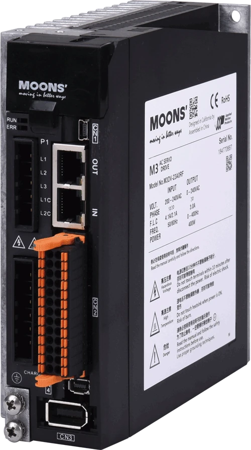

上海安浦鸣志自动化设备有限公司是鸣志（MOONS’）运动控制体系中的电机驱动与自动化企业，产品覆盖**步进、步进伺服、交流伺服及集成式电机**，服务于设备的运动控制。

## 发展历程

安浦鸣志于2007年2月由鸣志与美国 Applied Motion Products 合资成立。2014年，鸣志收购 Applied Motion Products，进一步扩展电机驱动与运动控制业务。

## 电机、驱动器与总线控制

| 产品方向 | 主要形式 |
|---|---|
| 步进驱动 | 智能型步进驱动器 |
| 步进伺服 | 步进伺服驱动器及集成式步进伺服电机 |
| 交流伺服 | 伺服电机与驱动器 |
| 集成式电机 | 将电机与驱动器组合的运动单元 |

M3系列是鸣志的交流输入伺服驱动产品。

<figure class="company-photo company-photo--portrait">

<figcaption>M3系列交流伺服驱动器 · 图：<a href="https://www.moons.com.cn/series/m3-series-servo-drives-ac-input-cn050303">鸣志</a></figcaption>
</figure>

鸣志的总线产品覆盖 Modbus、CANopen、EtherNet/IP、eSCL/SCL 和 EtherCAT 等通信方式。配套的Q编程功能可将运动指令、条件判断和寄存器操作组织成程序，保存在驱动器中独立运行。

## 资料来源

- [鸣志发展历程](https://www.moons.com.cn/about-us/who-we-are/history)
- [总线型驱动器与电机](https://www.moons.com.cn/support-training/fieldbus_control)

- [M3交流输入伺服驱动器](https://www.moons.com.cn/series/m3-series-servo-drives-ac-input-cn050303)
