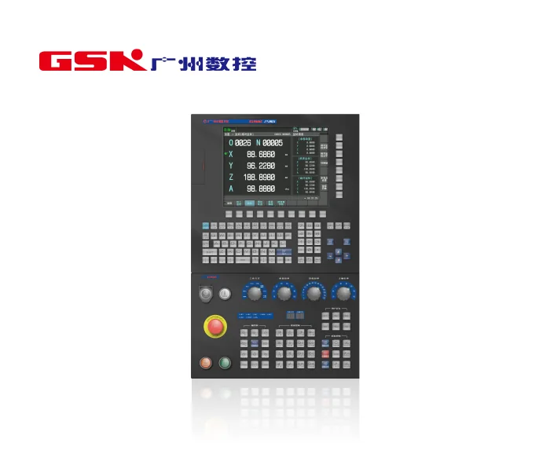

广州数控（GSK）卖的是整套：数控系统自己写，伺服驱动器自己做，伺服电机自己绕，工业机器人自己装。客户买它的系统，伺服和电机最好一起买，因为总线协议和参数是绑死的。它不卖减速器，也不单独卖编码器——编码器是伺服电机的内置件，随电机一起交付。这种"系统＋驱动＋电机＋本体"的闭环，在国内是少数几家能全做的。

## 1991 年建厂，2000 年改制民营

公司前身是集体企业华南电子厂，1991 年抽出 20 余人成立广州数控设备厂，1992 年研发出第一套 GSK 928 车床数控系统；2000 年改制为民营股份制，定名广州数控设备有限公司。厂区在广州市黄埔区观达路 22 号。公司未上市，无证券代码。

资质：2011 年被国家发改委认定为国内首家数控系统行业国家企业技术中心；2017 年"高性能数控系统关键技术及产业化"获国家科学技术进步二等奖；2020 年获工信部制造业单项冠军示范企业（机床数控系统）。规模上的公开表述是累计配套数控机床 180 万台、近年每年产销数控系统 10 万套、连续 25 年占国产数控市场 50%，员工约 2000 人、研发与技术约 800 人。这些是公司口径，没有第三方统计背书。[发展历程](https://www.gsk.com.cn/fzlc/index_47.aspx)

<figure class="company-photo company-photo--wide">

<figcaption>广州数控 GSK 25MDi 铣床数控系统 · 图：<a href="https://www.gsk.com.cn/cplb/list_27.aspx?lcid=6">广州数控官网</a></figcaption>
</figure>

## 产品线：系统、驱动、电机、本体

| 类别 | 代表型号 | 公开参数 |
| --- | --- | --- |
| 五轴数控系统 | GSK 25i / 25iMc | 16 轴 5 联动、五轴 RTCP、可适配光栅尺；25iMc 相对 25iMb 存储 512 MB→6.5 GB、启动 78 s→30 s、单程序段 1.7 ms→0.6 ms |
| 齿轮机床系统 | GSK 25iG | 双 CPU，单通道最多 8 轴 5 联动，1 nm 级插补精度，用柔性电子齿轮箱替代机械齿轮箱 |
| 车铣复合系统 | GSK 25Ti | 配 GT 系列多轴一体伺服，进给标配 25 bit 绝对式编码器（约 3300 万分辨率） |
| 总线伺服 | GR2000-L（进给）/ GR3000-L（主轴） | 主轴单元支持磁阻编码器、磁栅，可做高精度 C 轴 |
| 脉冲式伺服 | DA98C | 标配 17 bit 绝对式编码器，也可选配增量式伺服电机 |
| 经济型系统 | GSK 928TC | 主轴编码器可选 1024 p/r 或 1200 p/r 增量式 |
| 工业机器人 | GSK RB 系列（如 RB210） | 最大抓举 300 kg，累计推广过万台，2016 年首批通过 CR 认证 |

编码器在它的系统里分三层用：进给轴要 25 bit 绝对式（机械式多圈），主轴要正余弦、磁阻、磁栅或增量式，系统层可再叠光栅尺做全闭环。三层分辨率和接口完全不同，选型只看"多少位"会配错。

## 编码器的三层用法

进给轴的 25 位绝对式管的是断电后位置不丢——机床开机不用回零，这是加工中心与五轴机床的基本要求。主轴的增量式与正余弦管的是转速与 C 轴分度，车床的主轴编码器常见 1024 或 1200 p/r，配螺纹加工的一转信号。光栅尺则在系统层做全闭环，用于高精度机床补偿丝杠误差。

这套分层说明广数的自研边界在"系统＋驱动＋电机"三层，编码器是随电机配套的反馈件。

## 在机器人关节/运动控制链上的位置

广州数控的位置是控制系统厂，比伺服厂更靠上游、比机床厂更靠下游。它对人形机器人链的价值不在单个零件，而在总线：GSK-Link 打通数控系统、伺服单元、I/O，GSK-Link-PA 再把机器人控制器与机床连起来，一条产线上机床与机器人由一家供，调试与售后只需一个口子。这条能力在它的 RB 系列工业机器人上已经跑了多年，机器人最大抓举 300 kg，覆盖搬运、焊接、打磨、喷涂、码垛、机床上下料。

下游决策权在机床厂与机器人集成商。对手在国内是华中数控、科德数控，在高端是发那科、西门子、海德汉。

边界：编码器随电机配套交付，官网与产品样本都没有说明它是自制还是外购，也没有公开供应商；第三方 B2B 页面出现过"编码器、功率模块实现自产"的说法，没有官方或年报级依据，不应采信。"主轴可选 1024/1200 p/r 增量式"指的是系统能接这类信号，不等于广数生产这类编码器。

## 官方资料

- [发展历程（1991 建厂、2000 改制、GSK 928 首发）](https://www.gsk.com.cn/fzlc/index_47.aspx)
- [GSK 25i 系列五轴加工中心数控系统样本](http://www.gsk.com.cn/uploadfiles/2025/03/02-GSK%2025i%E7%B3%BB%E5%88%97%E4%BA%94%E8%BD%B4%E5%8A%A0%E5%B7%A5%E4%B8%AD%E5%BF%83%E6%95%B0%E6%8E%A7%E7%B3%BB%E7%BB%9F%2020250317.pdf)
- [GSK 25Ti 车铣复合系统样本（GT 系列 25 bit 编码器）](http://www.gsk.com.cn/uploadfiles/2025/01/【20241129版-印刷注意：马扎克版本尺寸】GSK%2025Ti车铣复合数控系统.pdf)
- [伺服驱动及电机产品列表（DA98C、GR-L、GS 系列）](https://www.gsk.com.cn/cplb/list_27.aspx?lcid=63)
- [官网首页（联系方式与厂址）](https://www.gsk.com.cn/)
