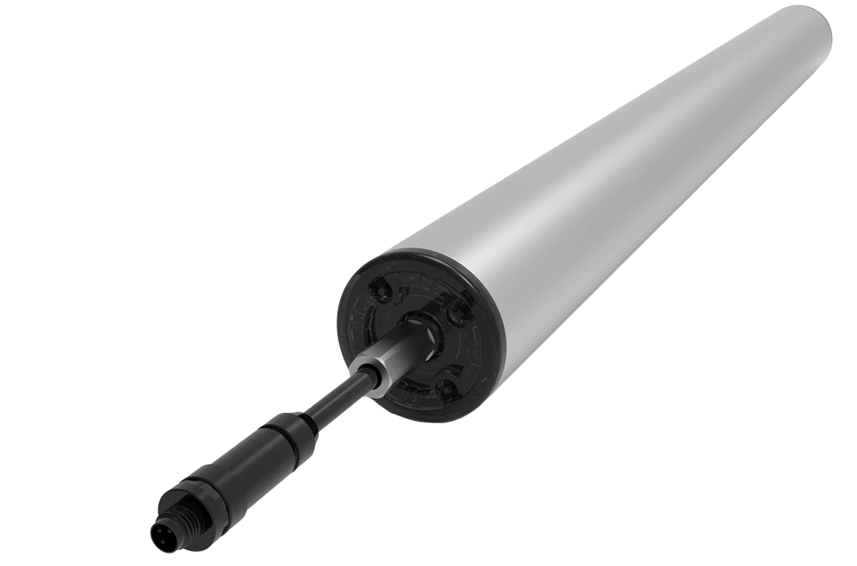

德昌电机（Johnson Electric）是一家提供**电机、执行器和运动子系统**的企业集团，1959年从香港微电机业务起步，产品应用于汽车、工业设备和其他终端。

## 主要产品

| 产品方向 | 代表产品 |
|---|---|
| 电机 | 直流、无刷、步进、同步及交流电机 |
| 精密运动 | 压电电机、多轴运动平台 |
| 传动与执行 | 行星及直齿齿轮箱、电磁铁、旋转执行器 |
| 流体控制 | 泵与阀 |
| 机电零件 | 开关、柔性电子及组件 |

这套产品组合使德昌既能提供电机本体，也能将电机、传动、控制与结构件组合成运动子系统。工业产品册中的牵引方案面向割草机、农业机器人及小型车辆，压电运动平台则面向单轴和多轴精密运动。

## 机器人与仓储自动化

德昌的机器人产品方向包括关节、手部和夹爪所需的紧凑电机、执行器与运动子系统。其业务也延伸到仓储自动化，提供输送滚筒、转向轮模组和分拣执行器等运动部件。

<figure class="company-photo company-photo--wide">

<figcaption>MDR电动滚筒 · 图：<a href="https://warehouseautomation.johnsonelectric.com/about/">德昌电机</a></figcaption>
</figure>

## 资料来源

- [德昌电机集团官网](https://www.johnsonelectric.com/)
- [工业产品册](https://www.johnsonelectric.com/pub/media/wysiwyg/je/je_pdf/20240807_Johnson_Electric_IPG_Brochure.pdf)
- [机器人关节产品](https://www.johnsonelectric.com/en/products/humanoid-robot-joints)
- [仓储自动化业务](https://warehouseautomation.johnsonelectric.com/about/)
- [MHI：德昌电机仓储运动产品](https://www.mhi.org/members/121133)
