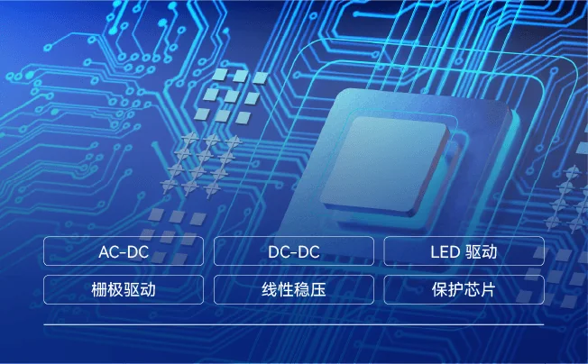

必易微是深圳的一家模拟芯片公司，五条产品线里电源管理、电机驱动、电池管理是原有的底盘，信号链与传感是 2025 年 10 月花 2.95 亿元收购上海兴感半导体补进来的。兴感以电流传感器起家（5A 到 200A 的集成式霍尔电流芯片），磁编码器是同一套磁传感与信号调理能力往角度方向的延伸——SL641、SL642、SL601 加 SL6422 四颗，是这个组合里最靠近关节的一段。

## 公司与这笔收购

深圳市必易微电子股份有限公司，证券代码 688045.SH，上交所科创板。公司自述为高性能模拟及数模混合集成电路供应商，以电源管理、电机驱动、电池管理为核心，已形成电源管理、电机驱动、电池管理、信号链、微控制器五大产品线；截至 2026 年半年报在售产品超过 1100 款，下游为能源与电力、家居家电、工业自动化、智能物联。[2026 年半年报](https://star.sse.com.cn/disclosure/listedinfo/announcement/c/new/2026-08-15/688045_20260815_UB6V.pdf)

收购于 2025 年 8 月 26 日董事会通过并公告，对价 29,502.36 万元受让兴感 100% 股权，资金为自有或自筹，10 月完成交割。评估采用市场法，股东全部权益评估值 3.01 亿元，较账面净资产增值 2.19 亿元，增值率 266.33%。标的当时在亏损：2024 年营收 4670.08 万元、净利润 -1286.45 万元；2025 年 1—5 月营收 1863.73 万元、净利润 -416.02 万元。业绩承诺为 2026 至 2029 年净利润分别不低于 1000 / 1500 / 2000 / 3000 万元，累计不低于 7500 万元。[收购公告](https://epaper.stcn.com/pic/202508/27/724e23373b1b3a56bd42b5f342c13c98.pdf)

到 2026 年上半年，兴感实现营收 2513.6 万元、净利润 415.95 万元，半年口径已经转正。母公司层面 2026 年前三季度营收 7.56 亿元、同比增长 63.78%，归母净利润 8849.24 万元、同比扭亏；三季度单季营收 3.04 亿元、毛利率 35.13%。

兴感自己的技术积累在电流检测这一侧：全集成霍尔式电流芯片覆盖 5A 到 200A，隔离耐压标到 2kV 以上（部分型号 3kV 至 5kV），原边导体阻抗 ≤1mΩ，主打直插式与穿心式安装；更大量程靠线性电流传感器做模块方案。这批参数与磁编码器共用同一套霍尔敏感元件与数字校准流程，这也是收购方强调"感知环节补齐"的物理依据。

<figure class="company-photo company-photo--wide">

<figcaption>必易微电源管理芯片产品线：AC-DC、DC-DC、LED 驱动、栅极驱动、线性稳压与保护芯片 · 图：<a href="https://www.kiwiinst.com/cpzx_2797">必易微官网产品中心</a></figcaption>
</figure>

## 磁编码器产品线

兴感的磁编码器不是一颗芯片，而是"传感元件 + 调理芯片"的组合，按 Hall 与 AMR 两条技术路线铺开。下表参数照抄公司发布的系列说明，不做换算。

| 型号 | 技术路线 | 公开参数 | 接口与输出 | 在系统中的位置 |
| --- | --- | --- | --- | --- |
| SL641 | Hall 单片集成（Hall in chip） | 14bit 绝对角度，INL ±0.7°，重复性 ±0.05°；3.0~5.5V；最高 60000 rpm；响应 5 µs；ABZ 1~1200 脉冲/圈，UVW 1~16 对极可编程 | SPI / SSI、PWM（12bit） | 通用电机控制与位置检测，性价比档 |
| SL642 | Hall 单片集成 + SoC EEPROM | 21bit 绝对角度，INL ±0.07°；最高 120000 rpm；响应 2~10 µs；ABZ 1~16384 线（65536 步），UVW 1~64 对极；零位 0~360° 可配 | SPI / SSI / RS485（多摩川协议，2.5 Mbps）、PWM（16bit） | 伺服与关节反馈 |
| SL601 | AMR 惠斯通桥 | 模拟 sin/cos 输出；未做非线性校准时角度误差 < ±0.15°；输出质量 17.5bit 有效位（高温 16.7bit）；可耐 1500 Gs；灵敏度 13.2 mV/V；支持最高 2 kHz 输入 | 模拟差分（sin 2θ、cos 2θ） | 传感元件本体，需配调理芯片 |
| SL6422 | 信号调理 SoC | 内置 CORDIC 硬件、高分辨率 ADC 与数字滤波；绝对角度误差 0.07°，重复性 0.005° 以内，延迟 < 5 µs；支持 32/64/128/256 点非线性校准 | SPI、RS485（多摩川协议）、ABZ / UVW / PWM | AMR 或 TMR 桥之后的解算与编码 |

三条工程上的差别。

**分辨率和误差不是一回事。** SL642 写 21bit 分辨率，同一颗的 INL 是 ±0.07°，差着四个数量级——21bit 是输出字段宽度，不是能信到 0.0002°。SL641 的 14bit 官方写"有效位"，SL642 只写"分辨率"，两处措辞不一致，比较时要回手册对齐定义。

**Hall 与 AMR 是两笔不同的账。** SL641 与 SL642 用 Hall in chip 工艺，卖点是省掉额外键合、成本低；SL601 用 AMR，卖点是抗杂散磁场与安装公差容忍度，能配离轴或在轴安装，代价是要另配 SL6422 做解算，BOM 多一颗。

**多摩川协议是实际门槛。** SL642 与 SL6422 都支持 RS485 上的多摩川通信，主控可直接读 17/23bit 绝对角度与状态位，省掉协议转换 MCU。对已经在用多摩川光编的伺服厂，这条迁移路径比换 SPI 方案短。

除编码器外，兴感的产品线还包括可编程磁传感器（SC810、SC824/5、SC844 等，参数表以电流测试口径组织）与角度传感器，与 SL 系列共用封装与校准产线。

## 在编码器链上的位置

必易微的位置是"一家能把编码器旁边的器件一起供的模拟厂"。一颗关节里，电流采样、母线电源、栅极驱动、电机驱动、电池管理，加上角度反馈，它现在都能在同一份目录里给出——这是收购前没有的能力，公告把产品体系描述为"电流检测—运动感知—电源管理—电池管理—电机驱动"五段，编码器在中间。竞争上，SL642 的对手一半是国产磁编（赛卓的 SC6021X、灿瑞的 OCH198 系列），另一半是它想替代的光编与旋变，后者精度更高但价格与体积都更贵，"可替代部分光编码器"这句只在精度要求不极端、且能接受磁体安装公差的项目里成立。

边界有两处要留意：SL641 与 SL642 内部用几对极磁体、片上有没有独立温度补偿环路，官方未披露；兴感自述的产品达到"车规级与航天级要求"，但公开页面没有对应证书编号与料号清单，按车规项目选型时需向原厂索取。

## 官方资料

- [必易微官网](https://www.kiwiinst.com/)
- [兴感半导体官网](https://www.senkomicro.com/)
- [兴感电流传感器产品页（含型号参数表）](https://senkomicro.com/product/1)
- [磁编码器系列说明：SL641 / SL642 / SL601 / SL6422](http://mp.weixin.qq.com/s?__biz=MzU1MDYzMDU5NA==&mid=2247551582&idx=1&sn=bccd6aed92e0f2f190b524ee15b834a5&chksm=fa5d9afc86c0ae73bf207138a8d882357bdef082aa81e344481696696f63f4e127935b0375f2#rd)
- [收购兴感半导体 100% 股权的公告](https://epaper.stcn.com/pic/202508/27/724e23373b1b3a56bd42b5f342c13c98.pdf)
- [2026 年半年度报告](https://star.sse.com.cn/disclosure/listedinfo/announcement/c/new/2026-08-15/688045_20260815_UB6V.pdf)
