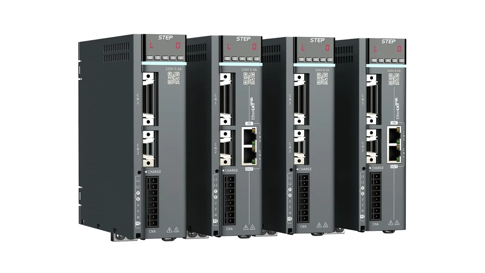

新时达是纵向一体化最深的国产工控公司之一：伺服驱动器、伺服电机、运动控制卡、控制器、工业机器人本体、机器人控制系统，全是自己做的。它的起点是电梯控制与变频器，这两块至今还是现金流来源；机器人是后来长出来的第三条腿。它不卖减速器，也不单独卖编码器——编码器被包在伺服系统里，以"23 bit""20 bit"这类位数指标出现。

## 海尔入主后的第一个完整财年

公司全名上海新时达电气股份有限公司，深交所主板上市（002527.SZ）。据 2025 年年报与公开报道，海尔集团已成为控股股东，公司并入卡奥斯工业互联网生态并启动 STEP 2.0，从单一产品制造商转向场景解决方案商；具体持股比例与一致行动安排以最新公告为准。

2025 年营业收入 35.35 亿元（+5.29%），归母净利润 550.77 万元实现扭亏，但扣非净利润 −6037.11 万元。当年非经常性损益 6587.88 万元，其中政府补助 5162.95 万元、应收款减值准备转回 1280.14 万元——归母口径靠非经常项翻正，主业口径仍亏。研发投入 2.35 亿元（+15.67%），占营收 6.65%。期末合并报表未分配利润 −9.95 亿元，当年不派现、不送股。12 亿元定增在推进。

<figure class="company-photo company-photo--wide">

<figcaption>新时达 STEP 直驱型伺服驱动器（EtherCAT 接口） · 图：<a href="https://www.stepelectric.com/Product_list/140.html">新时达官网</a></figcaption>
</figure>

## 三块业务：通用驱动过半

| 业务板块 | 2025 年收入 | 同比 | 代表产品 |
| --- | --- | --- | --- |
| 通用控制与驱动 | 17.93 亿元（占 50.71%） | +12.56% | AS800 高压变频器、Ω6 系列伺服、运动控制卡与控制器、PLC、IO |
| 机器人产品及系统 | 8.50 亿元 | +5.97% | 六轴 SR/SP/SA/SD 系列、SCARA、晶圆传输机器人、人形关节模组 |
| 电梯控制产品及系统 | 6.45 亿元 | −1.81% | SmartX 电梯控制系统、目的层群控、门系统、电梯云 |

电梯这块受国内新梯市场下滑拖累，收入小幅下降，但海外电梯控制产品收入增长 9%，是它最稳定的利润来源。机器人侧官网称掌握 1~600 kg 负载的机器人控制系统、伺服与软件技术；半导体方向覆盖 2 至 12 寸晶圆传输机器人，满足 SEMI 标准与 ISO Class 1 洁净要求。

## 伺服：参数到哪一步

Ω6 系列是现在主推的伺服平台，参数给得比较具体：Ω6-C 通用型驱动器标 3.2 kHz 速度环带宽、23 bit 编码器；Ω6-W 双轴驱动器标 3.0 kHz 速度环带宽、20 bit 编码器，支持最高 23 位绝对值编码器，双轴共直流母线省 30% 能耗，前装占地缩小 55%；Ω6-A 旗舰型标 115% 连续过载、350% 瞬时过载、200:1 负载惯量比自适应，支持全闭环与龙门同步。[Ω6-C 产品页](https://www.stepelectric.com/product/89.html)

人形机器人方向，2025 年推出具身智能机器人 SYNDAR1，规划产能 1 万台，并在海尔重庆工厂完成部署实训；人形关节模组单列在产品目录里，但年报没有单列这块收入。

## 在机器人关节/运动控制链上的位置

新时达站的位置是"驱控一体＋本体"：价值不在单件，而在控制算法与行业工艺包——电梯的目的层调度、点胶的 PSO 位置同步输出、3C 的高速取放，这些是它二十年攒下来的东西。人形机器人这条线上，它更可能做关节模组加驱控一体再加整机集成，而不是单卖部件。

对手是汇川（伺服与机器人双线）、埃斯顿（本体＋驱控），以及发那科、安川在通用伺服上的存量客户群。纵向一体化既是优势也是包袱：既卖部件又卖本体，纯部件客户会顾虑。

两点边界：编码器只有位数公开，光编还是磁编、自制还是外购没有说明；SYNDAR1 的"规划产能 1 万台"是规划口径，不等于已出货。

## 官方资料

- [官网首页（三大业务板块与产品线）](https://www.stepelectric.com/)
- [Ω6-C 通用型交流伺服驱动器](https://www.stepelectric.com/product/89.html)
- [Ω6-W 双轴伺服驱动器（20 bit 编码器）](https://en.stepelectric.com/Product_detail_by/1493997545631264768.html)
- [运动控制产品目录（含机器人关节模组）](https://en.stepelectric.com/ydkz/p-0-4.html)
- [2025 年报要点与扣非亏损说明](https://news.qq.com/rain/a/20260415A06S5A00)
