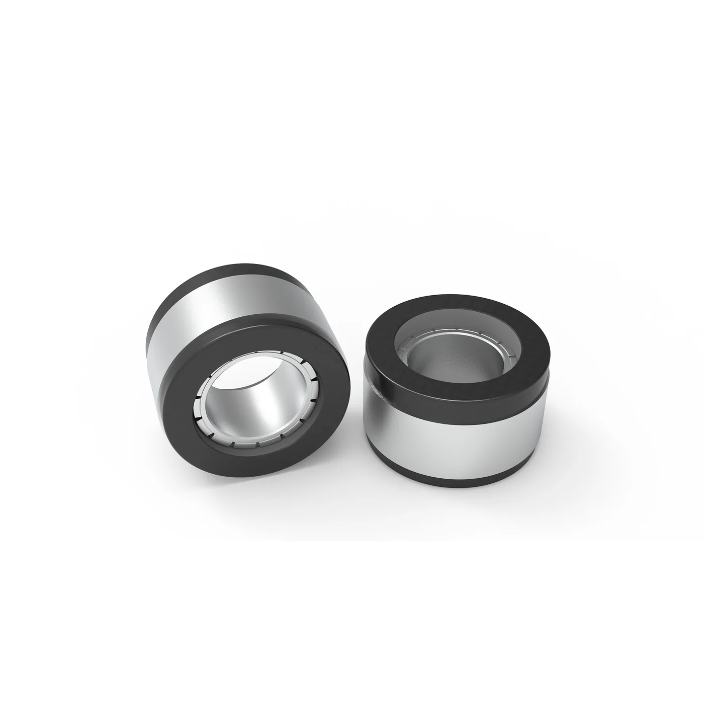

本末科技的立论是一句反常识的话：机器人关节不一定要减速器。它把这条路线做成了生意——不是先做机器人再卖零件，而是先给扫地机、洗地机、割草机做直驱轮组，用消费电子的量把直驱电机的成本与工艺喂熟，再往具身智能的关节模组上走。所以读它的资料要分清两件事：消费机器人动力模组是它的现金流，人形机器人关节模组才是它与这条产业链对话的接口。

## 从香港的实验室到松山湖的产线

创始人张笛在北京理工大学读机械，2016 年赴香港科技大学攻读机器人系统与控制，师从李泽湘。他在港科大做卫星姿态控制时按"高速电机加减速器"搭系统，调不通，把减速器拆掉反而更好，这条经验后来成了公司的技术原点。2018 年在香港注册前身，2020 年 3 月在东莞松山湖注册成立，XbotPark 机器人基地投了种子轮。

现在承担上市职能的主体是本末动力（北京）科技股份有限公司，注册地北京通州，2026 年 9 月 29 日在港交所主板挂牌，股票代码 06731，以 18C 特专科技公司身份上市。研发与制造仍在东莞松山湖，两大生产基地合计超过 3 万平方米，17 条自动化与半自动化产线、3 条柔性线。官网自述团队近 400 人、研发占比超过 47%，持有 321 项授权专利（含 41 项发明专利），另有 163 项在申请。[关于我们](https://motors.directdrive.com/about-us)

<figure class="company-photo company-photo--portrait">

<figcaption>本末科技 BFI 系列无框力矩电机 · 图：<a href="https://motors.directdrive.com/">本末科技官网</a></figcaption>
</figure>

## 两条产品曲线：动力模组与轮足整机

直驱动力模组（M 系列、P 系列、G 系列）覆盖约 0.1 至 120 N·m，应用按场景切：扫地与拖地机器人的行进轮与扫拖模组、AGV 与巡检机器人的驱动轮、健身器材的阻尼电机。出货量是这家公司最硬的一组数字：2023 年约 18.6 万套，2024 年约 214 万套，2025 年约 850 万套。按 2025 年收入计，它在国内消费机器人直驱动力模组市场的份额为 61.1%（弗若斯特沙利文口径，见招股书）。

具身智能这条线是 2024 年才成立的机器人事业部在做。2024 年 6 月发布 P1010A 准直驱关节模组，峰值扭矩 120 N·m、减速比 10:1；2026 年世界机器人大会发布 HMD-P 系列一体化关节模组。

| 产品线 | 定位 | 公开参数 |
| --- | --- | --- |
| M / P / G 系列直驱动力模组 | 消费与商用工商用轮式机器人驱动、健身阻尼 | 力矩区间约 0.1–120 N·m；个别型号的低速平稳性、防护等级、噪声数据散见于媒体访谈，官网产品页未逐型号公开 |
| P1010A 准直驱关节模组 | 人形机器人旋转关节（准直驱，带小减速比） | 2024 年 6 月发布，峰值扭矩 120 N·m、减速比 10:1 |
| HMD-P 系列一体化关节模组 | 协作机器人、人形机器人 | 无框力矩电机 + 精密行星减速器；覆盖 20–120 mm 尺寸区间，峰值扭矩 120 N·m |
| TITA / TITA TIT 轮足整机 | 8 自由度双轮足，可拼接 | 2023 年推出，腿部改用带减速器的准直驱电机 |
| D1 模块化轮足整机 | 可拼接为双轮、双足、四轮、四足 | 2025 年 10 月发布，3 秒拼接，2026 年 4 月亦庄人形机器人半马任关门兔 |

财务上，营收从 2023 年 1754 万元增至 2025 年 2.82 亿元，2026 年上半年 2 亿元。2025 年账面净亏损 8.81 亿元，主要是可转换优先股公允价值变动等会计处理，剔除后经调整净亏损 4325 万元。

## 在机器人执行器链上的位置

本末做的是**关节模组整机厂**这一层：买磁材与硅钢自己做电机（无框力矩电机与空心杯电机两条线），自己做驱动，自己装配，向下直接卖给整机厂。它把"直驱"当作差异化：在消费机器人上，去掉减速器换来的是低噪声、长寿命、可回驱；在人形机器人上，这个论点就不那么绝对——HMD-P 系列本身仍然集成了行星减速器，说明高扭矩密度场景下减速器还在。

编码器这一层要谨慎。**公开资料（含招股书摘要与官网产品页）没有披露它用哪家的编码器**。能说的只有：它自述具备"从传感器、驱动器到电机本体的全套技术"，招股书把一体化关节描述为集成"高转矩电机、伺服驱动系统、控制部件（如编码器及传感器）及结构外壳"。至于这颗编码器是自研、外购还是与某家磁编厂联合开发，公开页面没有答案。

它的真实门槛不在单点技术，在量产一致性：850 万套/年的出货量意味着工艺、供应链与测试体系已经跑通，而这套能力迁移到关节模组上是否同样成立，要看 HMD-P 的客户验证节奏。招股书摘要提到该系列已进入人形机器人与机器狗头部企业供应链、实现小批量供货，但未点名。

## 官方资料

- [公司官网](https://www.directdrive.com/)
- [关于我们（团队、基地、专利、发展历程）](https://motors.directdrive.com/about-us)
- 港交所披露易"本末动力（北京）科技股份有限公司"招股书与公告（份额、出货量、客户结构的原始出处）
