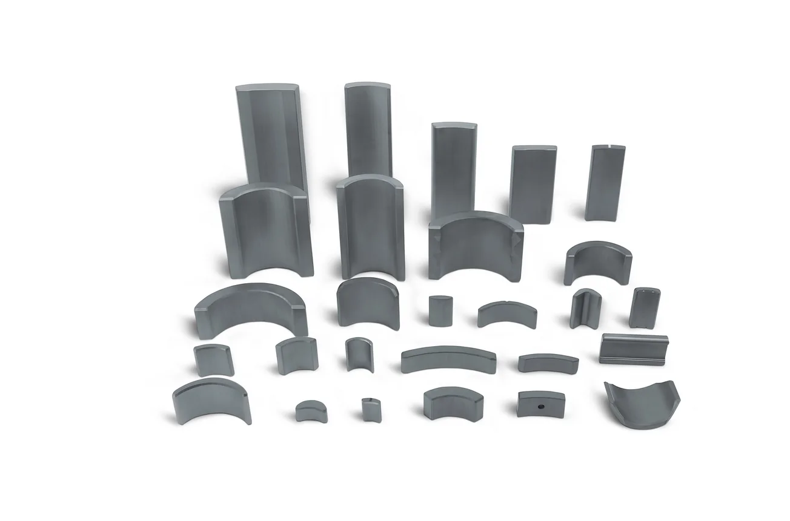

横店东磁卖的是磁材料本体：永磁、软磁、塑磁三大体系的粉体、磁体与磁芯，外加光伏组件和锂电。它的客户是电机厂、器件厂与整机厂，卖吨不卖颗。

## 1980 年起步，2006 年上市

横店东磁创立于 1980 年（横店集团创始人徐文荣办的磁性器材厂），1999 年 3 月 30 日改制设立股份公司，2006 年 8 月 2 日在深交所上市（002056.SZ），注册地浙江省东阳市横店工业区。以它为首的东阳磁性产业集群在 2010 年被中国电子元件行业协会命名为"中国磁都"，产品出口近 70 个国家和地区。

2025 年经营数据：

| 分部 | 收入 | 同比 | 占比 | 出货量 | 毛利率 |
| --- | --- | --- | --- | --- | --- |
| 光伏产品 | 143.1 亿元 | +29.27% | 63.36% | 24.9 GW（+45%） | 15.25% |
| 磁性材料 | 40.04 亿元 | +5.03% | 17.73% | 磁材合计 21.8 万吨 | 28.14% |
| 锂电池 | 27.22 亿元 | +12.69% | 12.05% | 6.22 亿支（+17.1%） | 15.38% |
| 器件 | 9.96 亿元 | +29.99% | 4.41% | — | — |
| 合计 | 225.86 亿元 | +21.70% | 100% | — | 17.82% |

归母净利润 18.51 亿元（+1.34%），研发费用 5.69 亿元。年报另把磁材器件合并表述为"约 50 亿元、同比 +9.2%"，与上表拆分口径不矛盾。

<figure class="company-photo company-photo--wide">

<figcaption>横店东磁 永磁铁氧体瓦形磁体（电机磁瓦）系列 · 图：<a href="https://www.chinadmegc.com/product/1.html">横店东磁官网</a></figcaption>
</figure>

## 三大磁材体系

公司在 2025 年 11 月的机构调研中讲得很清楚：

- **永磁**：永磁铁氧体为主，用于汽车电机、家电、工业与医疗。生产规模行业第一，国内出货市占率超 20%。客户包括博世、法雷奥、博泽、电装，以及美的、格力、松下、三星。
- **软磁**：软磁铁氧体、金属磁粉芯、纳米晶、复合软磁，用于新能源汽车、光储充、数据中心、人形机器人、AI 服务器。规模行业第一，国内出货市占率超 10%。
- **塑磁**：橡胶磁、注塑磁，用于家电电机、3D 打印机、热管理系统，连续多年增长。

磁性材料总产能约 30 万吨，永磁与软磁合计出货超 20 万吨。

塑磁这一支离编码器最近：磁编码器的码盘/磁环主流做法之一，是把磁性粉体（铁氧体或钕铁硼）与高分子粘结剂混炼后注塑或压延成型再充磁，橡胶磁、注塑磁正是这条路线的原材料形态。但公司公开资料列的应用是家电电机、3D 打印机、热管理系统，没有把编码器磁环写进去。

与机器人相关的动作写在年报里的是"加大替代稀土新型永磁材料、高频低损耗材料、注塑异方性材料及下游器件的研发"，以及铜片电感等器件出货量倍增——偏电感与电源侧。

## 在编码器链上的位置

它是链条最上游的一段：粉体 → 成型 → 充磁前的磁体。往下一环是磁环/码盘加工与充磁（东升龙这类做双码道磁码盘组件的厂），再往下一环才是读头与解算。

这个位置决定了它的经营逻辑跟编码器厂完全不同：客户是电机厂和器件厂，不是机器人本体厂；价格跟着稀土与铁氧体原料走，而不是跟着机器人出货量走。人形机器人对它来说是软磁与器件的一个增量应用。

几句话要说清："东磁做塑磁"与"某家编码器厂的磁环供应商"之间，公开资料里没有这条对应关系；"永磁铁氧体国内市占率超 20%"是全部永磁产品的口径，与编码器磁环这个细分不是一回事；软磁铁氧体是磁芯材料，不是磁敏材料。

## 官方资料

- [走进东磁（1980 年创立、1999 年改制、2006 年上市）](https://chinadmegc.com/aboutus.html?lang=ch)
- [2025 年年度报告（分部收入、出货量、毛利率）](https://www.cnfin.com/announ/detail/index.html?dannoun=lcdetail&id=827965965508)
- [2025-11-30 机构调研纪要（三大磁材体系、市占率口径、产能）](https://www.cls.cn/detail/xk/02d46803109e886407d5eff7d8efd76f)
