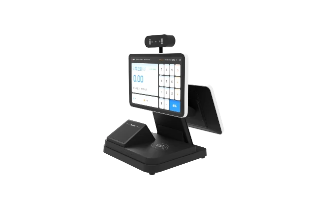

正元智慧集团股份有限公司提供**智慧校园、园区数字化系统及运营服务**，股票代码300645。公司业务从校园信息化延伸到平台、应用软件和联网终端，将人员身份、支付、设备与管理业务连接起来。

## 数字基座、场景应用与智能终端

正元以“数字基座+场景应用”组织产品体系，数字基座包含物联、数据、AI、支付、认证和协同中台。智能终端涵盖消费支付、安全防范、物联网关、智慧屏、能耗管控和食品安全等类别。

| 场景 | 主要功能 |
|---|---|
| 智慧餐饮 | 采购、食品安全、加工、订餐与结算 |
| 智慧出入 | 人员通行、身份核验与安全管理 |
| 智慧公寓 | 宿管、门锁、用能及生活服务 |
| 绿色校园 | 照明、水电、环境与能耗管理 |

YT241是正元的双屏智付终端，面向消费支付，采用桌面式安装。

<figure class="company-photo company-photo--wide">

<figcaption>YT241智付终端 · 图：<a href="https://www.hzsun.com/product-detail?id=111">正元智慧</a></figcaption>
</figure>

## 系统建设与运营服务

正元面向高校、基础教育、企事业单位及园区提供系统建设和运维服务，也通过易校园、易通云等平台提供运营及增值服务。物联网平台承担设备接入、状态管理和业务联动，场景应用则将终端数据接入日常管理流程。

## 资料来源

- [正元智慧公司概况](https://www.hzsun.com/about)
- [产品与解决方案](https://www.hzsun.com/)
- [智能终端](https://www.hzsun.com/product3)
- [智慧餐饮](https://www.hzsun.com/solution-detail?id=817)
