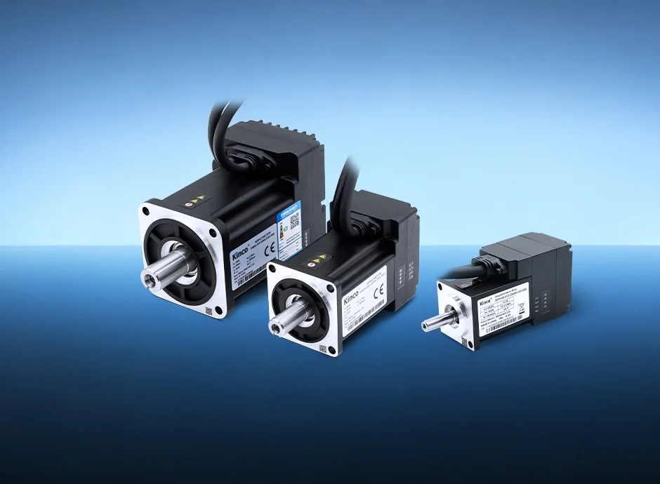

步科（Kinco）做的是运动控制与人机交互部件：HMI、PLC、伺服驱动器、伺服电机。它不做减速器本体，也不做机器人整机，但在移动机器人上把驱动器、电机、行星减速器、编码器拼成一个方块卖，这套"四件套集成"的做法现在被搬到人形机器人的关节上。它是国产低压伺服的主要供应商，强项在微小型驱动器的集成度与成本，不在大功率与高精度。

## 1996 年成立，2020 年上科创板

公司 1996 年成立，全名上海步科自动化股份有限公司，2020 年在上交所科创板上市（688160.SH）。总部与研发在上海自贸区申江路，制造基地在深圳与常州，另在上海、深圳、常州、成都设四个研发中心，在德国、美国、日本设分公司，产品销往 70 多个国家。

2025 年营业收入 7.24 亿元（+32.18%），归母净利润 7248.10 万元（+48.25%），扣非 5993 万元（+59.04%），毛利率 36.24%；研发投入 8383 万元，占营收 11.58%；累计专利 143 项（发明 26 项）。[2025 年年度报告](https://star.sse.com.cn/disclosure/listedinfo/announcement/c/new/2026-04-03/688160_20260403_16A8.pdf)

<figure class="company-photo company-photo--wide">

<figcaption>步科 iSMK 一体伺服驱动电机（三种机座号） · 图：<a href="https://www.kinco.cn/product/112?classification_id=39">步科官网</a></figcaption>
</figure>

## 按行业卖，不按产品线卖

年报的收入披露口径是按行业切的，这一点很能说明它的销售方式——它卖的是"某个行业的动力方案"，不是标准件目录。

| 行业 | 2025 年收入 | 同比 | 代表产品 |
| --- | --- | --- | --- |
| 机器人 | 3.71 亿元 | +74.57% | i-Kinco 一体机、FMK 无框力矩电机、RD 环形驱动器、iWMC 伺服轮、全向舵轮模组 |
| 机器物联网 | 1.66 亿元 | +5.66% | HMI、触控一体机、物联网盒子、DToolsPro 组态软件、机器人手持器 |
| 通用自动化 | 1.40 亿元 | +5.28% | 通用伺服、变频器、PLC、AK8X0 控制器 |
| 医疗影像设备 | 0.43 亿元 | +2.74% | 运动控制方案 |

机器人这一块再往下拆：移动机器人是基本盘，靠伺服轮与舵轮模组，负载段从 50 kg 到 1 t；协作机器人供高功率密度轻量化无框电机；人形机器人供第四代无框力矩电机、RD 系列环形驱动器，以及 25~115 mm 大中空无框电机配中空驱动器与行星减速器，分别对应足式的旋转/直线关节与轮式的全向底盘。

## 市占率的两个口径

年报引用 MIR 睿工业《2023 年中国直流伺服市场研究报告》：公司 2021、2022 年国内直流伺服市占率分别为 12%、13%，为国内第一大厂商。高工机器人产业研究所数据：2023 年度中国移动机器人行业伺服电机销量第一，按销量计市占率 54.11%。HMI 侧较弱，据《2024 年中国 HMI 市场研究报告》，2023 年销售额占国内 3%，排第十、国产品牌第四。这三组数字来自第三方机构，与公司自述要分开看。[2024 年年度报告摘要](https://www.cninfo.com.cn/new/disclosure/detail?announcementId=1223281907&announcementTime=2025-04-25&orgId=9900032778&plate=sse&stockCode=688160)

## 在机器人关节/运动控制链上的位置

步科站在电驱动这一层：往上是功率器件与 MCU，往下是关节模组与整机。它的产品逻辑是"少一个电柜、少一把线"——传统机器人动力系统由电机、驱动器、减速器、编码器四件离散拼装，体积大、布线乱，i-Kinco 把四件塞进一体，卖点是装配工时与结构空间，不是单件性能。这套逻辑在 AGV/AMR 上已经跑出规模，人形机器人是同一个思路往关节里搬。

下游决策权在整机厂的关节设计：中空孔径决定走线，驱动器外径决定关节壳体，定版后换供应商要改结构件。对手是汇川、雷赛这类国产综合厂，以及松下、安川等在小型伺服上的存量客户群。

需要交代的边界：i-Kinco 里的编码器具体位数、光编还是磁编，年报与官网都只写"集成了编码器"，没有给型号；"灵巧手、轴向磁通电机已进行研发布局"是布局描述，没有产品参数与出货口径。

## 官方资料

- [官网首页（研发中心、制造基地、产品总览）](https://www.kinco.cn/)
- [2025 年年度报告（分行业收入、研发投入、专利数）](https://star.sse.com.cn/disclosure/listedinfo/announcement/c/new/2026-04-03/688160_20260403_16A8.pdf)
- [2024 年年度报告摘要（市占率所引第三方报告）](https://www.cninfo.com.cn/new/disclosure/detail?announcementId=1223281907&announcementTime=2025-04-25&orgId=9900032778&plate=sse&stockCode=688160)
- [产品中心（无框力矩电机、伺服一体机、驱动器）](https://en.kinco.cn/product/38.html)
