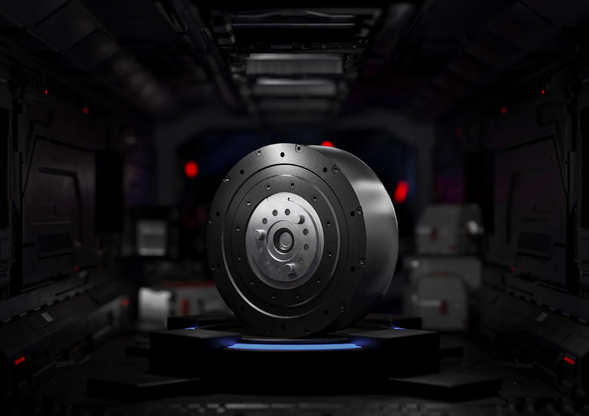

灵足时代做的是"一体化关节模组"这一个品类：电机、行星减速器、FOC 驱动器、编码器四件装进一个壳子，按扭矩分档标价零售。这个定位决定了它的全部竞争力都压在三个数字上：扭矩、重量、单价。

## 一支小米系的年轻团队

北京灵足时代科技有限公司成立于 2023 年 11 月 22 日，注册在北京经济技术开发区（亦庄），注册资本 446.4387 万元。六位核心成员均出自小米机器人事业部：CEO 王勃曾主导小米关节项目组，COO 邵元欣曾任小米机器狗"铁蛋"项目总负责人，团队曾获小米"百万美金技术大奖"，平均年龄 30 岁。[世界机器人大会展商资料](https://www.worldrobotconference.com/expo/company/644.html)

融资节奏：2024 年 5 月种子轮、2024 年 9 月天使轮（累计天使投资超 2000 万元）、2025 年 4 月 Pre-A 轮、2025 年 9 月 Pre-A+ 轮。2025 年下半年在常州高新区成立灵足时代（常州）机器人智能科技有限公司，形成"北京研发 + 常州生产"的双基地结构，选常州的一个直接原因是核心结构件供应商富兴机电就在当地，供应链半径短。

<figure class="company-photo company-photo--wide">

<figcaption>RobStride 04 一体化关节模组 · 图：<a href="https://www.robstride.com/">RobStride 官网</a></figcaption>
</figure>

## 产品：一个系列八个型号，按扭矩标价

RobStride 系列全部是准直驱（QDD）架构：低减速比行星齿轮 + 大扭矩密度电机，靠力矩密度而非高减速比换扭矩。官网标出的零售价与扭矩直接对应，这在关节模组行业里不常见——多数厂商是询价制。

| 型号 | 峰值扭矩 | 额定扭矩 | 减速比 | 重量 | 编码器 | 零售价 |
| --- | --- | --- | --- | --- | --- | --- |
| RobStride 00 | 14 N·m | 5 N·m | — | — | 双磁编 | 598 元 |
| RobStride 01 | 17 N·m | 6 N·m | 7.75:1 | 380 g | 单磁编，14 bit | 599 元 |
| RobStride 02 | 17 N·m | 7 N·m | — | — | 双磁编 | 699 元 |
| RobStride 02 IP67 | 17 N·m | 7 N·m | — | — | 双磁编 | 999 元 |
| RobStride 03 | 60 N·m | 20 N·m | 9:1 | 880 g | 双磁编 | 999 元 |
| RobStride 04 | 120 N·m | 40 N·m | 9:1 | 1420 g | 双磁编，14 bit | 1199 元 |
| RobStride 05 | 5.5 N·m | 1.6 N·m | 7.75:1 | 191 g | 双磁编，14 bit 单圈绝对值 | 499 元 |
| RobStride 06 | 36 N·m | — | — | — | — | 849 元 |
| EduLite 05 | 6 N·m | — | — | 242 g | — | 299 元 |

共性参数：FOC 驱动、CAN 与 CAN FD 通信（1 Mbps）、额定电压按型号分 36 V 或 48 V、使用电压范围 15–60 V、防护 IP52（可定制 IP67）、工作温度 −20…+50 ℃。

公司另有开源机器人硬件 M-bot 与 EduLite A3 开源机械臂两条开发者线，配套开源设计框架，面向高校与实验室。

## 在机器人执行器链上的位置

灵足时代供的是**关节总成**这一层，直接对接整机厂与机械臂厂。它是这条链上少见的"明码标价 + 现货零售"模式，海外收入占比不小（2026 年上半年海外业务约占四分之一，主要销往北美、欧洲、东南亚，此为公司对外口径）。

编码器怎么集成，这一家是有明确公开答案的：RobStride 02 的官方使用说明书里列了主要器件清单——MCU 为 GD32F303RGT6，栅极驱动为 DRV8353，**磁编码器芯片为 AMS 的 AS5047P，数量 2 颗**，功率 MOS 为 JMGG031V06A，另有 NTC 热敏电阻。这解释了产品页上"编码器分辨率 14 bit"与"双磁编码器"两个说法：AS5047P 正是 14 位单圈绝对值的片上磁编。说明书没有标注两颗芯片各自的安装位置（电机端还是输出端），只知道 02 及之后的型号按双编设计、01 是单编。

它的天花板也在同一处：低减速比意味着电机要扛更大的反电动势与发热，120 N·m 的 04 号是 1420 g、9:1，而人形机器人髋关节已经在往 300 N·m 以上走。这条路线往上是硬碰硬，往下则要面对更便宜的白牌模组。

## 官方资料

- [公司官网（型号、参数、零售价）](https://www.robstride.com/)
- [RobStride 01 产品参数页](https://robstride.com/products/robStride01)
- [RobStride 04 产品参数页](https://www.robstride.com/products/robStride04)
- [RobStride 02 使用说明书（器件清单与通信说明）](https://www.robstride.com/assets/product_manual_robStride02-e7f9f7c4.pdf)
- [世界机器人大会展商页（公司信息与展品说明）](https://www.worldrobotconference.com/expo/company/644.html)
