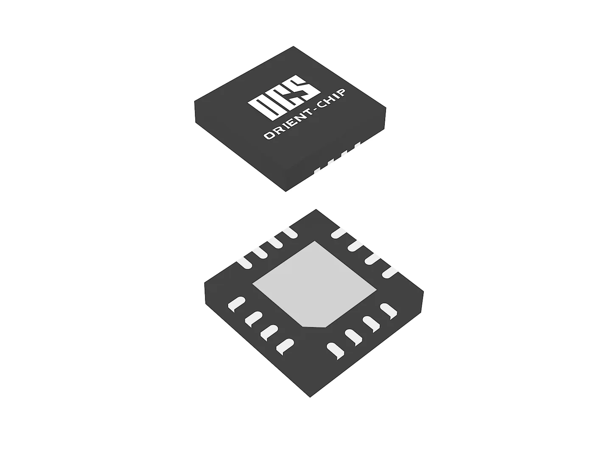

灿瑞科技是上海的一家磁传感器与数模混合芯片公司，产品分三块：磁传感器、电源管理、电机驱动，外加自建的封测产线。它跑量最大的是开关与锁存霍尔——电机换相、位置限位、开合检测这类离散量场景；角度芯片是 2026 年才补上的一档，OCH1982 标 16bit 绝对角度输出、精度 0.1°，直接对着机器人关节与伺服电机。

## 公司与收入结构

上海灿瑞科技股份有限公司（Shanghai Orient-Chip Technology，官网用 OCS 标识），2005 年成立，2022 年 10 月 18 日在上交所科创板上市，证券代码 688061.SH。官网首页标的知识产权数量为 418 项。公司自述具备"全流程集成电路封装测试服务能力"，覆盖晶圆测试、芯片封装、成品测试三个环节——这是它区别于多数 Fabless 的地方，也是它能在消费类价格战里守住毛利的结构性原因。[官网](https://www.orient-chip.com/)

2025 年分产品数据能看清重心在哪：

| 业务 | 2025 年收入 | 同比 | 毛利率 |
| --- | --- | --- | --- |
| 智能传感器芯片 | 3.63 亿元（占 58.22%） | +22.22% | 38.12% |
| 电源管理芯片 | 1.97 亿元（占 31.57%） | -0.48% | 9.42% |
| 其他芯片 | 5498.97 万元 | -12.58% | -6.52% |
| 封装测试服务 | 592.44 万元 | -9.76% | -6.07% |

全年营收 6.24 亿元、同比增长 10.30%，归母净利润 -5871.56 万元；研发费用 1.45 亿元，研发费用率 23.32%，员工 502 人。传感器是唯一保持两位数增长且毛利为正的板块，电源管理与封测服务两块都在盈亏线附近或以下。[2025 年年报数据](https://newzzbcx.cs.com.cn/cxnews.html?name=new20260425090133faauzwyh)

客户结构偏消费电子：2026 年 2 月公司获传音控股"2025 年度精诚合作伙伴"称号，同年车规芯片入选《国产车规芯片可靠性分级目录（2026）》。消费端的具体应用之一是折叠屏手机的铰链开合与姿态检测。

2024 年 4 月公司完成上市后首单收购，标的是南京睿赫电子（2018 年成立，做数字电源管理与智能驱动），落地产品是支持 QI2.0/QI2.2 MPP 方案的大功率无线充电发端芯片，同年加入无线充电联盟 WPC。电机驱动产品收购时处于验证阶段，公告口径的意图是补齐"智能电驱控制器"这块平台。

<figure class="company-photo company-photo--wide">

<figcaption>灿瑞科技芯片 QFN-16 封装外观（顶面打字与底面焊盘） · 图：<a href="https://www.orient-chip.com/">灿瑞科技官网</a></figcaption>
</figure>

## 磁传感器与角度芯片

官网把磁传感器分三支：霍尔效应锁存器和开关、线性霍尔效应传感器、多轴线性和角度位置传感器。与关节反馈直接相关的是第三支，官方描述为"基于 OCS 专利磁集中器技术的数模混合类传感器 IC"。

| 型号 | 方向 | 公开参数 | 在系统中的位置 |
| --- | --- | --- | --- |
| [OCH1982](https://www.orient-chip.com/products/sensors/magnetic-sensors/multi-axis-linear-and-angle-position-sensors/685) | 磁编位置传感器 | 16bit 绝对角度，官网标精度 0.1°；3.0~3.6V，11mA，磁场 100~700G，QFN3030-16L，-40~150 ℃，AEC-Q100: NO | 机器人关节、伺服与 BLDC 位置反馈 |
| [OCH1981](https://www.orient-chip.com/products/sensors/magnetic-sensors/multi-axis-linear-and-angle-position-sensors/684) | 同族车规版 | 4.5~5.5V，SOP8L / TSOP16L，ASEN(Typ) 0.005deg，-40~150 ℃，AEC-Q100: YES | 车载执行器与电机位置反馈 |
| [OCH1973](https://www.orient-chip.com/products/sensors/magnetic-sensors/multi-axis-linear-and-angle-position-sensors/311) | 三轴线性霍尔 | 1.7~3.6V，8.0 µA 掉电，1.1 / 3.1 µT/LSB，±507G，DFN1616-6L | 空间磁场分量，摇杆与旋钮 |
| [OCH1917](https://www.orient-chip.com/products/sensors/magnetic-sensors/multi-axis-linear-and-angle-position-sensors/686) / [OCH1919](https://www.orient-chip.com/products/sensors/magnetic-sensors/multi-axis-linear-and-angle-position-sensors/310) | 微功耗线性/角度 | 1.65~1.95V，0.15 µT/LSB，WLCSP4 | 电池供电的便携与可穿戴 |
| Hall-in-one（HIO）电驱芯片 | 集成霍尔元件的电机驱动 | 年报列为智能电机驱动的主形态 | 与磁传感同一个电机模组内的执行端 |

OCH1982 的规格表里 ASEN(Typ) 写 0.005 deg，这个数与 16bit 满量程对应的单步（360°/65536 ≈ 0.0055°）基本吻合，属于分辨率；正文写的"精度可达 0.1°"是误差口径。两者差一个数量级以上，选型时不能拿前者当后者。另外同族两颗料的车规状态不同：OCH1981 标 AEC-Q100 通过，OCH1982 明确标 NO，不能按同一份手册上车。

## 在编码器链上的位置

灿瑞的位置是"一颗关节里能凑出好几项"：角度芯片给方向，霍尔开关给换相与限位，电流传感器给电流环，HIO 电驱与收购来的电驱平台给执行端。对整机厂，这意味着少开几家供应商；对只做单颗角度芯片的同行，它的筹码在配套可获得性与自有封测的交付节奏。同档国产对手包括纳芯微、赛卓这类车规线更长的公司，以及刚通过收购切入磁传感的美芯晟，灿瑞的差异主要落在"器件 + 封测"的纵向整合上，而不是单颗芯片的位数。

要判断真实档位还得回到手册。OCH1982 的敏感元件是霍尔还是 xMR、0.1° 是在什么温区与校准条件下测的，官方都没有公开；而"关节编码器芯片已进入小批导入"这句只出现在第三方工商信息摘要里，不是公司公告或年报原文，只能当传闻看。

## 官方资料

- [灿瑞科技官网](https://www.orient-chip.com/)
- [磁传感器分类](https://www.orient-chip.com/products/sensors/magnetic-sensors)
- [多轴线性和角度位置传感器](https://www.orient-chip.com/products/sensors/magnetic-sensors/multi-axis-linear-and-angle-position-sensors)
- [OCH1982 产品页](https://www.orient-chip.com/products/sensors/magnetic-sensors/multi-axis-linear-and-angle-position-sensors/685)
- [2025 年年报分产品数据](https://newzzbcx.cs.com.cn/cxnews.html?name=new20260425090133faauzwyh)
