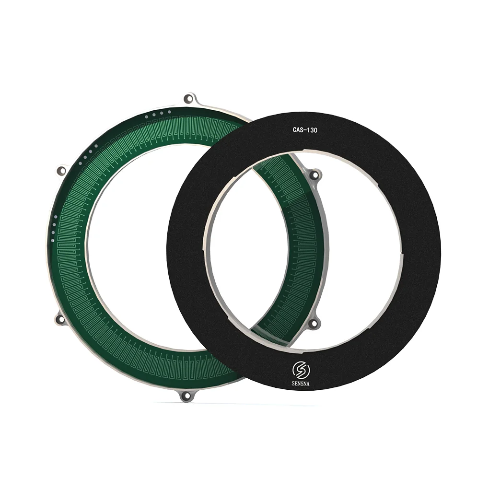

盛耐科技（英文品牌 SensnaTech，产品打 SENSNA 标）只做电感式（电涡流）编码器，客户分两头：协作机器人关节、医疗与物流设备，以及国防电子、航空航天的高可靠指向机构。

## 主体

全称**上海盛耐科技有限公司**（英文稿写 Shanghai Shengnai Technology Co., Ltd.），上海市高新技术企业，通过 ISO 体系与欧盟 CE 认证，自称拥有数十项核心专利。成立年份、注册资本、员工规模未在官网出现。

产品矩阵按结构命名：DNAP（窄边双编）、DIAP（薄型单侧/双侧双编）、MIAP（微型）、CAS/CAF（薄环式）、IAC/IAS/IAP（其他薄型）。公司给的覆盖范围是薄至 3.6 mm、窄至 2 mm、小至 10 mm 外径、中空 2–200 mm。

<figure class="company-photo company-photo--portrait">

<figcaption>盛耐 CAS-130 薄环式电感编码器（感应环与转子环） · 图：<a href="https://www.sensnatech.com/product">盛耐科技官网</a></figcaption>
</figure>

## DNAP：窄在哪里

DNAP 是 2026 年首发的窄边双编系列，也是它进入机器人关节话题的那一款。[新品发布稿](https://www.sensnatech.com/en/news/4.html)

| 型号 | 外径/内径/厚度 | 重量 | 分辨率 | 精度 | 最高转速 | 转动惯量（内圈/外圈） |
| --- | --- | --- | --- | --- | --- | --- |
| DNAP10-15-25 | 25 / 10 / 4.5 mm | 5 g | 17 bit | 0.03° | 6,000 rpm | 0.030 / 0.088 kg·mm² |
| DNAP15-20-30 | 30 / 15 / 4.5 mm | 6 g | 17 bit | 0.03° | 6,000 rpm | 0.089 / 0.198 kg·mm² |
| DNAP20-25-35 | 35 / 20 / 4.5 mm | 8 g | 17 bit | 0.03° | 6,000 rpm | 0.198 / 0.372 kg·mm² |
| DNAP25-30-40 | 40 / 25 / 4.5 mm | 9 g | 17 bit | 0.03° | 6,000 rpm | 0.372 / 0.625 kg·mm² |
| DNAP30-35-45 | 45 / 30 / 4.5 mm | 11 g | 17 bit | 0.03° | 6,000 rpm | 0.625 / 0.974 kg·mm² |

补充口径：厚度不含连接器与安装组件；边框窄至 2 mm；最大静态误差 ±2 LSB；支持 SSi、BiSS-C、RS-422、RS-485；非接触电磁感应原理，无滚珠轴承、无玻璃码盘。

"窄"的实处是这套尺寸链：外径 25 mm 的环，内径给到 10 mm，剩 7.5 mm 的环宽里要塞下激励线圈、感应线圈和板，边框只能做到 2 mm。

公司对外另给过一组系列级上限：角度精度可达 0.006° 级，角分辨率覆盖 15–19 bit / 17–19 bit，工作温度 -30…+100 °C 或 -30…+105 °C、储藏 -50…+100 °C，抗冲击 100 g/11 ms。这组数不对应具体型号。

行业综述（机电之家）把"整机功耗低至 70 mA"写在 DNAP 名下，盛耐自己的发布稿与参数表都没有功耗行，引用时按第三方转述处理。

## 客户方向

展会记录比产品页更能说明取向。2026 年 6 月上海上交会带的是 MIAP 微型、DIAP 单侧/双侧双编、DNAP 窄边双编；2026 年 9 月第十四届中国国际国防电子展（CIDEX）带的是军用低温编码器、CAS/CAF 薄环式、DIAP/DNAP、MIAP 全套。

协作机器人关节则与机器人、医疗设备、物流自动化并列提到。

## 在编码器链上的位置

盛耐做的是线圈板 + 解算 + 结构的纯模组。电感式路线的共同立场是不依赖永磁磁环，因此不怕外部杂散磁场、没有退磁问题、也不需要磁材料图案化充磁；代价是要做激励线圈与解算电路，板级设计与温漂补偿的活儿比磁编重。

它和弓望、锐鹰在同一技术带上，差别从产品形态就能读出来：弓望主打超大中空与异侧双编，锐鹰把同侧双编做薄到 6.8 mm，盛耐把边框压到 2 mm、整环做到 25 mm 外径 5 g。同一条路上还有纳芯微这类从芯片侧切入的玩家。

## 官方资料

- [官网（产品新闻与展会动态）](https://www.sensnatech.com/)
- [DNAP 超窄电感式双编码器发布稿（含参数表）](https://www.sensnatech.com/en/news/4.html)
