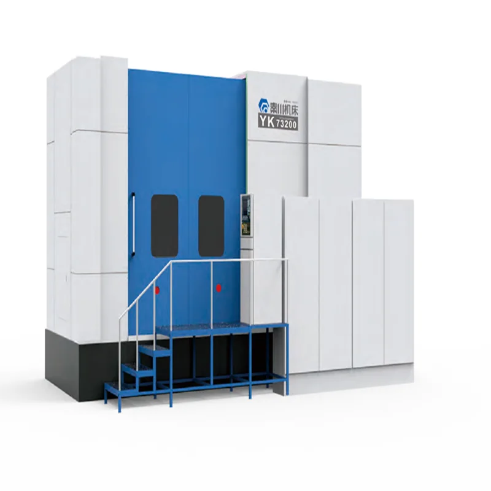

秦川机床是机床工具集团，主营是造机器——磨齿机、螺纹磨床、外圆磨床、加工中心、复杂刀具。它同时卖用这些母机加工出来的零件：滚珠丝杠、直线导轨、工业机器人关节减速器。所以它在机器人链上的身份是双重的，既卖减速器，也卖造减速器要用的磨齿机，这个组合在国内只有它一家。

## 陕西宝鸡的机床集团，控股股东是法士特

公司全名秦川机床工具集团股份公司，深交所上市（000837.SZ），注册地与办公地都在陕西省宝鸡市姜谭路 22 号。2020 年 4 月 27 日，控股股东由陕西省国资委变更为陕西法士特汽车传动集团，实际控制人仍为陕西省国资委。旗下有宝鸡机床、汉江机床、汉江工具、沃克齿轮、秦川格兰德、秦川宝仪、精密装备、高精传动、智能机床等企业，是陕西省数控机床产业链"链主"企业。[企业概况](https://www.qinchuan.com/index.php?m=content&c=index&a=lists&catid=2)

2025 年营业收入 40.90 亿元（+5.96%），归母净利润 5289.38 万元（−1.65%），扣非净利润 −7167.53 万元；经营活动现金流净额 3.17 亿元（+103.34%）；研发投入 2.40 亿元（+17.62%），占营收 5.86%，研发人员 1218 人占 13.23%。归母为正、扣非为负，说明当期利润里非经常性项目占比不小。[2025 年年度报告摘要](https://cfi.net.cn/p20260326006399.html)

<figure class="company-photo company-photo--portrait">

<figcaption>秦川机床 YK73200 磨齿机 · 图：<a href="https://www.qinchuan.com/list-41-1.html">秦川机床官网</a></figcaption>
</figure>

## 三条产品线

| 层次 | 代表产品 | 在机器人链上的作用 |
| --- | --- | --- |
| 工作母机 | 数控磨齿机、螺纹磨床、外圆磨床、高档数控车床、加工中心、精密测量仪器 | 决定柔轮、刚轮、丝杠的齿形精度与批量一致性 |
| 滚动功能部件 | 滚珠丝杠、滚动直线导轨 | 直线关节与机床进给轴的传动件 |
| 机器人关节减速器 | E、C、F、N 系列与一体机 | 6 大系列、50 多种规格、200 多种速比、200 多种连接方式，覆盖 5~1000 kg 机器人选型，已批量生产和销售 |
| 专用磨床（新） | HJ109 内螺纹磨床、HJ110 外螺纹磨床 | 面向行星滚柱丝杠加工，2026 年 4 月 CCMT 起推广 |

减速器那一行的数字直接落在年报产品表里，应用写明"工业机器人、精密转台、机床刀塔、机床 ATC 刀库、医疗器械"。YK4626 强力珩齿机 2025 年已交付新能源汽车用户。行星滚柱丝杠专用磨床是新增能力项，说明秦川盯的是人形机器人直线关节那条路线——直线关节要用滚柱丝杠，滚柱丝杠的螺纹磨削正是螺纹磨床的活。

## 减速器的真实体量

减速器业务没有单独披露收入，混在"功能部件"里。

## 在机器人关节/运动控制链上的位置

秦川的位置在"制造工艺供给方"这一层。核心资产是磨齿机与螺纹磨床：谐波减速器的柔轮壁薄易变形，RV 减速器的摆线轮与针齿啮合靠磨削保证，谁能稳定磨出这个精度，谁就在减速器的成本结构里占上风。它同时卖磨床和减速器，等于既卖给同行设备、又下场做产品，这在客户关系上有利也有摩擦。

下游决策权分散：机床客户与机器人客户是两拨人，采购口不在一个部门。对手在减速器侧是绿的谐波、双环传动、中大力德，在母机侧是格里森、克林贝格、三菱重工。

## 官方资料

- [企业概况（子公司结构、产品门类、资质）](https://www.qinchuan.com/index.php?m=content&c=index&a=lists&catid=2)
- [2025 年年度报告摘要（减速器与滚动功能部件产品表）](https://cfi.net.cn/p20260326006399.html)
- [2025 年年度报告全文（财务数据、控股股东变更）](https://www.cninfo.com.cn/new/disclosure/detail?announcementId=1225038126&announcementTime=2026-03-27&orgId=gssz0000837&plate=szse&stockCode=000837)
- [2025 年研发投入与 HJ109 / HJ110 磨床](https://www.163.com/dy/article/KU8G8J4L0519QIKK.html)
