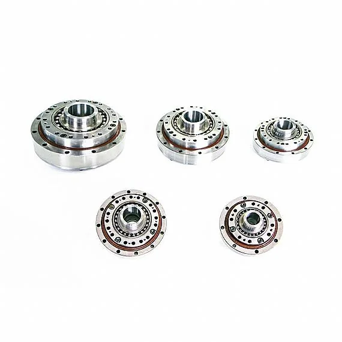

绿的谐波卖的是关节里那个把转速换成扭矩的零件：谐波减速器。它在链条上是零件层的主力，2025 年谐波减速器及金属部件收入 4.76 亿元，占营收 83.49%，谐波减速器销量 42.5 万台。往上一层它也做机电一体化产品——把减速器、力矩电机、伺服驱动装成一体化关节模组，2025 年这块 0.74 亿元、占 13.02%。所以它不是纯零件厂，也不是整机厂，位置在"零件为主、模组为辅"。

## 从齿形开始的公司

公司 2003 年做出第一代齿形，2013 年谐波产品被机器人客户接受、标准化到 14 个系列，2020 年在科创板上市（688017.SH），注册地在苏州。官网英文简介给出的规模口径是：谐波减速器年产能超过 50 万台，2025 年销量超过 30 万台、覆盖 21 个系列，客户 1,800 余家，国内市场份额 60% 以上。这组数字是公司自述，与年报口径（2025 年销量 42.5 万台）不完全对应，引用时需注明来源。

2025 年公司营收 5.71 亿元（+47.31%），归母净利润 1.24 亿元（+121.42%），毛利率 36.91%。增长来自两头：工业机器人产量回升带来的基本盘，以及具身智能客户从研发转入小批量试产。

| 产品线（2025 年） | 收入 | 占比 | 同比 | 毛利率 |
| --- | --- | --- | --- | --- |
| 谐波减速器及金属部件 | 4.76 亿元 | 83.49% | +46.42% | 36.77% |
| 机电一体化产品 | 0.74 亿元 | 13.02% | +41.28% | 40.89% |
| 智能自动化装备 | 0.15 亿元 | 2.61% | +221.35% | 11.52% |

公司自称的差异化在齿形：以自研"P 型齿"数学模型与误差修正方法为基础的齿形体系，绕开传统渐开线设计。这类表述只能用"公司口径"引用，第三方无法从公开资料复核齿形细节。

<figure class="company-photo company-photo--portrait">

<figcaption>绿的谐波谐波减速器系列产品 · 图：<a href="https://www.leaderdrive.com/product/4.html">绿的谐波官网</a></figcaption>
</figure>

## 谐波路线：精度与背隙强在哪，弱在哪

按官网 LCS/LCSG 标准杯型系列的技术参数表，公开的指标是这几个：机型 14–58，速比 30–160，额定转矩 4–549 N·m（LCSG 高转矩型最高 969 N·m），最大背隙 ≤10 角秒，角度传动精度 60–180 角秒（即 1–3 角分），最高输入转速 3,000–8,500 r/min，扭转刚度最高约 71×10⁴ N·m/rad。

| 参数 | LCS / LCSG 标准杯型（官网表列） |
| --- | --- |
| 机型 | 14–58 |
| 速比 | 30–160 |
| 额定转矩 | 4–549 N·m（LCS）／7–969 N·m（LCSG） |
| 最大背隙 | ≤10 角秒 |
| 角度传动精度 | 60–180 角秒（1–3 角分） |
| 最高输入转速 | 3,000–8,500 r/min |

这组数字读法要拆开看。背隙是"回程空转"，谐波因为多齿同时啮合、且靠柔轮弹性变形传力，天然能做到接近零背隙，这是它相对行星与摆线结构的核心优势；角度传动精度是"输入多少度、输出该转多少度"的偏差，1–3 角分在关节场景够用，但比精密转台差一个量级。弱项是刚性与抗冲击：柔轮是薄壁件，过载与频繁冲击会吃寿命，这也是下肢重载关节更偏向 RV 或行星滚柱丝杠的原因。

## 在机器人执行器链上的位置

绿的谐波供两层：谐波减速器（零件）与一体化关节模组（总成）。减速器在关节里的位置是"电机之后、负载之前"——电机给出高转速低扭矩，减速器把它变成低转速大扭矩并放大分辨率，同时承担关节的刚性与回差指标。它不和无框力矩电机竞争，两者是串联件：一款旋转关节的带宽与精度上限，由电机的转矩波动和减速器的背隙共同决定。

它往总成的延伸是可见的：官网产品目录里除减速器外，还有 KMF 无框力矩电机、KAH 旋转执行器、KCR 数控转台，年报把行星滚柱丝杠、微型电液执行器也列进主业。2025 年还与南宁宇立合资设立上海哈莫森，做机器人旋转与线性执行器的力矩传感器——这是往"感知件"补位。

编码器在它这一层同样没有公开。公司的一体化关节模组在描述里只说集成高精度编码器，没有给品牌与分辨率；模组级背隙与精度指标也未单独发布规格书。这类信息只能向厂商索取，不能从公开页面推断。

## 官方资料

- [绿的谐波官网（中文）](https://www.leaderdrive.cn/)
- [LCS/LCSG 标准杯型谐波减速器（技术参数表）](https://www.leaderdrive.com/product/6.html)
- [公司简介（产能与份额口径）](https://www.leaderdrive.com/about/profile.html)
- [2025 年半年度报告（上交所）](https://big5.sse.com.cn/site/cht/www.sse.com.cn/disclosure/listedinfo/announcement/c/new/2025-08-16/688017_20250816_7GVZ.pdf)
