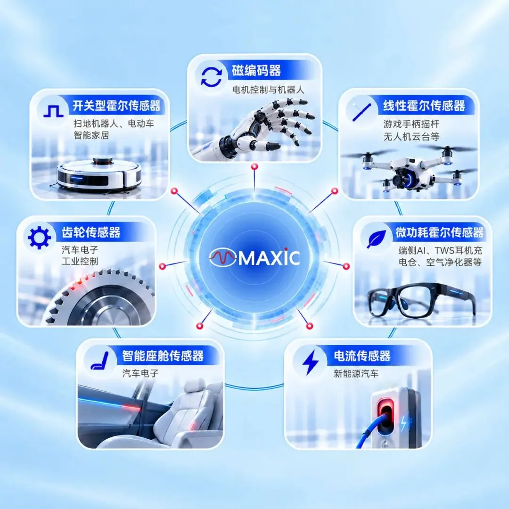

美芯晟是北京的一家数模混合芯片公司，两块主业是电源管理（无线充电、快充、照明驱动）与光学传感（环境光、ToF、皮肤检测），磁传感是 2026 年 1 月花 1.6 亿元买来的——标的是上海鑫雁微电子，一家做霍尔开关、线性霍尔、齿轮传感的老厂。所以它的磁产品目录很厚（近百款、近四分之三收入来自开关霍尔），但要往关节角度反馈走的那一步，眼下还在图纸上。

## 两块主业与一次收购

美芯晟科技（北京）股份有限公司，证券代码 688458.SH，上交所科创板。公司自述战略是"电源管理 + 信号链"双驱动，平台分"手机 + 汽车 + 机器人"三块；官网产品中心列五栏：智能传感器、充电管理、电机驱动、电源管理、汽车电子。[官网](https://www.maxictech.com/)

收购的时间线清楚：2026 年 1 月 27 日董事会通过，1 月 28 日至 29 日公告，3 月完成工商变更与股权过户。交易结构是"受让老股 1.25 亿元 + 增资 3500 万元"，投前估值 1.25 亿元，合计 1.6 亿元取得 100% 股权，全部用自有资金。原股东承诺 2026 至 2029 年累计净利润不低于 6200 万元，分年 1000 / 1300 / 1700 / 2200 万元。[收购公告](http://xinpi.zqrb.cn/pdf/KCB/688458/2026/0129/e57b30d3730f570f30a500c5a0cf6ee7.pdf)

标的的体量与结构，问询函回复里说得很细：2025 年 1—11 月营业收入 5873.12 万元，综合毛利率 39.66%。按品类拆开是开关霍尔 4338 万元（毛利 38.31%）、马达驱动 1141 万元、线性霍尔 127 万元、电感式接近开关 105 万元、齿轮传感 81 万元。员工 40 人，其中研发 18 人，知识产权合计 94 项。按应用分，电动出行（两轮车为主）是最大头，2025 年 1—11 月 3705 万元。[问询函回复](https://static.sse.com.cn/disclosure/listedinfo/announcement/c/new/2026-03-11/688458_20260311_6414.pdf)

这个收入结构说明了合并后的真实起点：它拿到的是一门两轮车与工控家电的生意，开关量为主，角度量几乎为零（线性霍尔 127 万元）。

<figure class="company-photo company-photo--screen">

<figcaption>美芯晟磁传感器产品线与应用场景：开关型霍尔、齿轮传感、线性霍尔、微功耗霍尔、磁编码器、智能座舱与电流传感 · 图：<a href="http://mp.weixin.qq.com/s?__biz=MzA4ODQ4ODQwOQ==&mid=2651066119&idx=1&sn=cbc0a32a69866119c0102ecab5bd3f92#rd">美芯晟微信公众号《磁传感器的四大应用场景》</a></figcaption>
</figure>

## 磁传感产品矩阵

下表按公司在公告与公开文章里给出的系列整理。同一系列内型号共用一段描述，官网没有逐型号参数页；电感式接近开关与磁编码器芯片这两类，公司只给了品类名，没有型号与参数。

| 品类 | 公开出现的型号 | 公开信息 | 在系统中的位置 |
| --- | --- | --- | --- |
| 智能座舱霍尔 | GH21xx / GH22xx | 座椅、车窗与天窗、侧滑门与遮阳板、电动尾门、车锁位置检测；符合 AEC-Q100；卖点是开关点温度特性与高低温一致性 | 车身位置检测 |
| 齿轮传感器 | GH1922 / GH1922U / GH1817 / GH1820 / GH1835 / GH1836 / GH5901 | 差分霍尔架构；曲轴、凸轮轴位置与 ABS 轮速；GH1836 为差分霍尔加双路正交输出；GH1922U 用超薄封装 | 转速与相位；正交输出可作增量信号源 |
| 开关型霍尔 | GH11xx / GH12xx / GH31xx / GH34xx / GH1120 | 电机换相、位置限位、非接触开关；官网称 GH31xx/GH34xx 用于雅迪、爱玛、九号等品牌的两轮车轮毂与中置电机 | 无刷电机换相与行程开关 |
| 双极锁存 | GH2102 / GH2103 | 官网新品稿标"高灵敏度双极锁存"，面向工业与消费电机控制 | 无刷电机换相 |
| 线性霍尔 | GH39F / GH3562 / GH35xx | 灵敏度与温漂为卖点；用于摇杆、手柄、扭矩感应 | 模拟量位置与力矩 |
| 微功耗霍尔 | GH1248 等 GH12xx | 周期唤醒机制，面向电池供电终端 | 低功耗开合检测 |
| 电感式接近开关 | — | 靠电磁感应与涡流效应做金属非接触检测 | 工业限位 |
| 磁编码器芯片 | — | 半年报列为磁传感器系列的一类 | 关节角度反馈 |

## 磁编码器的三条路线

2026 年 8 月公司发布的一篇应用文章把路线讲得比较具体：针对髋、膝、肘等中大型关节，"正在研发"霍尔阵列型高精度磁编码器力位协同感知芯片，标称角秒级角度解析；另外"规划"双码道离轴感编芯片作为性价比补充，以及"规划"在轴式磁编码器芯片面向灵巧手指关节。三个动词分别是研发与规划，没有一个写成量产；同段还提到"磁编码器与电机驱动配套协同"，即把它当"感知 + 执行"闭环的前端来定位。[磁传感器四大应用场景](http://mp.weixin.qq.com/s?__biz=MzA4ODQ4ODQwOQ==&mid=2651066119&idx=1&sn=cbc0a32a69866119c0102ecab5bd3f92&chksm=8a86af300fda11c62a7d01cfb7cee74612e8af77ea428a39f01c8bf246caedeba182fc0c4b60#rd)

技术底子来自标的：问询函回复列出两项与"多轴集成与三维磁传感"相关的授权专利（垂直霍尔效应传感器、3D 霍尔传感器），另有温度补偿与非线性校准、马达驱动保护两组。回复同时写明上市公司侧的器件设计能力覆盖"霍尔器件、AMR/TMR 器件"——这意味着后续往高精度走有 AMR/TMR 的选择空间，但目前没有公开的 xMR 编码器产品。

## 在编码器链上的位置

美芯晟在链条上占两段不同的位置。**已交付的一段**是磁传感前端：开关、锁存、齿轮传感、线性霍尔，对应换相、限位、轮速、曲轴相位——这一档国内极卷，同台的有纳芯微、灿瑞、赛卓，以及大量做两轮车与家电霍尔的中小厂，胜负主要靠成本与客户认证，不靠位数。**在研的一段**才是关节编码器，卖点被设计成"编码器 + 电机驱动 + 电源"打包，这与它原有的手机与汽车客户渠道能对上。

需要交代的边界：三条编码器路线都没有型号、位数与误差数据，官方只给"角秒级"这类形容词；标的自述的"汽车级国际认证"没有对应的证书编号与料号清单；客户名单里的品牌是集团整体供应链口径，不能读成"某客户用了它的编码器"。

## 官方资料

- [美芯晟官网](https://www.maxictech.com/)
- [并购磁传感器企业后的产品矩阵说明（2026-01-31）](https://www.maxictech.com/about/news/153)
- [磁传感器的四大应用场景（含编码器研发口径）](http://mp.weixin.qq.com/s?__biz=MzA4ODQ4ODQwOQ==&mid=2651066119&idx=1&sn=cbc0a32a69866119c0102ecab5bd3f92&chksm=8a86af300fda11c62a7d01cfb7cee74612e8af77ea428a39f01c8bf246caedeba182fc0c4b60#rd)
- [收购上海鑫雁微 100% 股权的公告](http://xinpi.zqrb.cn/pdf/KCB/688458/2026/0129/e57b30d3730f570f30a500c5a0cf6ee7.pdf)
- [问询函回复（标的分产品收入与毛利率）](https://static.sse.com.cn/disclosure/listedinfo/announcement/c/new/2026-03-11/688458_20260311_6414.pdf)
