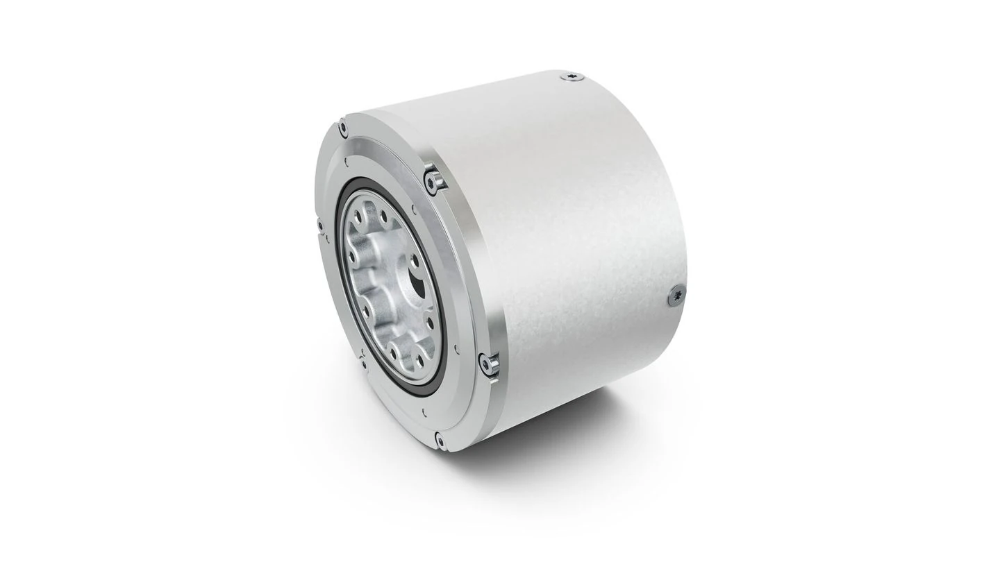

舍弗勒（Schaeffler）是一家运动技术集团，产品覆盖**轴承、精密传动、电机、传感器和执行器**，业务从机械零件延伸到集成运动系统。

## 运动技术产品

舍弗勒为汽车和工业设备提供轴承、直线导向、齿轮及丝杠传动等部件，同时发展电机、控制电子与执行器。人形机器人业务将这些技术组合到关节、直线驱动和其他运动单元中。

## 行星齿轮执行器

舍弗勒在CES 2026展示的行星齿轮执行器，将**两级行星减速器、电机、编码器和控制器**组合在紧凑单元内，面向人形机器人肩部、膝部、髋部等关节。

其人形机器人运动产品组合还包括旋转与直线执行器、谐波减速器、滚柱丝杠、薄壁轴承及控制电子，覆盖支撑、传动、驱动和反馈等环节。

<figure class="company-photo company-photo--wide">

<figcaption>人形机器人行星齿轮执行器 · 图：<a href="https://www.schaeffler-industrial-drives.com/en/news_media/press_releases/press_releases_detail.jsp?id=88158464">Schaeffler</a></figcaption>
</figure>

## 电感式转子位置传感器

舍弗勒的人形机器人产品材料列出穿轴式和轴端式电感转子位置传感器，与电机、控制器及执行器共同组成运动产品组合。传感器提供位置反馈，执行器则把反馈、驱动和机械传动集成为关节运动单元。

## 资料来源

- [舍弗勒集团产品](https://www.schaeffler.com/en/divisions-products/)
- [人形机器人](https://www.schaeffler.com/en/technology-innovation/technology/humanoid-robots/)
- [CES 2026行星齿轮执行器](https://www.schaeffler-industrial-drives.com/en/news_media/press_releases/press_releases_detail.jsp?id=88158464)
- [人形机器人运动产品组合](https://www.schaeffler.com/remotemedien/media/_shared_media_rwd/08_investor_relations/presentations/20260112_schaeffler_powering_humanoid_motion.pdf)
