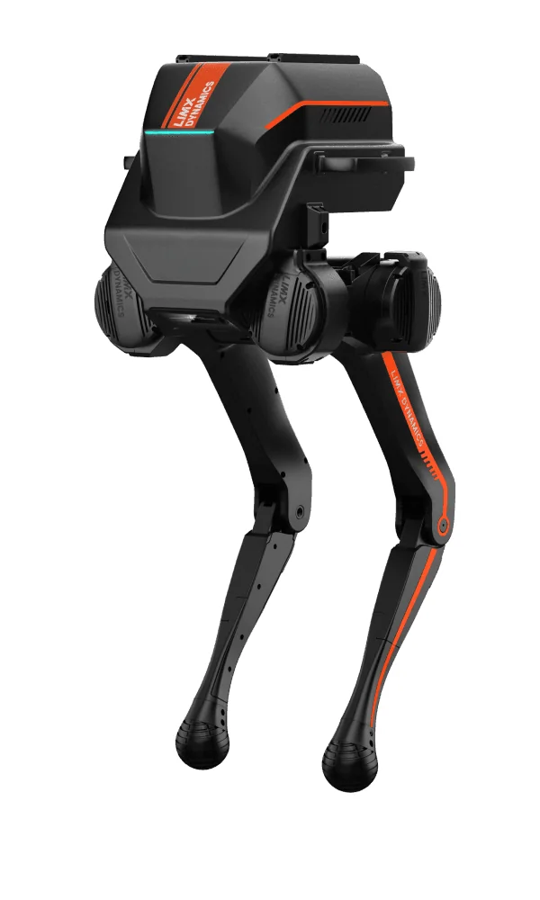

逐际动力的立足点是运动智能——让足式机器人在非结构化地面上走稳，再往外长成人形和操作系统。这条"软硬都做、先运动后认知"的路径，让它的产品谱系比同批公司更杂：一条腿做科研入门平台，一条腿做全尺寸商用整机。

## 团队与三个技术层

公司 2022 年在深圳南山成立，创始人张巍本科毕业于中国科学技术大学自动化系，博士毕业于普渡大学电气与计算机工程系，此后在俄亥俄州立大学任长聘教授，2019 年回国加入南方科技大学机械与能源工程系。2021 年，他的团队率先实现人形双足机器人在室内外场景的强化学习行走。联合创始人中有 19 年思科高管经历者，核心成员来自清华、中科大、普渡、伯克利。

官方把技术栈拆成三层：System 0 是全身运动基础模型，负责复杂地形下的稳定行走；System 1 是 VLA／WAM 操作能力，对应开源的 FluxVLA Engine 与 VGM 视频生成运动算法；System 2 是以大语言模型和世界模型为引擎的具身智能体操作系统 COSA（2026 年 1 月发布，7 月更新到 0.5）。说白了，它把"走路"和"干活"当成两个可分别替换的模块卖。

<figure class="company-photo company-photo--portrait">

<figcaption>TRON 1 双足机器人 · 图：<a href="https://www.limxdynamics.com/zh/products/tron1">逐际动力官网</a></figcaption>
</figure>

## 产品矩阵

产品演进顺序是有讲究的：2023 年 9 月先出四轮足 W1（比常规四足更快、更省电），2024 年做双足人形原型与 CL 系列验证上下楼梯与负重搬运，2025 年才推出面向科研的 TRON 1，2025 年下半年进入全尺寸商用整机。

| 产品 | 形态 | 公开参数 | 定位 |
| --- | --- | --- | --- |
| TRON 1 | 多形态双足（点足／双足／轮足，足端可拆换） | 站立尺寸 ≤392×420×845 mm、净重 ≤20 kg、负载 ≤10 kg、续航 ≤2 h、关节额定扭矩 30 N·m、主控 12 代 Intel i3／16G／512G | 强化学习与人形运控科研入门 |
| LimX Oli | 全尺寸通用人形 | 身高 165 cm、31 个自由度（头 2／单臂 7／腰 3／单腿 6）、15.8 万元起 | 科研、演艺、导览、巡检 |
| LimX Luna | 全尺寸交互人形 | 身高 160 cm、27 个自由度、支持 200 台以上群控 | 商场、博物馆、游乐园、舞台 |
| TRON 2 | 多形态具身机器人 | 官方未给完整规格表 | 双臂／双足／双轮足构型切换 |

TRON 1 的参数表有个细节值得记：中文规格页写的关节峰值扭矩是 60 N·m，英文商店页写的是 80 N·m，两处口径不一致；同一页的轮足最高速度，中文写 ≤3 m/s、英文写 ≥5 m/s。这类出入在迭代快的硬件公司里常见，但意味着选型时不能拿官网任一语言版本当准数。[TRON 1 规格](https://www.limxdynamics.com/zh/products/tron1/spec)

Oli 的软件配套相对完整：Python 全流程开发、模块化 SDK、上下层接口开放、URDF 完整、支持 Isaac Sim／MuJoCo／Gazebo，预装 15 个交互动作。

## 融资与商业化进度

资本节奏：2023 年 10 月天使轮加 Pre-A 合计近 2 亿元（峰瑞资本、明势资本、昆仲资本、绿洲资本领投、联想创投）；2024 年 7 月 A 轮由阿里巴巴领投，招商局创投、上汽尚颀资本入局；2025 年 7 月京东战略领投新一轮；2026 年 2 月完成 2 亿美元 B 轮；2026 年 7 月完成近 2 亿美元 Pre-IPO 轮（IDG 资本、蓝思科技、GGG Group、华山资本、合肥滨湖产发集团等），2026 年 3 月已完成股份制改造。

海外占比高与产品定位有关：Luna 这类"能演能互动"的整机，海外商场与展馆的采购决策比国内快。

## 产业链角色

自研的范围写在产品页上：关节电机（Luna 页面写"关节电机全新升级"）、6 轴 IMU（Oli 页面标注"自研 6 轴 IMU"）、第二代 Sys 0 运控引擎、COSA 系统、FluxVLA 工程底座。TRON 1 关节额定 30 N·m 属于中小扭矩段，适合 20 kg 级机体，也解释了 165 cm 的 Oli 为何需要另一套关节。

**

## 官方资料

- [逐际动力官网](https://www.limxdynamics.com/zh)
- [TRON 1 规格参数表](https://www.limxdynamics.com/zh/products/tron1/spec)
- [LimX Oli 产品页（自由度分解、软件支持）](https://www.limxdynamics.com/zh/products/oli)
- [LimX Luna 产品页（群控、热管理）](https://www.limxdynamics.com/zh/products/luna)
- [公司新闻中心（COSA 0.5、Pre-IPO 轮、Luna 发布）](https://www.limxdynamics.com/zh/news)
