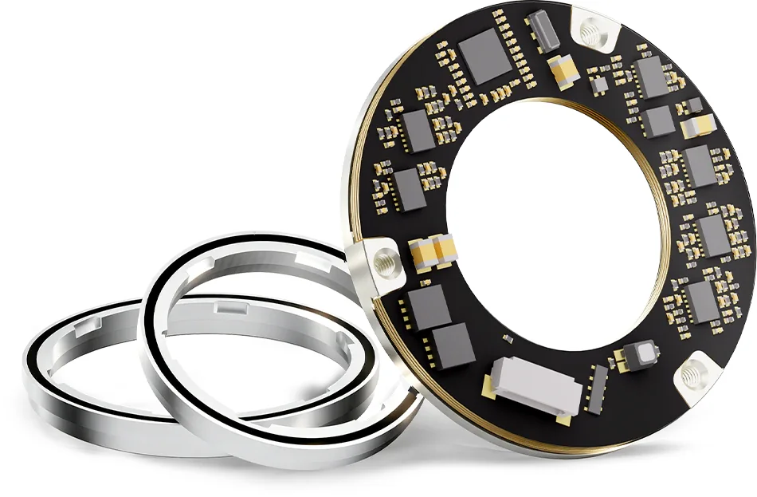

金钢科技（品牌 KingKong）做的是机器人一体化关节里的磁编码器模组，产品只有双编码器、单编码器、三编码器三类，全部围绕"一个关节里要同时测电机端和减速机端"展开。原理是霍尔读磁环，公司自己把这套充磁方式叫"图案式磁"。它不卖磁敏芯片，也不做电机与减速器。

## 2017 年 4 月成立，"1993" 是转载错误

工商登记：北京金钢科技有限公司，统一社会信用代码 91110114MA00DN799G，成立日期 2017 年 4 月 14 日，法定代表人梁正，注册地北京市昌平区科技园区双营西路 82 号院，注册资本 865.42 万元，员工约 160 人。

不少供应商盘点稿（艾邦机器人、同花顺财经等）写"成立于 1993 年"，这个数字与工商登记、与官网历程都对不上：[官网 2026 年 WAIC 稿件](https://kingkong.tech/about/news-waic-crab-20260721)写"金钢科技成立于 2017 年"，产业媒体转述央视财经采访也写"2017 年，90 后创业者梁正创立金钢科技"。一位 90 后创始人在 1993 年办公司不成立，这个年份属于二手稿件的串行错误。

<figure class="company-photo company-photo--wide">

<figcaption>金钢科技 DPT-20-35 双编码器模组（磁环与环形电路板） · 图：<a href="https://www.kingkong.tech/encoder/DPT">金钢科技官网</a></figcaption>
</figure>

## 产品：DPT 与 DPB 两条主线

官网编码器栏目下列 DPT（双编）、DPB（双编）、MPT（单编）、TPB（力矩三编码）、MPP（大关节单编）五个系列。两个双编系列的差别不在位数，而在气隙容忍度与抗磁能力。[DPT](https://kingkong.tech/encoder/DPT) · [DPB](https://kingkong.tech/encoder/DPB)

| 项目 | DPT 系列 | DPB 系列 |
| --- | --- | --- |
| 分辨率 | 双 24 位绝对值 | 双 20 位绝对值 |
| 精度 | 双 ±0.01° | 双 ±0.05° |
| 径向单边宽度 | 7.5 mm | 7 mm |
| 安装气隙 | — | 正常 0.8 ± 0.3 mm，抗冲击动态 0.5–1.6 mm |
| 最高转速 | ≥20,000 rpm | ≥20,000 rpm |
| 抗磁 | — | 可达 1000 Gs |
| 尺寸档位 | 内径 10–30 mm 共五档 | 内径 10–30 mm 共五档 |

表中空白项在产品页没有数值，要看数据手册（DPT v0.6、DPB v0.5）。DPT 全系列最薄 5 mm。型号命名读法是"内径-中间径-外径"，DPT-10-15-25 即内径 10 mm、外径 25 mm。安装方式分螺纹正装、螺纹正反装、粘胶正装、粘胶正反装四种，每一档都放了 STEP 模型与 2D 图纸。

技术上有两句关键的：编码器内部是"多个高精度霍尔传感器测量转子磁环的磁场变化"，即霍尔 + 磁环，不是 TMR 也不是电感；"每个产品出厂都拥有独一无二的磁场标定数据"，即逐台标定而非按批给曲线。

## 产能与市场地位

产能数字来自 2026 年央视财经采访：2024 年年产 4 万套，2025 年 30 万套，2026 年规划 200 万套。官网首页写"80%+ 市场占有率"，昌平区政府网站 2026 年 1 月的稿件也引用"国内人形机器人编码器市场占有率已达 80%"。

这个数字没有说明统计口径（按金额还是按数量、按人形机器人专用还是全部机器人），也没有第三方机构署名。第三方稿件列的客户名单（智元、宇树、傅利叶、小鹏、绿的谐波）同样未见官方确认——官网只写"国内外多数头部机器人本体、关节厂家"。

## 在编码器链上的位置

金钢处在"磁环 + 读头 + 解算 + 标定"打包成关节内模组这一段。它的门槛不在器件选型，而在三个工艺动作：把磁环和读头做薄做窄、用图案化充磁把磁环做出接近光学的信号质量、逐台标定补偿装配误差。买一颗更好的芯片解决不了其中任何一件。

对关节厂来说，双编省掉第二个编码器的轴向空间与一套线束，代价是两路信号共用结构与标定体系，一路出问题整体更换。对手是同做关节内置编码器的多摩川、雷尼绍、锐鹰，以及走电感式路线的弓望、盛耐。

选型时要问清两件事：霍尔元件与解算芯片来自哪家（官网未公开），双编里减速机端那一路是绝对多圈还是靠减速比换算的伪多圈（DPT 页面只说"绝对值输出"，没写圈数）。

## 官方资料

- [关于金钢（愿景、专利数、投资方）](https://kingkong.tech/about)
- [编码器产品总览（五个系列）](https://kingkong.tech/encoder)
- [DPT 系列（含数据手册 v0.6）](https://kingkong.tech/encoder/DPT)
- [DPB 系列（含数据手册 v0.5）](https://kingkong.tech/encoder/DPB)
- [WAIC 2026 稿件（成立年份、触觉舵机）](https://kingkong.tech/about/news-waic-crab-20260721)
