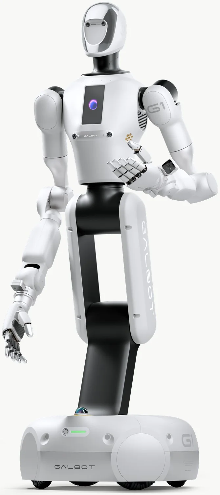

银河通用的本体是倒着设计的：先有大模型与数据，再决定机器人长什么样。所以它的主力机型长期是轮式的——G1 是四轮全向底盘加可升降躯干，S1 是重载轮式平台，都不追双足。理由很实际：便利店夜班、药房货架、电池厂线边，要的是 0 到 2.3 m 的垂直触达和 8 小时不断电，不是走路。直到 2026 年做 C 端演艺，它才补上第一款双足 ET1。

这也是它和星动、傅利叶最不一样的地方：**它几乎不谈关节**。官方参数页写底盘、写升降行程、写算力、写传感器布局，执行器层面只到"双臂负载"和"末端可换"，关节模组、编码器、减速器一概不展开。

## 公司与产品沿革

全称北京银河通用机器人有限公司，2023 年成立，创始人王鹤，北京大学前沿计算研究中心助理教授、斯坦福大学博士。技术主张是"合成仿真数据为主、真机数据为辅"的虚实融合训练，数据体系叫银河星坊（AstraSynth），模型体系叫银河星脑（AstraBrain），对外表述为把大脑、小脑与神经控制集成进一个全身端到端模型，下面再分 WAM（大脑）、WBC（小脑/全身控制）、Dex（灵巧操作）三支。[官网](https://www.galbot.com/)

2026 年 3 月完成 25 亿元新一轮融资，投资方包括国家人工智能产业投资基金（大基金三期）、中国石化、中信投资控股、中国银行、上汽集团金控、中芯聚源、亦庄国投等；这是国家大基金首次投具身智能赛道。同期公司称已获宁德时代、博世、丰田、北汽、上汽等客户合作，累计订单数千台——数字为公司口径。

<figure class="company-photo company-photo--portrait">

<figcaption>Galbot G1 轮式双臂机器人 · 图：<a href="https://galbot.com/g1">银河通用官网</a></figcaption>
</figure>

## 机型与公开规格

G1 与 S1 的数值取自官网规格表；ET1 取自发布时的公开参数页与媒体转述，三者口径不同源，不要混用。

| 机型 | 形态 | 公开规格 | 定位 |
| --- | --- | --- | --- |
| [Galbot G1](https://galbot.com/g1) | 轮式双臂 | 最高 1730 mm；92.5 kg；自由度 21（不含底盘与末端：颈 2、臂 7×2、腰 3、腿 2）；单臂 5 kg / 合计 10 kg；48 V 30 Ah、8 h、适配器充电 3.5 h；四轮全向、1.5 m/s；AGX Orin 64 GB / 275 TOPS；IP54；末端可换灵巧手、吸盘、夹爪 | 零售、即时零售仓、工业取放、家庭服务 |
| [Galbot S1](https://galbot.com/s1) | 重载轮式 | 1793 mm；320 kg；升降行程 750 mm；双臂最高 50 kg；触达 0–2.3 m；自由度：颈 2、臂 7×2、升降 1；48 V 30 Ah ×2，支持热插拔，满电 8 h；四轮转向全向底盘 730×730 mm | 工业重载搬运、高位货架取放 |
| Galbot ET1（银河星仔） | 双足人形 | 1.25 m、32 kg；基础版 26 自由度，专业版/旗舰版 38（加 12 自由度灵巧手）；RK3588 + RDK X5，专业版 Orin Nano 40 TOPS、旗舰版 NX 100 TOPS；IP54；7.9 / 13.9 / 17.9 万元三档 | 家庭陪伴、文娱演艺、门店接待 |

G1 有一处细节值得单独看：腕部配两个六维力传感器，末端可在灵巧手、吸盘、夹爪之间换。这说明它的操作精度责任有一部分压在末端与力控上，而不是靠关节做得很精。S1 的可动轴更少——双臂各 7、升降 1、颈 2，扛 50 kg 靠的是结构刚性与升降行程，不是靠堆自由度。

## 产业链角色

银河通用在公开材料里不打"自研执行器"这张牌。G1 与 S1 的底盘、升降立柱、双臂、关节模组是自制还是外部集成，官网没有写；编码器、减速器、电机同样没有披露。**从公开资料无法判断它的本体自研深度**，只能确认模型、数据与整机定义在自己手里。

唯一有明确外部指向的是 ET1：多家媒体报道其本体电机由宇树提供、与宇树联合开发，这条在公司官方参数页上没有标注，属媒体口径。如果属实，ET1 是"模型自研 + 本体借力"的样本，与它此前轮式机型的关系需要另看。

灵巧手方面，官方只写"可换"，不写自由度与传感器数量；2026 年央视春晚那台定制手被媒体描述为 22 自由度、30 余个电机，但这不是在售规格。

对上游的意义因此是反向的：这家公司买的是整机级的执行与结构能力，卖的是场景里的任务成功率。器件厂想进它的 BOM，谈判对手不是它的关节团队，而是它的整机集成团队。

场景侧的公开数据：银河太空舱便利店落地 40 余个城市、170 多个点位；即时零售仓在百家门店 7×24 小时值守超过一年半；工业端 S1 在宁德时代工厂常态化作业（均为公司或官网口径）。2026 年 9 月官网新闻披露落地上海老百姓大药房。这些数字反映的是运营密度，不是交付台数，两者不可互换。

## 官方资料

- [银河通用官网](https://www.galbot.com/)
- [Galbot G1 规格参数页](https://galbot.com/g1)
- [Galbot S1 规格参数页](https://galbot.com/s1)
- [G1 开发者文档（快速使用手册）](https://developer.galbot.com/docs/g1/2.2.4/zh/g1/)
