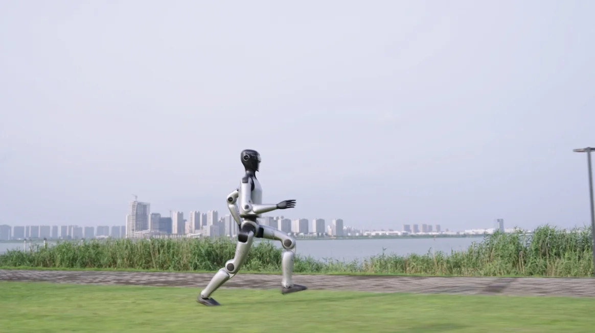

魔法原子走的是"先能造、再能用、最后能批量部署"的顺序，与只卖开发平台的同行不同：它的旗舰机 MagicBot X1 是 180 cm 的全尺寸双足本体，标称关节峰值扭矩 350 N·m 以上，第一条验证产线就是自家股东追觅的工厂车间。好处是有真实工位练手，代价是必须提前回答交付、维护与单机成本的问题。

## 公司与出身

工商主体为魔法原子机器人科技（无锡）有限公司，2023 年 12 月 18 日成立（工商登记 2024 年 1 月），注册地在江苏无锡梁溪区江海西路 98 号。公司由追觅科技生态孵化，创始团队核心成员此前参与过小米第一代 CyberDog（铁蛋）四足项目，2022 年底转向人形，2023 年初推出首台人形原型。团队规模在天使轮时约 100 人，研发占比超过 80%。

2026 年，公司成为中央广播电视总台春节联欢晚会的智能机器人战略合作伙伴，在同台表演的几家机器人公司中，官方强调自己是唯一同时"秀表演"和"能干活"的一家。[官网](https://www.magiclab.top/)

<figure class="company-photo company-photo--wide">

<figcaption>MagicBot X1 人形机器人 · 图：<a href="https://www.magiclab.top/">魔法原子官网</a></figcaption>
</figure>

## 产品线

官网当前的产品矩阵是：MagicBot X1（旗舰全尺寸人形）、MagicBot Z1（小尺寸高动态人形）、MagicDog Y1 与 MagicDog-W（四足）、MagicArm R1（柔性仿生力控机械臂）、MagicHand 系列灵巧手。早期以"小麦"为名的人形与 MagicBot G1，是 X1 之前的代次。

X1 的官方规格表如下（官网产品页，X1 与 X1 Ultra 两档）：

| 项目 | MagicBot X1 | MagicBot X1 Ultra |
| --- | --- | --- |
| 高×宽×厚 | 180×55.4×28 cm | 同左 |
| 整机重量 | 约 70 kg | 约 70 kg |
| 主动自由度 | 31（头 2／单臂 7／腰 3／单腿 6） | 31 |
| 臂展／单腿长度 | 158 cm／92 cm | 同左 |
| 峰值／极限关节扭矩 | ≥350 N·m／≥400 N·m | 同左 |
| 算力 | 八核 CPU + NVIDIA Orin NX | 八核 CPU（含开放开发核）+ 可选 AGX Thor 2070 TOPS |
| 二次开发 | 不支持 | 支持 |
| 电池 | 双电池、18 Ah、支持不关机快换 | 同左 |
| 感知 | 双目相机、头部与腰部 RGBD、激光雷达选配 | 同左 |

这张表最能说明定位的是最后两行：标准版不给二次开发权限，Ultra 版才开放开发核与 Thor 算力——标准版是给产线与商业场景用的封闭整机，Ultra 版是给集成商和研究者改的。

## 商业化：先在自己人的工厂里跑

2024 年 12 月，公司发布多台 G1 在电子厂产线协作的视频；此后人形机器人在追觅科技工厂承担上下料、质检、搬运、装箱等工序，是国内较早完成人形多机协作验证的团队之一。2026 年 3 月发起"千景共创计划"，目标在全球拓展 1000 家合作伙伴、1000 个落地场景，官方口径已有 20 余家来自汽车产业链、半导体、3C、医疗、核化领域的企业参与验证。

地域落地上，2026 年 4 月与无锡市政府达成战略合作，梁溪区与梁溪科技城给出首批数十台全尺寸人形的采购意向，双方预期未来在无锡实现万台级销售。海外侧与斯洛文尼亚邮政签约做柔性分拣；国内有大健康行业 1.5 亿元订单。这些数字都是公司口径，没有第三方审计数据可交叉核对。

融资方面，2024 年 12 月完成天使轮，2026 年 3 月完成 A 轮，汽车零部件企业拓普集团参投，官方表述是借此强化制造体系与量产能力；各轮金额公开渠道口径不一，此处不引用。

## 产业链角色

自研的比例是这家公司最爱讲的一点。公司口径是 90% 以上的硬件自研，包括关节模组、减速器、驱动器与主控系统。这个比例无法独立验证，但可以从侧面看：X1 的关节峰值扭矩、机身拓扑、双电池快换这些指标都是围绕自研关节设计的，如果关节靠外购，很难在 70 kg 的机体上同时做到 350 N·m 峰值和 180 cm 身高。

外购的部分，官网规格表明确写了 AI 算力用 NVIDIA Orin NX，Ultra 版可选 Jetson AGX Thor（2070 TOPS）；双目相机、头部与腰部 RGBD、激光雷达属于外购件，官网未列型号。**关节内的编码器、电机磁钢、谐波减速器供应商没有公开披露。**

一个值得记录的技术判断：在人形本体之外，公司把机械臂（MagicArm R1）单独做成产品线。这既是对"上半身先落地"的务实承认，也意味着它的竞争对手不只是人形公司，还包括协作机器人厂商。

## 官方资料

- [魔法原子官网](https://www.magiclab.top/)
- [MagicBot X1 规格参数表](https://www.magiclab.top/x1)
- [资讯：千景共创计划与产业落地](https://magiclab.top/news/38)
- [资讯：大健康行业 1.5 亿元订单](https://www.magiclab.top/news/63)
- [资讯：2026 年央视春晚战略合作](https://www.magiclab.top/news/56)
