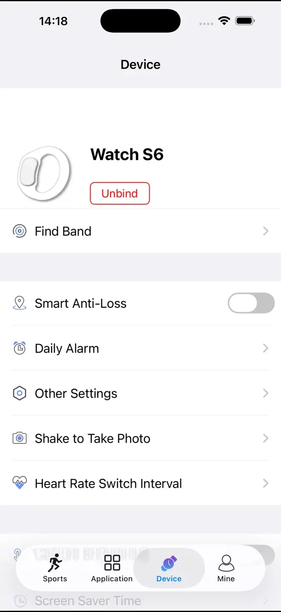

深圳市龙图信泰电子有限公司是 **Powerband** 的开发者。Powerband是一款智能手环、手表的配套手机应用，在iPhone和Android平台提供设备连接与活动数据展示。

## Powerband

Powerband面向兼容的手环和手表，主要功能包括步数统计、睡眠信息和心率数据展示，帮助使用者查看日常活动及运动记录。设备管理功能还包括查找手环、日常闹钟、摇一摇拍照等。

<figure class="company-photo company-photo--screen">

<figcaption>Powerband设备管理界面 · 图：<a href="https://apps.apple.com/cn/app/powerband/id1327357122">App Store</a></figcaption>
</figure>

## 资料来源

- [Powerband：Apple App Store](https://apps.apple.com/cn/app/powerband/id1327357122)
- [Powerband：Google Play](https://play.google.com/store/apps/details?hl=en&id=com.longtxt.com.cn.powerband)
