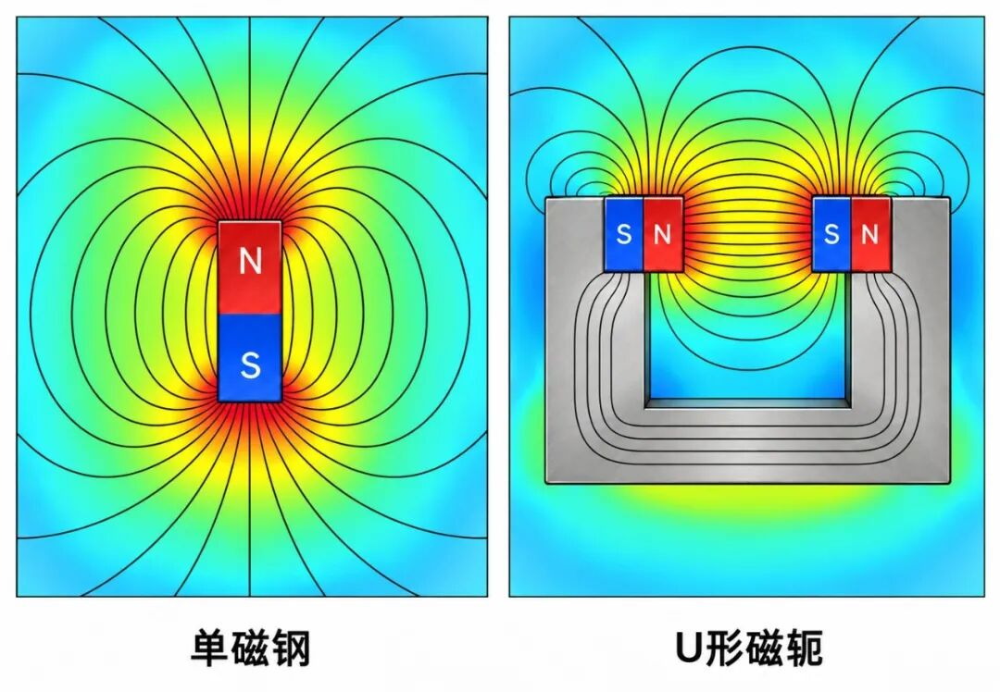
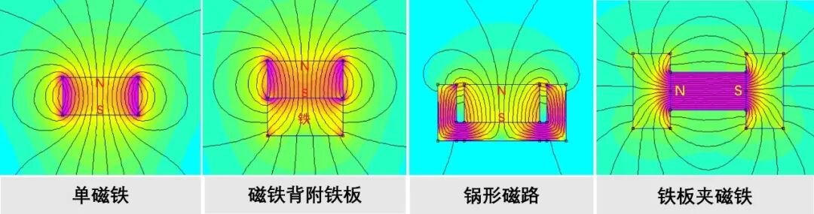
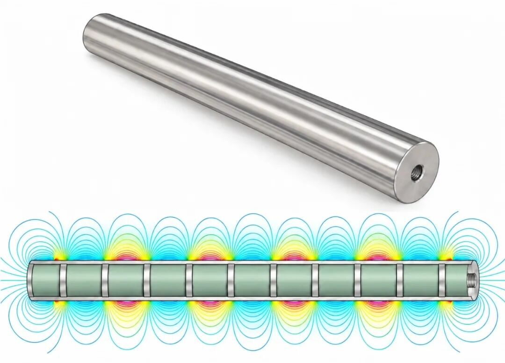
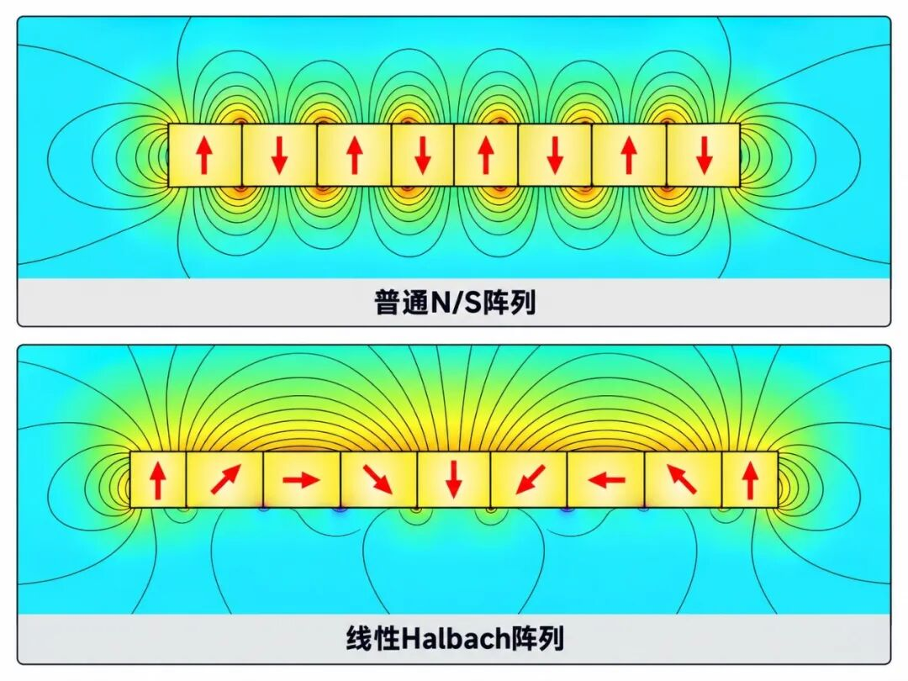
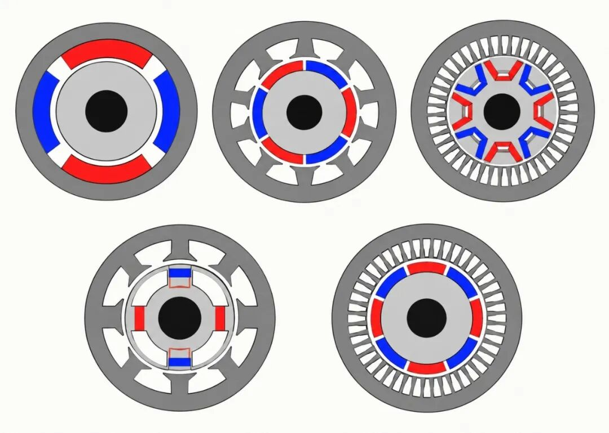
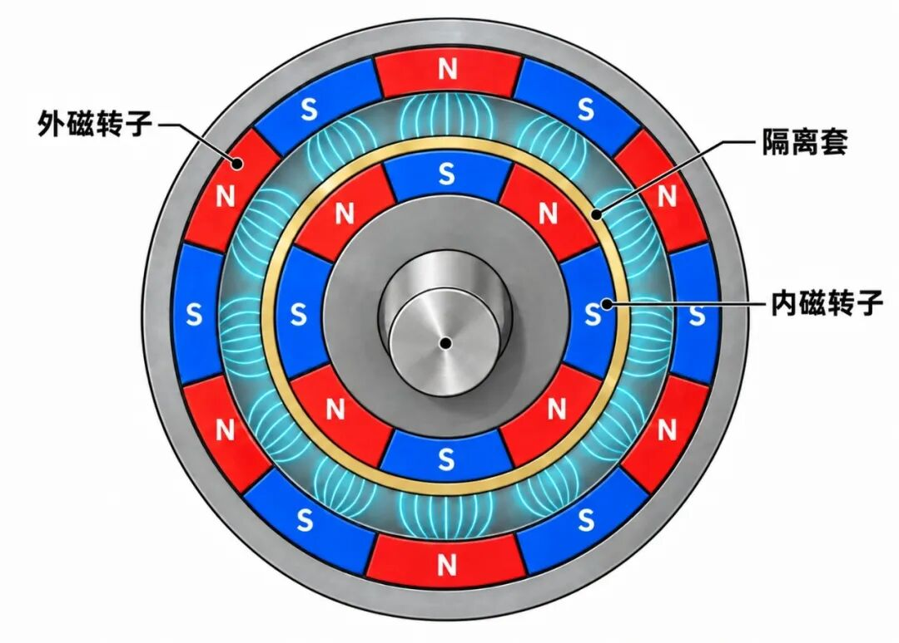
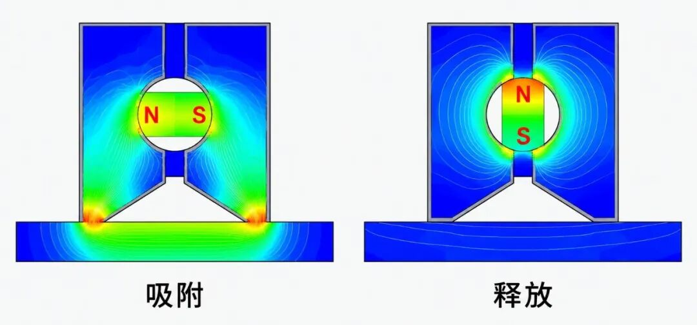
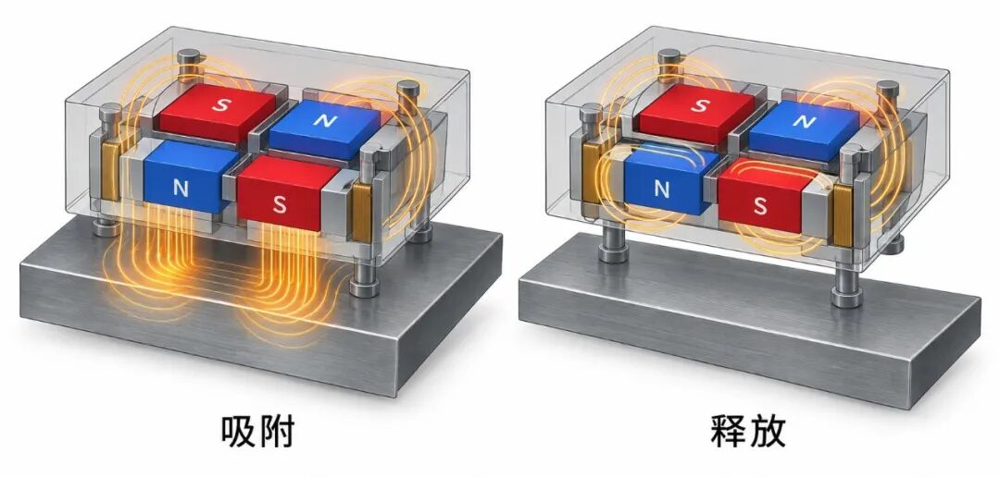
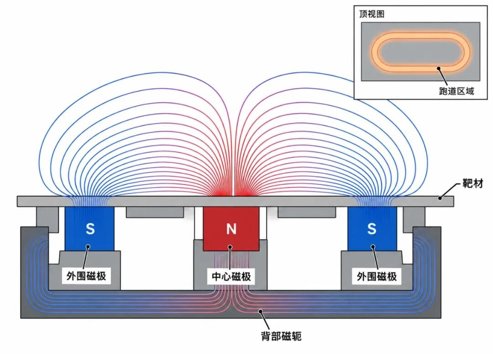
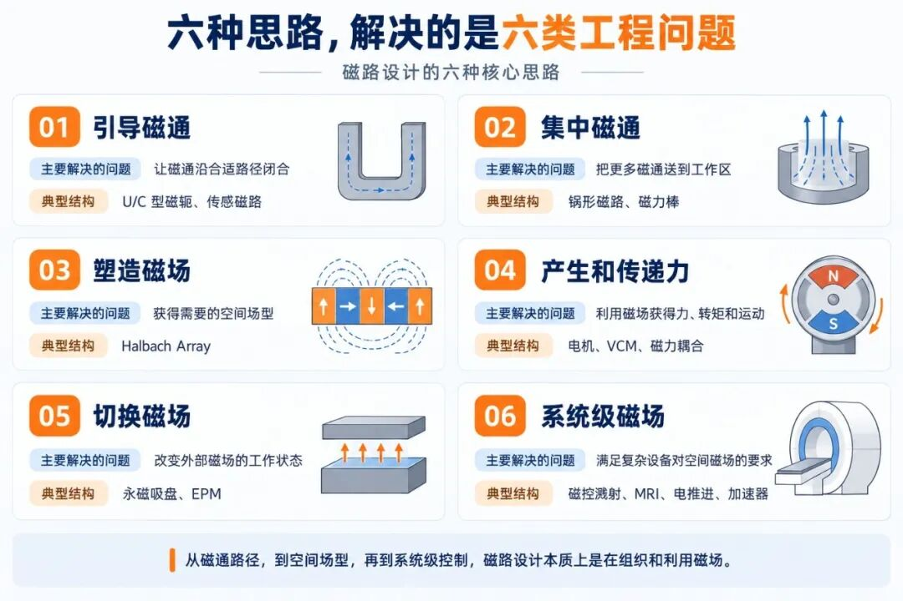

一块永磁体做好以后，它的材料、尺寸和磁性能也就基本确定了。

但把同一块磁铁装进不同的结构里，得到的结果可能完全不同。

它可以直接吸附工件，也可以配上背铁、装进钢壳；几块磁铁可以简单地N、S交替排列，也可以改变充磁方向组成 Halbach 阵列；再配合磁轭、极靴、气隙和机械结构，还可以产生转矩、推力，甚至实现磁场的开和关。

进入磁组件设计以后，问题也就从“这块磁铁有多强”，逐渐转向：

**怎样把磁体产生的磁通组织起来，让它在需要的位置，以需要的方向和强度发挥作用。**

这就是磁路设计。

从这个角度观察各种永磁产品，会发现许多看起来完全不同的结构，反复在应对几类相似的问题：引导磁通、集中磁通、塑造磁场、产生和传递力、切换磁场，以及在复杂设备中控制更大范围的空间磁场。

下面六类思路，是我们结合长期面对永磁产品和磁组件的经验，对常见磁路设计方法做的一次工程归纳。

**引导磁通：让磁通走到该去的地方**

最基础的磁路设计，是给磁通安排一条合适的闭合路径。

永磁体提供磁动势，铁、低碳钢等高磁导率材料则为磁通提供相对低磁阻的通路。

一块磁铁单独放在空气中，磁通从一个磁极出来以后，会经过周围空间返回另一个磁极，其中相当一部分没有经过工作区域，这就是**漏磁**。

增加磁轭以后，情况就会发生变化。

例如常见的U形磁轭，可以让更多磁通沿导磁材料闭合，只在预先设计好的工作气隙中跨过空气，减少无效漏磁，把更多磁通引到需要磁场的位置。

**单磁铁与U形磁轭的磁场分布对比**

这类结构广泛存在于吸附、传感以及各种需要在固定气隙中建立稳定磁场的产品中。

看起来只是“给磁铁加块铁”，实际设计时还要注意磁轭局部是否进入饱和。截面太小，磁通容易在局部受限；一味增加磁轭厚度，又会带来尺寸、重量和成本问题。

**所以引导磁通的关键，是让磁通顺利通过需要的路径，而不是简单增加导磁材料。**

**集中磁通：把有限磁通集中到工作区域**

引导磁通解决的是“磁通走哪条路”，进一步还可以考虑：怎样让更多磁通落在工作面上，又称为聚磁。

锅形磁铁就是一个很直观的例子。

一块圆片磁铁直接吸附钢板时，一部分磁通需要经过周围空气返回另一极。把它装进钢制杯壳以后，杯壳会把背面和侧面的磁通引到外圈，使中心磁极和外圈磁极同时出现在工作面附近。

于是，磁通可以经过被吸工件，更多进入了工作区域。

**磁铁没有变化，改变的是磁通走的路。**

单磁铁/背铁/锅形磁路/铁板夹磁铁磁场分布对比

这就是典型的集中磁通思路：磁铁本身没有变化，通过增加导磁结构，重新组织磁通路径，提高工作区域内磁场的利用率。

实际应用中，这种结构通常对工作气隙比较敏感。涂层、胶层、表面不平整和装配间隙都会增加磁阻，因此设计时仍要按照真实使用状态评估性能。

磁选设备里的磁力棒同样在集中磁通，但它追求的不只是某一个位置的高表磁。

磁力棒内部通常由多片永磁体和导磁极片交替组合，在不锈钢管表面形成多个强磁场和高梯度区域。

磁力棒剖面结构及表面磁场分布

对于细小铁磁颗粒来说，磁感应强度和磁场梯度都很重要。因此，只比较磁力棒表面的最高表磁数值，并不能完整反映它的捕获能力。

集中磁通要解决的，**是把有限的磁通尽量送到最能发挥作用的位置**。

**塑造磁场：让磁场形成需要的空间分布**

单块磁铁的磁场分布，主要由自身几何形状和充磁方式决定。如果这种天然场型不能满足要求，就可以把多块磁体组合起来。 不同磁体产生的磁场具有方向，在空间中既可以相互增强，也可以局部抵消。只要设计好每块磁体的位置和磁化方向，就有可能得到单块磁铁无法形成的空间磁场。 Halbach Array，也就是海尔贝克阵列，是其中最典型的结构之一。 它让相邻磁体的磁化方向按照一定规律逐步旋转，使磁场在阵列一侧相互增强，而另一侧明显削弱。 常见的离散线性Halbach阵列可以采用90°磁化方向步进；增加分段数以后，步进角还可以减小到45°或更小，使实际磁化分布更接近理想的连续旋转状态。 分段越细，磁化方向的种类、装配和极性防错也会更复杂，因此实际设计通常要在场型改善和制造难度之间取一个平衡。

普通N/S交替阵列与Halbach阵列磁场分布对比

Halbach结构的核心价值在于改变磁场的空间分布：一侧增强，另一侧削弱。原本会向两侧扩展的磁场，通过不同磁化方向的组合，被更多地重新分配到需要的一侧。 这类结构已经广泛用于直线电机、高速永磁转子、磁悬浮机构以及各种需要特殊场型的磁组件。 到了这一层，工程师开始直接设计工作空间里的磁场分布。

**产生和传递力：让磁场变成运动**

很多磁路最终不是为了得到一个静止的磁场，而是要把磁场转化为力、位移或者转矩。 永磁电机是最常见的例子。多块磁铁按照一定极数排列在转子或定子上，与绕组产生的电磁场相互作用，形成持续转矩。磁铁位置、极数、气隙和磁轭结构，都会影响气隙磁场分布，进而影响转矩、效率和运行稳定性。

永磁电机典型磁路结构

磁力耦合器则把“力的产生”进一步变成“力矩的隔空传递”。 典型磁力耦合器由内、外两组磁转子组成，中间隔着非磁性隔离套。外转子由电机驱动，磁场穿过隔离套作用于内转子，从而在没有机械轴直接贯穿壳体的情况下传递转矩。

磁耦合内外磁转子结构

这类设计的共同点，是磁场必须和机械结构一起考虑。气隙越大，磁场耦合通常越弱；磁铁排列、导磁结构和运动部件尺寸，也会同时影响磁性能和机械可靠性。 以磁力耦合器的隔离套为例，它越薄，内外磁转子之间的有效磁间隙越小，有利于传递转矩；但隔离套同时还要承担承压、密封和安全功能。 所以这一类磁路的重点，是让磁场在合适的气隙中产生稳定、可用的力和转矩。

**切换磁场：让永久磁场也能“开”和“关”**

永磁体可以长期保持磁性，这是它很重要的优势。 但在吸持、夹具和自动化抓取中，还会遇到另一个问题：吸住工件以后，还要把它放下来。 机械式永磁吸盘采用的办法，是改变磁通路径。 吸附状态下，磁通经过极面和工件形成外部闭合回路，工作面产生较强吸力；转动内部磁体或者改变磁体与磁轭的相对位置以后，大部分磁通改为在吸盘内部闭合，工作面的外部磁场随之显著降低。

永磁吸盘吸附/释放两种状态的磁力线对比

整个过程中，永磁体本身始终保持磁化状态。磁场的“开关”，实际上做在磁路上。 另一种方案是电控永磁，通常利用矫顽力差异较大的两类永磁材料，一些典型结构会组合使用高矫顽力的钕铁硼和较低矫顽力的铝镍钴。 线圈在切换瞬间通入短脉冲，使较低矫顽力磁体改变磁化方向，而高矫顽力磁体保持原来的磁化状态。两组磁体的相对磁化方向发生改变以后，整体磁通便可以在外部工作回路和内部闭合回路之间重新分配。

电控永磁两种磁化状态及磁通路径 切换完成后，线圈即可断电，新的状态由永磁材料自身保持。这种方式省去了持续供电，但切换脉冲、线圈设计和磁体状态一致性也提出了更高要求。

**系统级磁场：让磁场服务于复杂设备**

前面五类讨论的是较常见的磁路设计任务。 进入半导体、医疗、航天以及大型科研设备以后，这些方法会相互组合，设计对象也从局部工作面逐渐扩展到更复杂的二维和三维空间磁场。 磁控溅射就是一个典型例子。 在平面磁控靶和旋转磁控靶中，永磁体通常布置在靶材背后，通过不同磁极、磁铁和导磁结构的组合，在靶面附近建立特定的磁场。 电子在电场和磁场共同作用下被约束在靶面附近，运动路径延长，与工作气体发生碰撞电离的机会增加，从而提高靶面附近的等离子体密度和溅射速率。

平面磁控靶磁路与跑道磁场分布

实际设计中，磁铁的位置、极性、尺寸、磁轭结构，以及内外磁极之间的平衡关系发生变化，靶面上的磁场轮廓和跑道位置也会随之改变。 因此，这类磁组件往往需要结合磁场仿真、结构设计和样机测试不断调整。仅凭经验排列磁铁，很难同时兼顾场型、结构和实际工况。 再把视野拉远一些，磁场设计的应用范围还要大得多。 核磁共振MRI需要在较大的成像空间内建立稳定、受控的磁场；一些航天电推进装置利用磁场约束电子，并与电场共同建立所需的放电和加速条件；大型粒子加速器则用二极、四极以及更高阶磁体改变和约束高速粒子束。 这些设备已经进入各自高度专业化的工程领域，但从磁路角度看，设计对象都在不断扩大： 从一个磁组件内部的磁通管理，延伸到对复杂空间磁场的系统级控制。

**结语：设计磁铁之前，先想清楚磁通怎么走**

做永磁产品时，材料牌号当然重要。 但它只决定了我们手里有什么样的磁体。进入磁组件设计以后，还要继续考虑磁通怎样组织、工作区需要什么样的场型，以及这些磁场怎样与实际结构配合。 当性能瓶颈来自磁路结构时，直接把N35 换成N52，提升可能很有限。重新安排磁通路径、优化工作气隙或调整磁极和磁轭结构，往往更有效，也可能减少对高牌号磁材和磁铁体积的依赖。 同样几块永磁体，改变磁路结构，就可能成为完全不同的产品。
