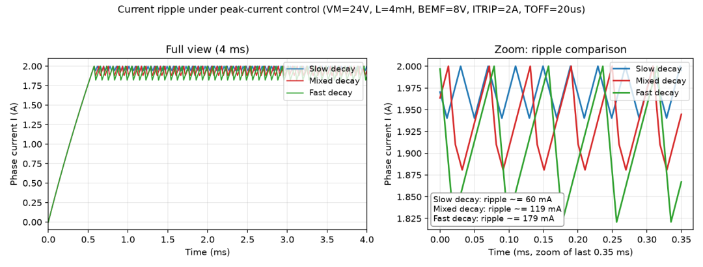
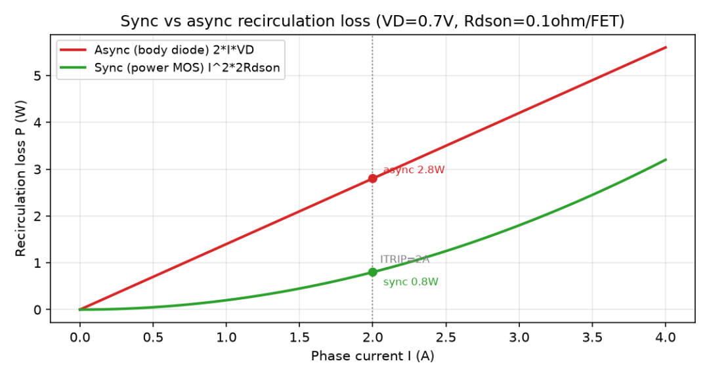
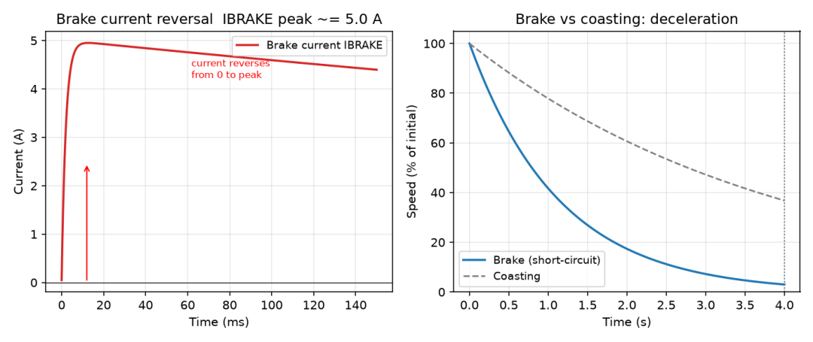

续流、衰减模式、刹车——把 TI 应用笔记 ZHCAA31 读透，再用仿真把每个结论复现一遍，这几个地方你就再也不会翻车。

封面图

## 一、先说三个真实场景

**场景一**：24V 代步车控制器，满速行驶瞬间切刹车，相电流采样瞬间报过流，MOS 炸了一只。回头测驱动波形，时序一点毛病没有。

**场景二**：步进电机低速细分运行，嗡嗡的啸叫换了两颗驱动芯片都压不下去，最后发现是衰减模式没选对。

**场景三**：有刷电机驱动，正常运行电流不到 1A，刹车瞬间电流反打到 6A——不是表坏了，是电流真的反向冲了 6 倍以上。

这三个坑的根因是同一件事：**电流续流（Current Recirculation）**。PWM 关断之后的几十微秒里，电感电流从哪条路走、以什么斜率衰减，决定了你的纹波、噪音、损耗，还有刹车那一下炸不炸管。

TI 有一篇被严重低估的中文应用笔记——**ZHCAA31《精通电机驱动的电流续流、衰减模式和刹车》**（戴观祖，即英文版 SLVA321），10 页纸把这件事讲透了。这篇我把它拆开重讲，每个结论配仿真，再把 ST 那边的对应方案拉出来对照。

## 二、续流的本质：电感的"倔强"

电机绕组 = 内阻 R + 电感 L + 反电动势 BEMF。驱动阶段（AH、BL 导通）：

**VM = I·R + L·(di/dt) + BEMF**

现在把所有管子关掉。电感电流不能突变，`L·di/dt` 会顶出一个巨大的感应电压，直到把 MOS 的体二极管顶穿——电流必须给它一条路，这条路就是**续流**。

续流路径只有两种：

| 路径 | 电流走向 | 损耗 |
|---|---|---|
| **异步续流**（走体二极管） | 经体二极管从地回到 VM | 2·I·VD，压降大、损耗大 |
| **同步续流**（走 MOS 管） | 主动打开对管，走 Rdson | I²·2Rdson，一般小得多 |

异步续流是"被动兜底"——死区时间里、以及全关时，电流只能走体二极管。同步续流是"主动开门"。**同步整流的本质，就是用 Rdson 替换掉 VD 那个恒定压降。**

同步vs异步损耗

仿真算一笔账（VD=0.7V，Rdson=0.1Ω/管）：2A 时异步续流损耗 2.8W，同步只有 0.8W，差 3.5 倍。

这里有个反直觉的细节：两条损耗曲线存在交叉点 I = VD/Rdson。用分立功率管（Rdson≈5mΩ）时交叉点高达 140A，工程上永远同步占优；但用集成驱动（Rdson 百毫欧级）时交叉点只有几安，大电流下体二极管反而更省——当然实际没人这么用，因为同步续流还有避免二极管反向恢复的好处。知道这个交叉点存在，比记住"同步更省"更重要。

## 三、慢 / 快 / 混合衰减：公式 + 一张表

续流期间电流怎么衰减，就是**衰减模式（Decay Mode）**。三种模式的斜率，从等效电路直接写出来：

| 阶段 | 管子状态 | 电流斜率 di/dt |
|---|---|---|
| 驱动 Driving | AH、BL 导通 | +(VM − I·R − BEMF)/L |
| **慢衰减** Slow | 双低侧（AL、BL）导通 | −(I·R + BEMF)/L |
| **快衰减** Fast | 斜对角（BH、AL）导通 | −(VM + I·R + BEMF)/L |
| **混合** Mixed | 先快 TDECAY，再切慢 | 介于两者之间 |

看慢衰减：回路里没有电源，BEMF 和 I·R 都是"消耗项"，斜率最小。看快衰减：电源反接，VM 和 BEMF 同向压电流，斜率最大。代个典型数（VM=24V，BEMF=8V，I·R=4V）：快衰减斜率是慢衰减的 36/12 = 3 倍。

配套的四个时间参数（TI 笔记里的关键变量）：

**ITRIP**：电流阈值，到了就关断进入续流

tBLANK：消隐时间，遮住开通瞬间的电流尖峰毛刺，同时是最小 ON 时间

**tDRIVE**：驱动阶段时长

**tOFF**：续流时长，tDRIVE + tOFF = PWM 周期

| 指标 | 慢衰减 | 快衰减 | 混合衰减 |
|---|---|---|---|
| 电流纹波 | 小 | 大（约 3 倍于慢） | 适中 |
| tOFF | 长，低频颤动可闻 | 短，开关损耗增加 | 适中 |
| 电流下降速度 | 慢，可能扭曲正弦波形 | 快，适合下降期 | 较快 |
| 适合电机 | 小电感 | 大电感 | 折中 |
| 适合阶段 | 电流上升期 | 电流下降期 | 下降期替代 |

慢衰减适合上升期、快衰减适合下降期——这不是玄学。上升期你希望电流平稳爬升、纹波小，慢衰减正好；下降期你要电流快速跟上 ITRIP 的下台阶，慢衰减的"拖泥带水"会把正弦波尾巴拖变形（细分精度就是这么丢的），快衰减或混合衰减才跟得上。TI 的 DRV8889-Q1 直接把这个经验固化成了 slow-mixed 模式：上升期慢衰减、下降期混合衰减。

## 四、仿真复现：纹波真的差 3 倍

按上面的模型搭了个 Python 仿真：VM=24V，L=4mH，BEMF=8V，ITRIP=2A，tOFF=20μs，峰值电流控制。

三种衰减模式纹波对比

稳态纹波：**慢衰减 60mA，混合衰减 119mA，快衰减 179mA**。右图放大后看得非常清楚：慢衰减的锯齿最浅，快衰减最深，混合衰减正好卡中间——和公式推出来的 3 倍关系完全一致。

调步进细分、调低速平稳性的，这张图就是你的调参地图：**纹波压不下去，先看衰减模式，再怀疑别的。**

## 五、刹车：和续流完全是两码事

最容易混淆的地方来了。**续流是 PWM 周期内的事，单位是微秒；刹车是系统级的事，单位是秒。** 续流那 50μs 里转速根本没变，BEMF 当常数处理；刹车全程转速在掉，BEMF 一直在降。

**惯性运转（Coasting）**：全桥关断。续流结束后绕组彻底开路，BEMF 无处释放，只能靠摩擦慢慢停下来——电刹车等于没有。

**刹车（Braking）**：双低侧导通并保持住。过程分两幕：

**第一幕**：相电流按慢衰减续流到 0（可能跨好几个 PWM 周期）。

第二幕：真正的刹车。BEMF 通过低侧回路形成发电机电流，方向与驱动电流相反：

**BEMF = L·(di/dt) + I·R → IBRAKE(max) = BEMF / R**

因为电感的存在，这个电流是阻尼式冲上去的。关键是这个数有多大：高速时 BEMF≈VM，刹车前驱动电流 IDRIVE=(VM−BEMF)/R 非常小，而 IBRAKE=BEMF/R 非常大——**两者差几倍到十几倍都正常**。TI 笔记里的实测波形：不到 1A 反冲到约 6A。

刹车动态仿真

我按 J=0.002 kg·m²、Ke=0.05、ω₀=200rad/s 仿真：刹车电流约 10ms 冲到 **4.95A（正好 BEMF/R=10/2）**，然后随转速衰减；右图能看到短接制动比惯性运转减速快得多，而且刹车结束后还有保持力矩（R 越小，保持力越大）。

三个必须写进设计评审的坑：

1. **OCP 阈值校核**：刹车电流按 IBRAKE=BEMF_max/R 算，别按运行电流算。很多"刹车报过流"就是 OCP 阈值按 IDRIVE 设的。

2. **MOS SOA**：刹车电流走的是 Rdson 回路，瞬时 6A/10A 的冲击要查单脉冲雪崩和结温。

3. **母线泵升**：三相 FOC 减速是再生制动，动能回灌母线，电容耐压和 OVP 点要留量，否则"一刹车就过压保护"。这在长下坡的代步车场景是实打实的安全项。

## 六、再往下挖一层：衰减模式的能量流向

这是原笔记没点透、但最值钱的一层：

慢衰减 = 能耗制动。绕组短接，电感能量和 BEMF 动能全部烧在铜线和 MOS 上。所以慢衰减"电流衰减慢"，但电机减速快——它本质就是持续微秒级的短路刹车。

快衰减 = 能量回收。电流被反压抽回母线，给电容充电，绕组电流快速卸掉，转矩消失，电机滑行。

所以"快/慢"说的是电流衰减快慢，不是车速。名字里的快慢和减速快慢正好相反——慢衰减才是更狠的刹车。想通这一点，场景一炸管的原因就清楚了：高速切刹车 = 瞬间把 BEMF≈VM 的电机短路，IBRAKE=BEMF/R 直接顶到 OCP。

## 七、TI 和 ST 各自怎么工程化

**TI 路线：把衰减模式做成自适应**

SLVA321/ZHCAA31：本文的理论底稿（异步/同步续流、三种衰减、tBLANK/tOFF 体系）

DRV8889-Q1 等：8 种衰减模式，其中 **Smart Tune Dynamic Decay** 固定 tOFF、每个 PWM 周期动态调整快衰减占比；**Smart Tune Ripple Control** 设 ITRIP+IVALLEY 双阈值滞环、tOFF 可变，纹波最小、噪音最低。这两招把"手工调混合衰减占比"彻底自动化，还顺带用 BEMF 相位差做了堵转检测。

**ST 路线：两条腿走路**

**AN4144（L6470 电压模式驱动）**：干脆不采电流，按占空比开环调制 + BEMF 补偿。省掉采样电阻，代价是参数整定敏感——笔记里明说：整定错了会失步、过流、噪音变大。

AN4158（L6472）：峰值电流控制 + 自动衰减调整 + 预测电流控制，和 TI Smart Tune 思路殊途同归。

AN6018：专讲一个实战坑——低电感、高压差工况下驱动阶段短于最小导通时间，峰值电流控制直接失控。对策是降载波频率、优化采样。这就是 tBLANK=最小 ON 时间在真实项目里咬人的样子。

**X-CUBE-MCSDK**：FOC 侧的再生制动处理给了两条路——泄放电阻（如 STEVAL-IHM023V3 电源板）和相短接刹车，正好对应本文第五节说的母线泵升问题。

两家思路其实一致：**固定的慢/快/混合衰减只够"能用"，要"好用"就得让衰减模式随电流上升/下降期、随转速自适应。**

## 八、落地清单

拿去直接对着设计评审勾：

| 场景 | 动作 |
|---|---|
| 低电感小电机（代步车/风扇类） | 慢衰减为主，重点核算 tBLANK 占空比损失 |
| 大电感步进 + 高细分 | 混合/自适应衰减，盯正弦波下降沿是否变形 |
| 刹车功能 | 按 IBRAKE=BEMF_max/R 校核 OCP 与 MOS SOA，留 30% 以上余量 |
| FOC 减速/下坡 | 校核母线泵升，配泄放电阻或能量回馈路径 |
| 低速噪音 | 先查衰减模式×PWM 频率组合，再查机械 |
| 参数辨识完的 FOC 电流环 | tBLANK/tDRIVE/tOFF 与采样时刻对齐，避开开关毛刺 |

## 参考资料

1. TI ZHCAA31《精通电机驱动的电流续流、衰减模式和刹车》（戴观祖，2020.9）——本文蓝本，即 SLVA321 中文版

2. TI SLVA321A *Current Recirculation and Decay Modes*（含 2.4 Smart Tune：Dynamic Decay / Ripple Control） https://www.ti.com/document-viewer/lit/html/SLVA321A/

3. TI SLYY099A *Getting Smart About Tuning Your Stepper Motor*（Smart Tune 白皮书）

4. TI DRV8889-Q1 数据手册（8 种衰减模式、Smart Tune、tBLANK 参数表）

5. ST AN4144 *Voltage mode control operation and parameter optimization*（DocID023491 Rev 3，L6470） https://www.st.com/resource/en/application_note/an4144-voltage-mode-control-operation-and-parameter-optimization-stmicroelectronics.pdf

6. ST AN4158 *Peak current control with automatic decay adjustment and predictive current control*

7. ST AN6018 *How to implement a peak current control avoiding minimum-on-time limit*

8. ST AN4241 *L6470 and L6472: fully integrated stepper motor drivers*

9. ST X-CUBE-MCSDK 用户手册：Dissipative brake resistor / Motor phases short-circuiting（实测见 STEVAL-IHM023V3 电源板） https://community.st.com/t5/stm32-mcus-motor-control/regenerative-brake-understanding/td-p/831040

*本文仿真脚本（Python + numpy/matplotlib）可在后台回复「续流仿真」获取。*
