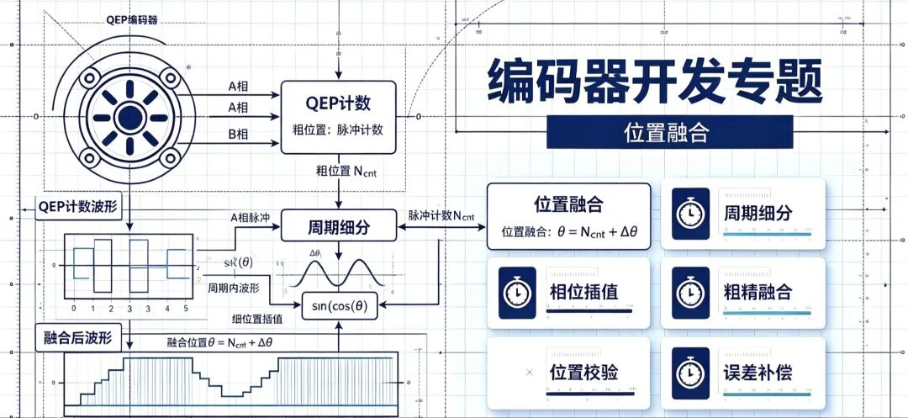
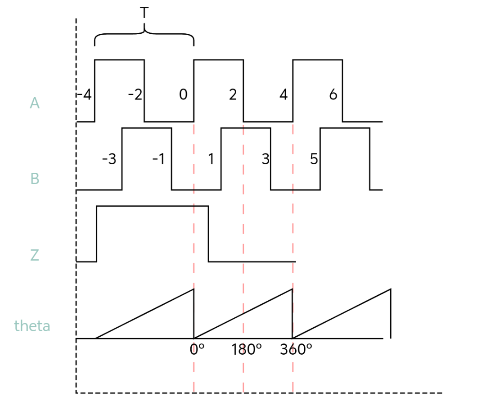
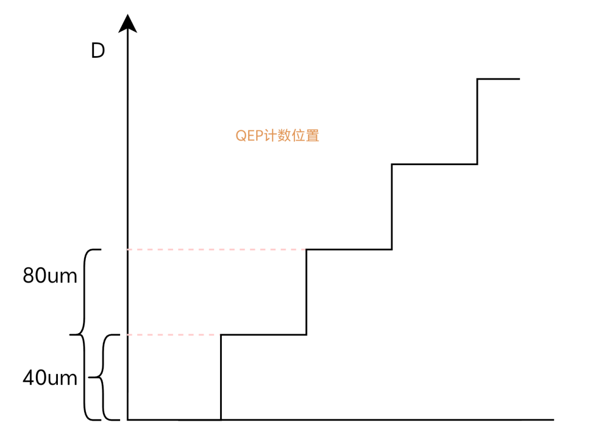
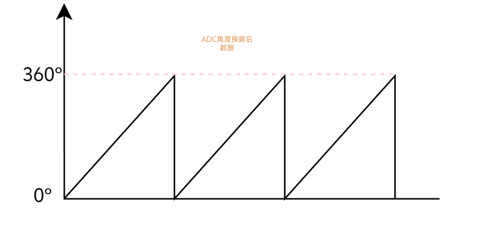
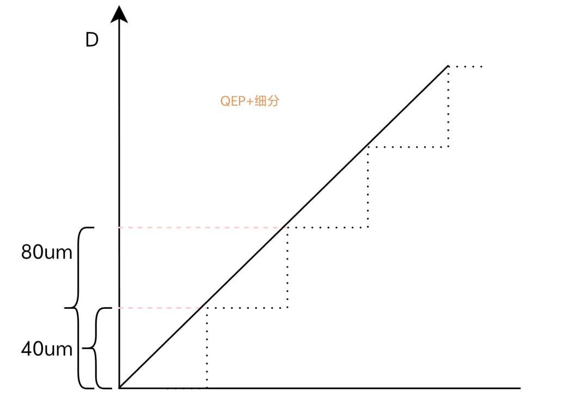
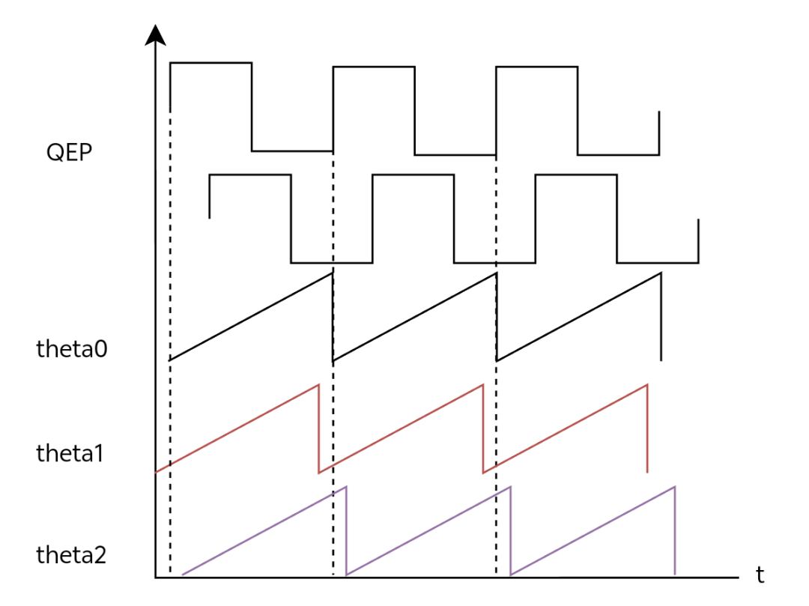
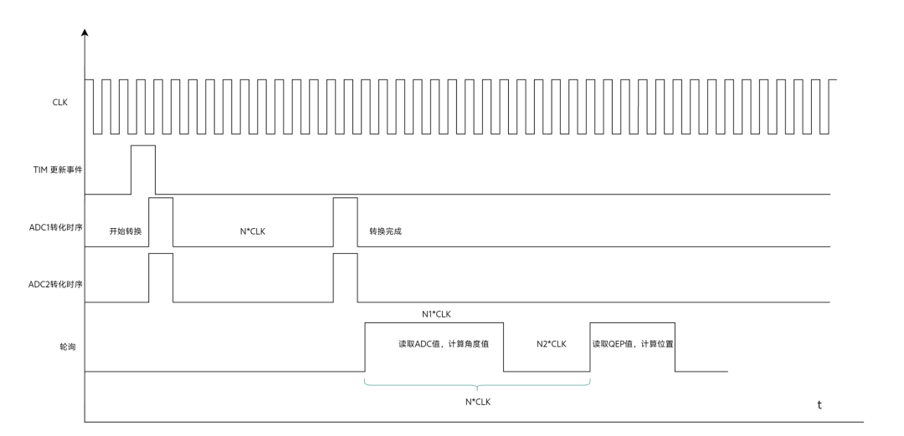
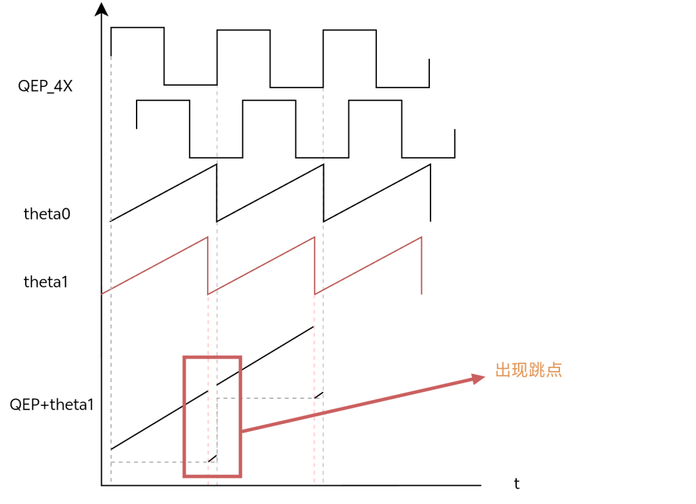
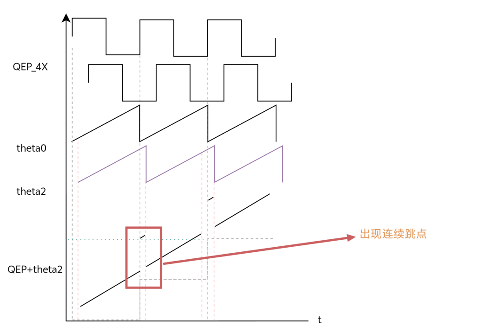
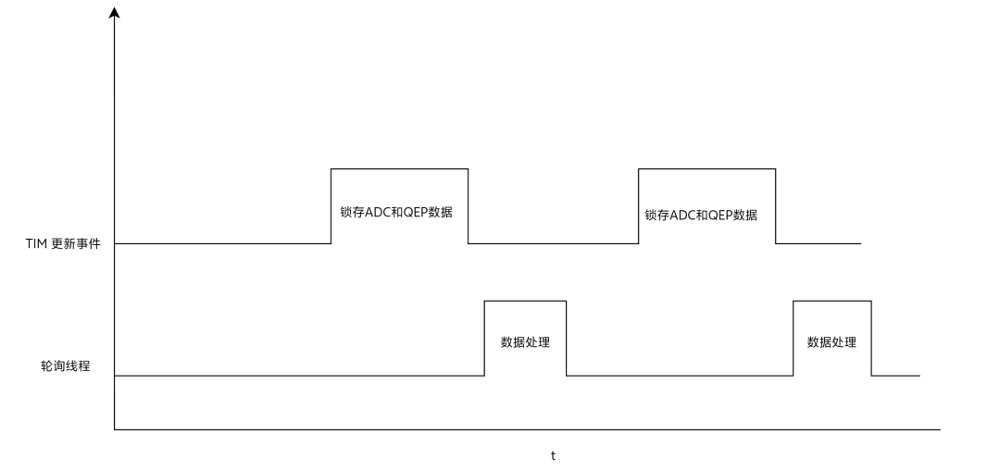

前言:本章主要介绍QEP计数+细分位置的融合，Z信号问控处理，数字滤波，边界位置跳点处理。

应用场景:增量式光栅尺，光电编码器等。

在之前的文章中已经介绍了QEP计数和周期内细分，在实际的应用中往往这两者需要配合计算位置。

那我们先来看下QEP计数的位置处理，如图所示正常情况下AB相会是正交的方波输入，MCU/DSP/FPGA对齐边沿计数（而通常为了提高分辨率会4X计数）。

图1 ABZ时序图

实际情况下一个周期T的宽度，对应的物理宽度是一个栅距D比方说40um。现在我们假定QEP_COUNT为方波的计数总和，QEP_POISITION为对应的物理位置，那么就有QEP_POISITION = (QEP_COUNT/4)*D，如图2所示。

图2 QEP位置图

有了QEP_POISITION之后相当于有了粗略的位置，当然这个精度是远远不够的。这时候软件细分就发挥作用了，如图3所示。

图3 软件角度细分

聪明的你肯定想到了，当前实际位置=图2+图3，即得到图4.

图4 QEP+细分

到这里你以为大功告成？然而实际的情况是残酷的，我们理论计算数据时默认数据都是绝对的同一时刻t的，而现实世界里是不存在“同时”这一说法的。以MCU为例子，我们拿到的ADC值、计算角度值和QEP计数值是存在不同步的，如果你是普通的轮询思路（读取ADC->计算角度->读取QEP值->位置融合），乍一看没啥问题，实际你会死的很惨！这样说估计不是很直观，用一张图片来表示会清晰点。

图5 实际时序图

图5中theta0是我们理想的细分角度和QEP的同步时序，而实际情况确实theta1/theta2的时序，为啥呢？

图6 MCU处理数据简易时序图

图中可以看出角度数据和QEP数据是存在时移t的，搞清楚不同步的原因，我们在看看会带来什么影响呢？以图5中的theta1（红色标记）为例QEP数据要比ADC数据相位超前，这样我们在相加数据后图形就会变成图6。

图7 数据不同步融合

图8 数据不同步融合

OK，现在知道了为啥数据不同步以及不同步后会带来怎样的后果。那么又该如何解决呢？这个问题要真的解决好还是不容易的，我们先不考虑噪声的因素，先来看看同步的问题如何解决。

之前分析原因可以总结成两方面：

底层硬件，ADC采集数据和QEP计数，QEP计数一般方案里都是交给硬件去做的。

上层软件，获取ADC和QEP计数以及后续的数据处理。

其最关键的就是获取ADC数据和QEP数据，如果你再轮询线程里先获取ADC再获取QEP，亦或是先获取QEP再获取ADC，那么天然的就形成了不同步。

首先我们需要调整处理逻辑，获取ADC数据&QEP数据->最后一起处理数据，减少逻辑上的引入的不同步。其次放弃在轮询线程里获取数据的思路，在MCU里可以想到的就是利用硬件定时器了，在硬件触发事件里去“快照”锁存数据很大程度上提高同步性，而轮询线程里做数据处理如图9所示。

做完硬件上的同步锁存看似就可以了？但往往现实是更加的复杂，单单靠硬件的同步依旧还是不行的，只能很大程度上减少跳点的出现。所以在软件层面我们还是需要添加补偿算法去实时的校准当前的数据，如果大家细心点就能发现跳点大概率出现在边界位置，针对这个边界位置我们可以通过ADC处理后的角度数据（也就相位），软件校准QEP计数。

具体如何补偿以及校准，还有不要忘了噪声还没考虑呢？为避免篇幅过长这些内容将在下一章篇幅和大家分享，希望各位道友多多关注，谢谢！
