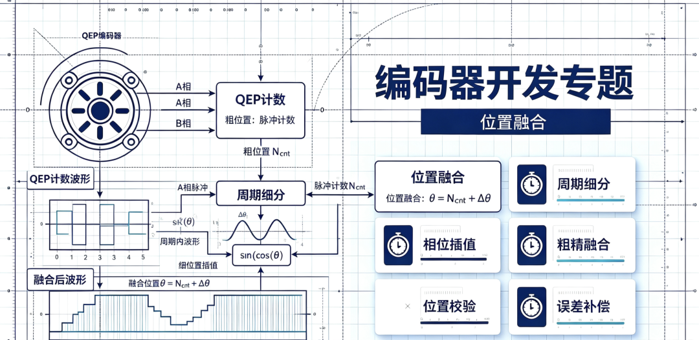
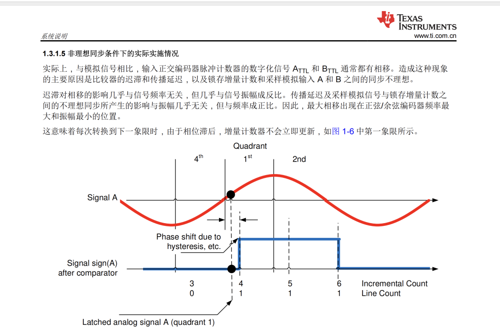
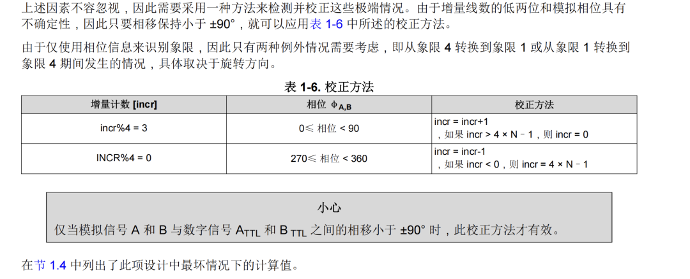
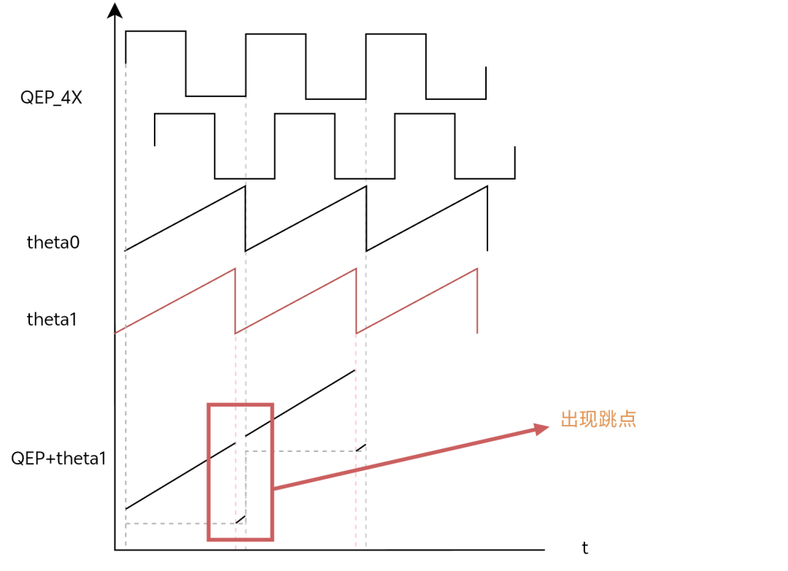
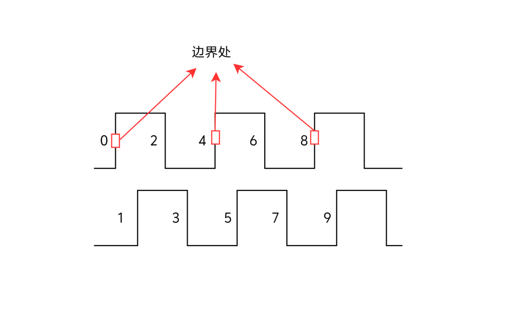

前情提要：上卷中介绍了位置融合跳点的原因、现象、硬件同步处理，各位小伙伴如果需要详细的介绍可在专题系列位置融合-上卷查阅；本卷内容将给大家呈现软件层面的补偿算法。

正式介绍之前我们先来看一篇TI的数据手册中的内容：

图1

图2

上卷的内容中小伙伴会发现，出现跳点的地方是在边界处。

那么这个边界是如何理解的呢？因为我们在QEP计数的时候一般会进行4X处理，也就说一个正交的方波周期计数4个边沿来提高分辨率。以光栅尺的应用场景为例：删距为40um,也就是一个正交方波T=40um,4X计数后，1/4T=10um直接提升了2BIT的分辨率。

所以QEP计数的时候顺序就是 0 1 2 3 4 5......如图3所示；

图3 边界处分析

校正补偿

我们在回头看下TI手册里面提到的相位区间和QEP计数的关系（注意这种情况是正向运动细分角度增加的方向象限变化趋势就是12341234，反向运动并不适配，这个地方之前我踩过坑！）。

条件1：incr%4=3 ，相位0~90°（QEP+1）

真实相位已经进入第一象限，计数器还卡在状态3（本该属于第四象限），计数慢了1步，+1修正，场景：过零点，相位已经在第一象限计数器滞后。

条件2：incr%4=0 ，相位270~360°(QEP-1)

真实相位还在第四象限，计数器已经提前到状态0（本该属于第一象限），计数快了1步，‑1修正，场景：快要到零点，第四象限→第一象限的中间过程计数器超前。

| QEP计数 | QEP%4 | 相位区间 | 所在象限 |
|---|---|---|---|
| 0 | 0 | 0º～90º | 一 |
| 1 | 1 | 90º～180º | 二 |
| 2 | 2 | 180º～270º | 三 |
| 3 | 3 | 270º～360º | 四 |
| 4 | 0 | 0º～90º | 一 |
| 5 | 1 | 90º～180º | 二 |
| 6 | 2 | 180º～270º | 三 |
| 7 | 3 | 270º～360º | 四 |
| 8 | 0 | 0º～90º | 一 |

表1 QEP计数&取余结果

反向运动时呢？如果还是沿用之前的逻辑±1QEP，那么就错了。

比如转子反转，从第一象限退回第四象限，马上跨过零点：真实相位还在0~90°，还没退过零点，如果计数器提前跳变，计数器直接变成3（incr%4=3）现在：相位0‑90°，incr%4=3，如果还套用原来 incr+1 的校正，直接火上浇油，原来的校正动作完全颠倒：超前该减的时候你加，滞后该加的时候你减，所以要修改一下逻辑。

条件1：incr%4=3 ，相位0~90°（QEP-1）

条件2：incr%4=0 ，相位270~360°(QEP+1)

2. 溢出补偿

TI手册表格里还有一段补充的说明：

`if incr>4*N-1 incr=0;``if incr<0 incr=4N-1;`

a. 上溢补偿(incr>4*N-1 incr = 0)

这个又是如何理解呢？

`还是以实际例子说明更好理解。（假定编码器一圈512CPR）正交4X``每圈总计数 = 512 × 4 = 2048也就是： 4×N = 2048``N=512 计数 incr 取值范围： 0 ~ 2047 （一共2048个值）``incr >= 2048 → 溢出，回到0；incr < 0 → 下溢，回到2047`

什么时候触发溢出判断？

`incr 当前是 2047，2047 %4 = 3``刚好命中条件:incr%4==3 && 相位0~90°``执行 incr+1 → 2048，2048>2047``满足溢出条件→incr 赋值为 0``场景：转子刚跨过零点，进入第一象限``incr 是一圈最后一个数2047（MOD(4)=3，第四象限状态），计数器滞后``+1之后本该到2048，一圈到头，直接回卷成0，完美闭环`

如果没到边界，正常情况

`incr = 1003，1003%4 =3，相位45°``incr+1=1004，1004 ≤2047，不触发溢出，直接就是1004`

b.下溢补偿(incn<0 incr = 4*N-1)

`incr 当前 = 0， 0%4 =0 ，命中条件： incr%4==0 && 相位280°``incr‑1 = -1,‑1 <0 ，触发下溢保护 → incr =2047``场景：转子还在第四象限，还没到零点，计数器提前进位跳到0（超前）``需要减1修正，减1变成‑1，一圈回卷到末尾2047`

没到边界的普通情况

`incr = 1200，1200%4 =0，相位300°``incr‑1 =1199，1199≥0，不触发下溢，直接等于1199`

注意：这里的溢出补偿和方向是没有关系的，属于环形编码器计数边界保护。

不过在实际应用中一般窗口区间可以收缩，正常QEP和细分角相位不会延迟1/8T，不然就是系统出现错误了补偿也不能解决全部问题。OK，到这里相信大家就弄清楚了软件如何利用细分相位去校正QEP计数了，总结来看核心就是两个问题同步和溢出

（噪声问题准备单独在下卷说明）
