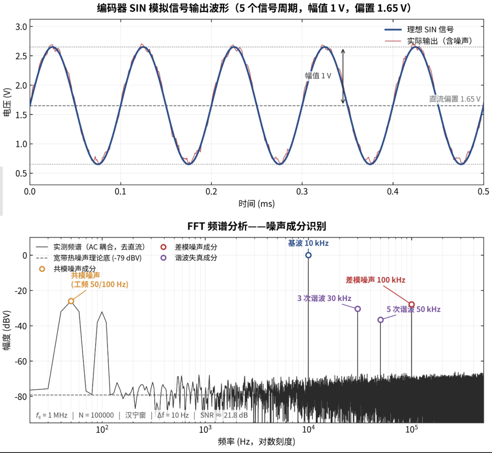
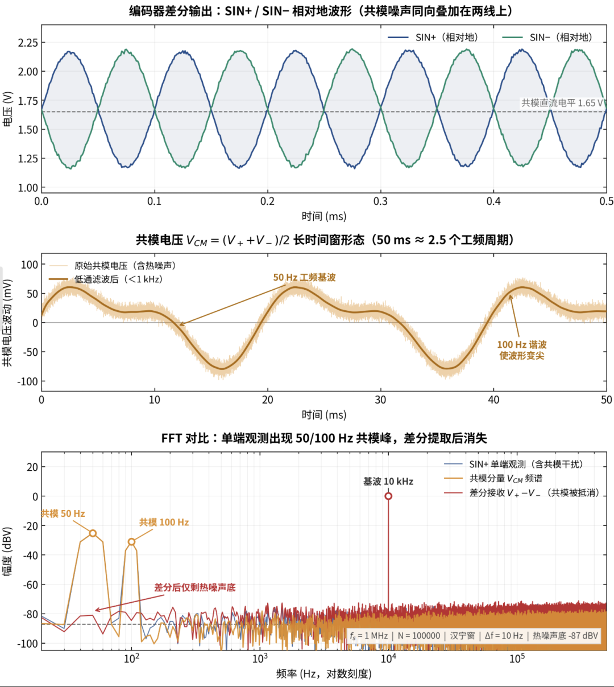
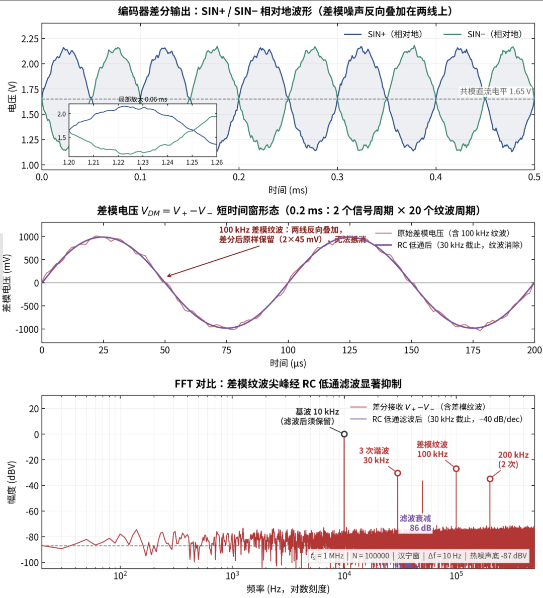
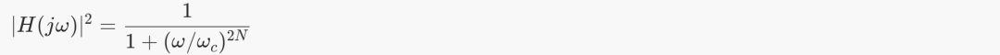
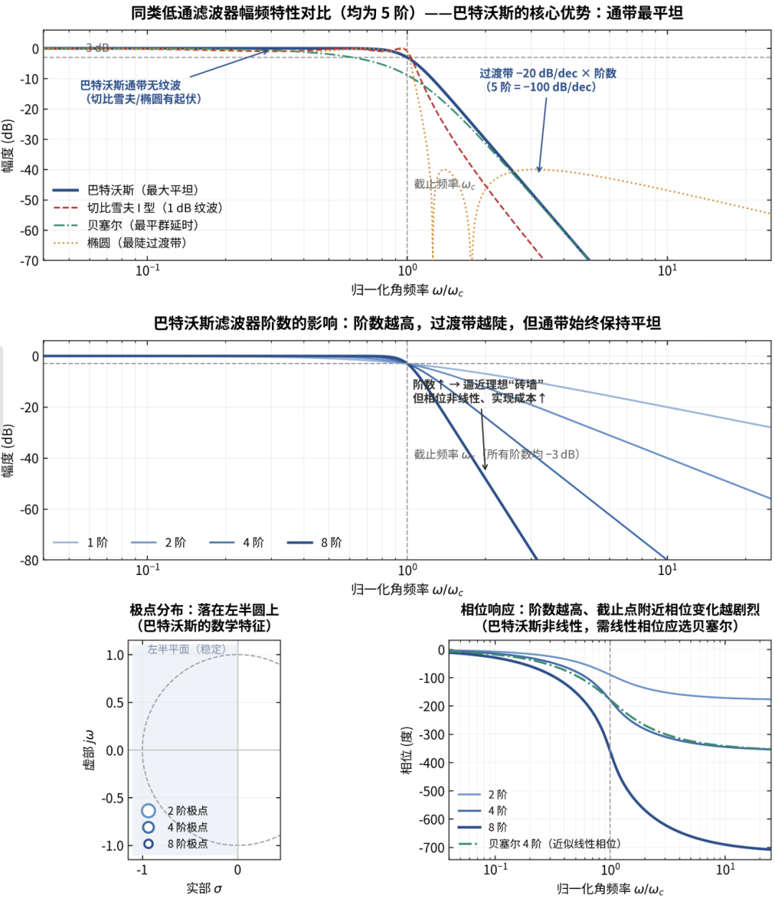

前情提要：上中卷分别介绍了QEP计数和角度细分相关知识点，以及在实际应用过程中为何有跳点问题、如何通过软硬件手段去处理等内容。本篇给大家着重介绍一下噪声问题，想必小伙伴在开发中会时常碰到。

老规矩先来分析一下噪声的来源，常见的一般由共模噪声、差模噪声、电源噪声、随机噪声等组成。

图1 常见噪声分析

共模噪声

图2 共模噪声分析

差模噪声

图3 差模噪声分析

从图1和图2中也能发现，共模噪声一般利用差分运放可以抑制掉，实际应用场景下受到尺寸、成本等因素的影响可以直接利用MCU自带的差分ADC通道采集AD值；而差模噪声也没啥好的办法可利用低通滤除，例如RC滤波。

数字滤波

说完硬件上的手段，再来看看数字滤波；关于这个内容网上也有很多资料什么均值滤波、滑动滤波、中值滤波、IIR滤波、卡尔曼滤波等等，这里我就不过多赘述，这些手段在Matlab数据处理里也经常打交道。不过个人觉得这些都是“

花里胡哨

”，MCU不建议数字滤波、我的理解是实时性才是核心脱离这个看似平滑的数据意义不大。

当然如果是FPGA的话那就不一样了，并行的处理能力优势很大，加个数字滤波也就是几个CLK的事，什么都好就是成本兜不住

不过这里还是有个巴特沃斯滤波分享一下：

巴特沃斯滤波器是一种通带幅度响应最大平坦（maximally flat）的低通滤波器——由英国工程师 Stephen Butterworth 于 1930 年提出，其幅度平方函数为：

“最大平坦”的数学含义：在 ω=0 处，幅度响应的前 2N−1 阶导数全部为零——它是同阶滤波器中通带最平的，没有任何纹波，只有单调缓降。

图4 巴特沃斯滤波分析

对于噪声问题主要还是要根据实际的情况来分析，PCB设计的时候就要考虑这个噪声可以很大程度上避免一些问题，常见的一般就是硬件滤波+数字滤波。若系统方案选用的MCU作为解算单元个人觉得数字滤波的比重建议轻点，软件处理引入的延时能达到1～5us在加上角度解算和逻辑判断整体延时很难稳定在10us以下,低转速下或许没啥问题但是在高转速电机的应用场景下延时是“致命的”。

OK，这三卷内容虽谈不上面面俱到，但简易抓住重点分享下
