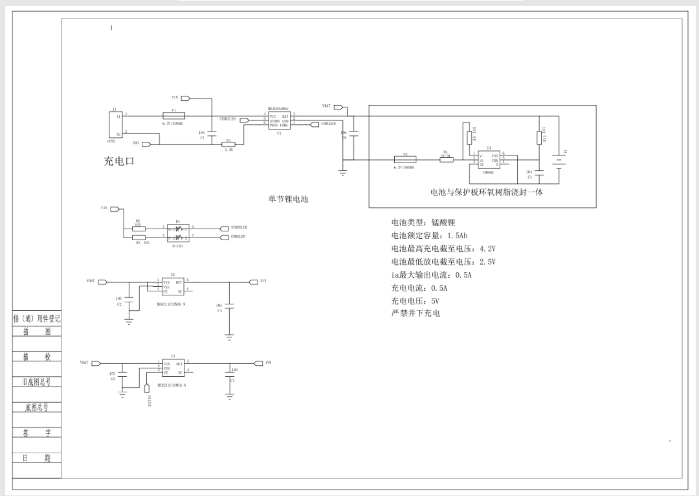
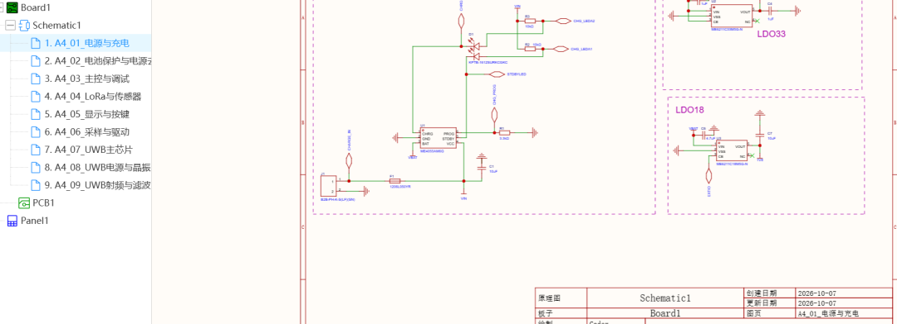
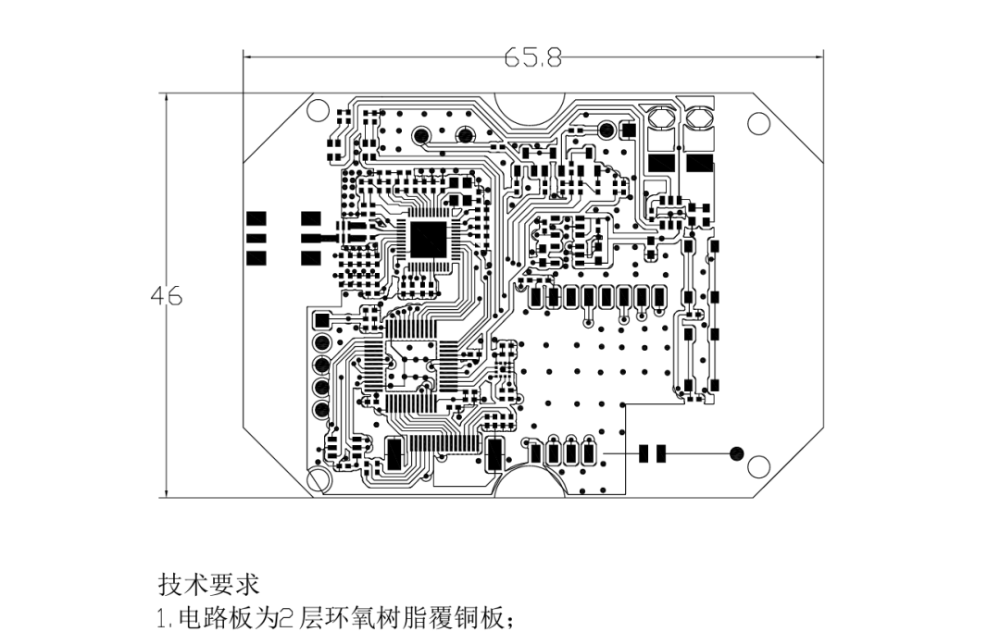
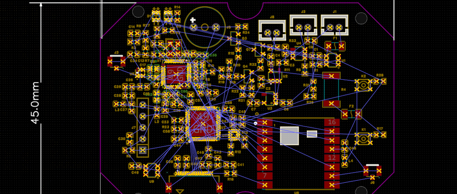
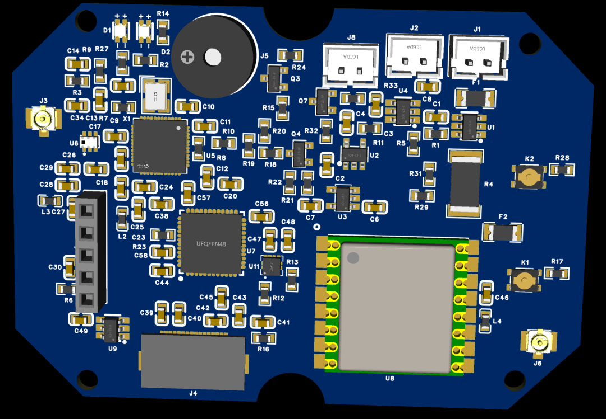

前面写过一篇《花了几天时间，终于把立创 EDA 和 AI 连接起来了》。接通之后，我一直想继续往下试：能不能拿一份实际电路，让 AI 把工程做起来？

此前尝试用的是 WorkBuddy。这一轮，我换成了 Codex + GPT-6 Astra，配合 easyeda-agent 操作嘉立创 EDA 专业版 V4。实际用下来，效果确实有了很大改善。工具链和操作流程也在调整，所以这里分享的是一次项目体验。

任务很具体：根据 标识卡的电气原理图 PDF，重建可以继续编辑的原理图和 PCB 工程。里面有电源、电池保护、主控、LCD 接口、LoRa 和 UWB，一共 114 个器件。

（本图是PDF图其中一页）

我的要求也很明确：原理图采用 A4 模板分页，保留器件之间的实体导线；保护电路放在主板；PCB 的尺寸和布局参考 PDF。部分器件缺少完整型号，可以选替代件，但要标注。LCD 接口经过确认，选用单排 16P、0.5mm 间距的 FPC 座。

这轮过程并不顺。连接器需要适配，最初还有图形落在视野外、文字显示不完整的问题。原理图最终整理成了 9 页 A4，我也手工调整了一部分走线，再让它继续核对。

真正让我重视起来的，是后面那次回头对照 PDF。

复查发现了 6 组连接问题，涉及 15 处引脚连接：电池保护负端回路接错，传感器配置电阻接错位置，主控一个未用引脚被额外接地，UWB 的 GPIO 和去耦节点也有偏差。这些都是重建工程相对原 PDF 的问题，不能把责任推给原图。

（嘉立创上的建立项目，原理图分页设计）

我让它先修正连接，再同步 PCB。修正之后，又保存、重载、重新读取数据，逐项核对：114 个器件、402 个 PCB 焊盘，目标网络已经对应一致，其它网络和 PCB 器件位置保持。

（pdf格式的PCB图）

（嘉立创的PCB图，未画完成）

对我而言，Codex + GPT-6 Astra 已经能分担一部分重复录入、工程整理和连接核对工作。接下来继续做 PCB 布线，看看它在走线、去耦和射频布局这些更细的地方，能帮到哪一步。

这次画原理图明显比以前好多了，可以看上次画原理图，它的很多连线不好。

[花了几天时间，终于把立创EDA和AI连接起来了](https://mp.weixin.qq.com/s?__biz=MzY5NjE4OTI2OQ==&mid=2247484115&idx=1&sn=f83f26771b57ab412c37045cf7cdd1ce&scene=21#wechat_redirect)

我是汤朝明，一名还在一边做项目、一边尝试 AI 的电子工程师。这次进步很明显，后面的结果，等板子继续做下去再交作业。
