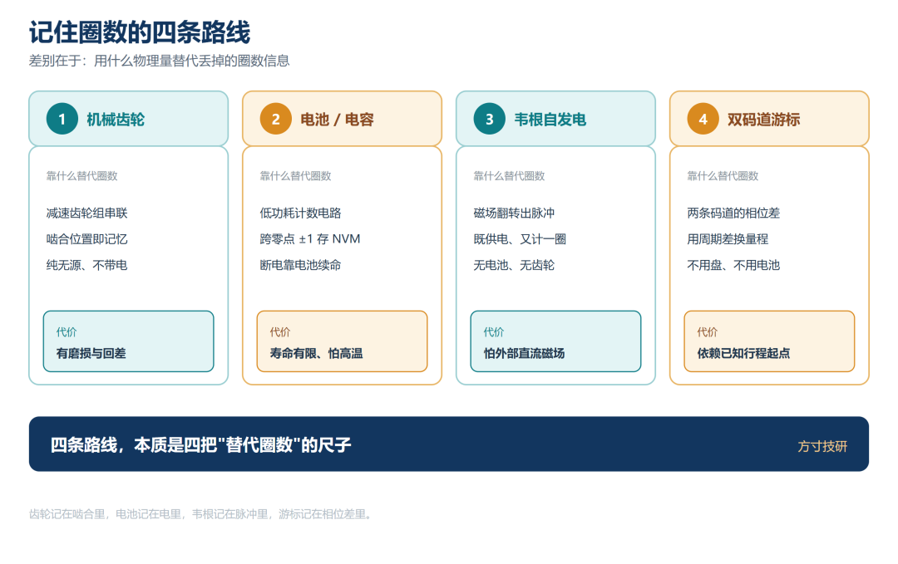
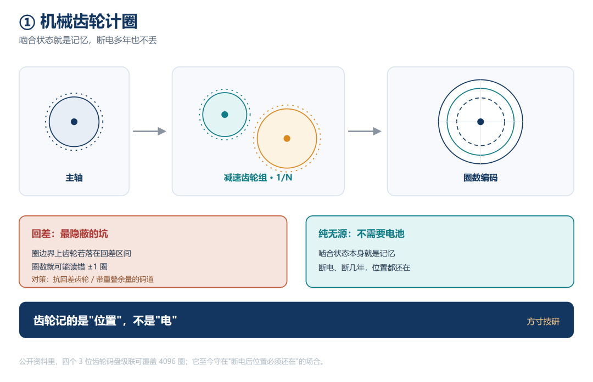
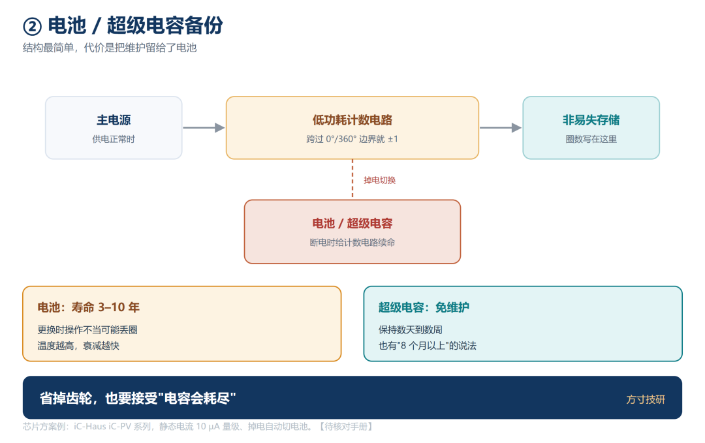
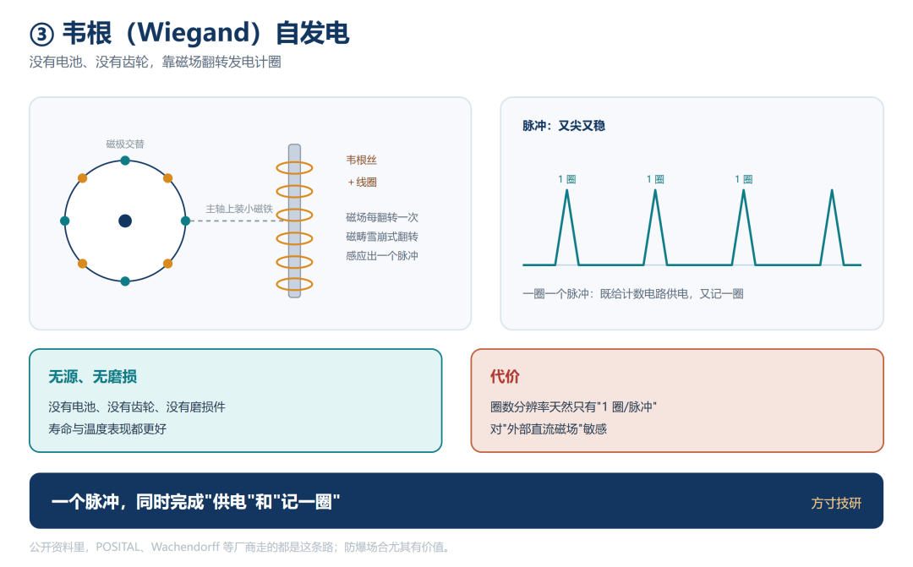
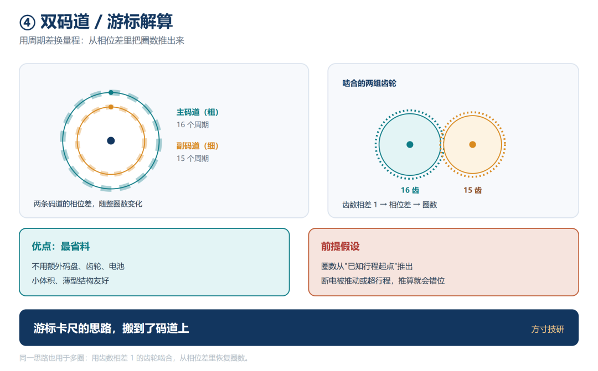
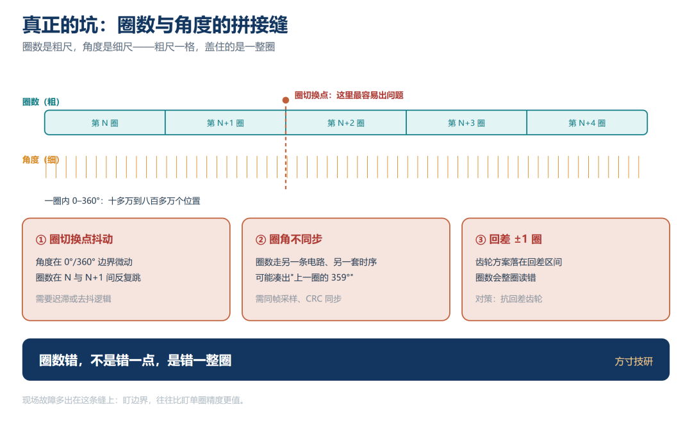
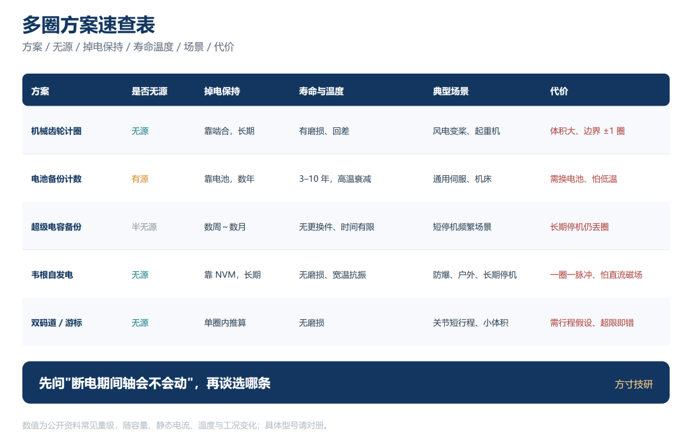

六轴机械臂的腕关节，一个来回就要转过 ±540°；机床丝杠轴，1 米行程配 25 mm 螺距要走 40 圈。这些场合单圈绝对值答不了——它知道"这圈里的哪个角"，不知道"这是第几圈"。

断电后有人顺手推一下轴，再上电，位置就整体偏了 360° 的整数倍。

RLS 编码器手册的钟表类比最直白：单圈是只有分针的钟，指向 5，你分不清是 5 分还是 65 分；多圈多了一根时针，才认得出"几点几分"。

圈数，是一件和角度并列、却完全独立的事情。

图 1｜左"只有分针"（5 分还是 65 分分不清）

## 一、角度是刻出来的，圈数是记出来的

一圈之内，绝对角度是刻在码盘上的——光学码道、磁环、电感式线圈，读一次就有一个唯一编码。

圈数没这个待遇。码盘转第二圈，图案原样重来，第 1 圈和第 100 圈长得一模一样，圈数只能在码盘之外另想。

**角在盘上，圈在盘外。**

一句话：**角度是刻出来的，圈数是记出来的——两件事，两套结构。**

多圈因此常和关节、升降柱绑定：增量式一断电就失位，上电必须回零，而关节一次要转好几圈，回零既慢又可能撞限位。

## 二、记住圈数的四条路线

落地成产品的四条路线，差别在用什么物理量替代丢掉的圈数信息。

图 2｜机械齿轮 / 电池备份 / 韦根自发电 / 双码道游标，各标"靠什么替代圈数信息"

### ① 机械齿轮计圈

单圈码盘后面串一组减速齿轮，主轴转一圈，第二级只转 1/N 圈，再驱动低分辨率码盘。公开资料里，四个 3 位齿轮码盘级联可覆盖 4096（2¹²）圈。

好处是**纯无源**：啮合状态本身就是记忆，断电断几年都不丢，风电变桨、起重机至今在用。

代价全在机械：体积大、有磨损、抗冲击振动弱；更隐蔽的是**回差**——圈边界上齿轮若正落在回差区间，圈数可能读错 ±1 圈，得靠抗回差齿轮或重叠余量码道兜住。

图 3｜主轴 → 减速齿轮组（1/N）→ 圈数码盘

### ② 电池 / 超级电容备份

单圈码盘照常高分辨率测角，另加一个低功耗计数电路，跨过 0°/360° 边界就 ±1，写进非易失存储器；断电靠电池或超级电容续命。

公开经验值：电池寿命常见 3–10 年；超级电容保持数天到数周，也有"8 个月以上"的说法。

代价从机械挪到了维护：电池要换，换时操作不当可能丢圈，温度越高衰减越快；超级电容免维护，却只把"能撑多久"从几年缩到几个月——**长期停机，位置照样丢。**

iC-Haus 的 iC-PV 系列就是电池缓冲的多圈计数 IC，静态电流 10 µA 量级，掉电自动切电池，圈数经 CRC 加密后同步给单圈芯片。

图 4｜主电源 → 计数电路 → 非易失存储

### ③ 韦根（Wiegand）自发电

韦根丝是一段特殊热处理、冷加工的合金丝。外部磁场方向每翻转一次，内部磁畴雪崩式翻转，在绕线圈里感应出一个又尖又稳的脉冲。

小磁铁装在主轴上，轴每转一圈磁场翻转一次，送出一个脉冲。这个脉冲**既给计数电路供电、又记一圈**，圈数写进非易失存储器。

没有电池、齿轮与磨损件，寿命和温度表现更好；POSITAL、Wachendorff 走的都是这条路。防爆场合尤其有价值——危险区域里锂电池本身就是隐患。

代价是圈数分辨率天然只有"1 圈/脉冲"，且对**外部直流磁场**敏感。

图 5｜韦根丝磁畴翻转 → 尖脉冲 → 供电 + 计一圈

### ④ 双码道 / 游标解算

前三条都在单圈之外另建计圈机构；这条反过来，用单圈内部的相位关系把圈数"推"出来。

做法一，双码道游标：同一磁环上做两条周期相差整一周期的码道（或两条齿数相差 1 的齿轮），旋转时相对相位随整圈数变化，解出相位差就得圈数——借的是游标卡尺"用周期差换量程"的思路。另有多对极 + 圈数解算：以极对数标定单圈周期，配合换向次数推算圈数。

它最省料，不用额外码盘、齿轮、电池，但有个前提——**圈数是从"已知行程起点"推出来的**，断电期间轴被推动或超行程就会错位。

图 6｜两条周期相差一个周期的码道 / 齿数相差 1 的齿轮，相位差 → 圈数

## 三、真正的坑在"拼接缝"上

现场故障往往不在路线本身，而在**圈数与角度拼在一起的那道缝**。

两段分辨率不是一个量级：单圈动辄 17–23 位（十多万到八百多万个位置），圈数常常只有 12–16 位（4096 到 65536 圈）。**多圈靠低分辨率数圈，单圈靠高分辨率测角**——粗尺的每一格，盖住的是一整圈。

**圈切换点抖动。** 角度在 0°/360° 边界微动，圈数会在 N 与 N+1 之间反复跳；没有迟滞或去抖，输出就在圈边界"打摆"。

**圈数与角度不同步。** 圈数走另一条电路、另一套时序，若不同一时刻采样、同一帧发出，边界处就可能凑出"上一圈的 359° 配下一圈"。iC-Haus 用 CRC 加密传输同步多圈与单圈数据，正是为了堵这个缝。

**机械回差导致的 ±1 圈。** 齿轮方案在边界落在回差区间时，圈数会整圈读错。

图 7｜粗尺（圈数）与细尺（角度）拼接

一句话：**圈数错，不是错一点，是错一整圈——那道缝，比精度更值得盯。**

## 四、多圈方案速查表

| 方案 | 是否无源 | 掉电保持 | 寿命与温度 | 典型场景 | 代价 |
|---|---|---|---|---|---|
| 机械齿轮计圈 | 无源 | 靠啮合，长期有效 | 有磨损、回差；抗冲击振动弱 | 风电变桨、起重机、航空航天 | 体积大、有回差、边界 ±1 圈 |
| 电池备份计数 | 有源（一次性电池） | 靠电池，数年 | 电池 3–10 年，高温加速衰减 | 通用伺服、机床 | 需换电池、低温衰减、换电池丢圈 |
| 超级电容备份 | 半无源 | 数周～数月 | 无更换件，但时间有限 | 短停机频繁场景 | 长期停机后仍丢圈 |
| 韦根自发电 | 无源 | 靠 NVM，长期有效 | 无磨损、宽温抗振 | 防爆、户外、长期停机 | 一圈一脉冲、怕外部直流磁场 |
| 双码道 / 游标 | 无源 | 单圈内推算圈数 | 无磨损 | 关节短行程、小体积 | 需行程 / 换向假设，超限即错 |

图 8｜方案 / 无源 / 掉电保持 / 寿命温度 / 场景 / 代价

选型先问三句。

**① 断电期间轴会不会被推动？** 会动，只能选"断电期间还能计圈"的方案（齿轮 / 韦根），电容与纯非易失存储只记"断电那一刻"。

**② 上电允不允许先动一下？** 不允许就得上真绝对多圈；允许，可用单圈 + 控制器数跨零点省掉多圈硬件。

**③ 维护窗口与温度如何？** 换不了电池又冷热交变，韦根或齿轮更稳。

## 总结

· 单圈与多圈是两道独立的题：**角度刻在码盘上，圈数在码盘之外另记**；单圈再高精度也答不了"这是第几圈"。

· 记圈四条路线：**机械齿轮（无源、有回差）、电池 / 超级电容（省事、有寿命与温度问题）、韦根自发电（无源、无磨损、怕直流磁场）、双码道游标（省料、有行程假设）**。

· 现场故障多出在拼接缝：**多圈低分辨率数圈、单圈高分辨率测角**，圈切换点抖动、圈角不同步、回差 ±1 圈——盯边界比盯精度更值。

💬 你们项目上用的是哪条多圈路线？有没有遇到过"上电位置整体偏了一整圈"的情况？评论区聊聊。

喜欢这类把原理、结构代价与工程取舍摊开讲的内容，点个关注。

**—— 方寸技研 · 下期预告：电涡流编码器怎么把角度算出来（完整信号链）**
