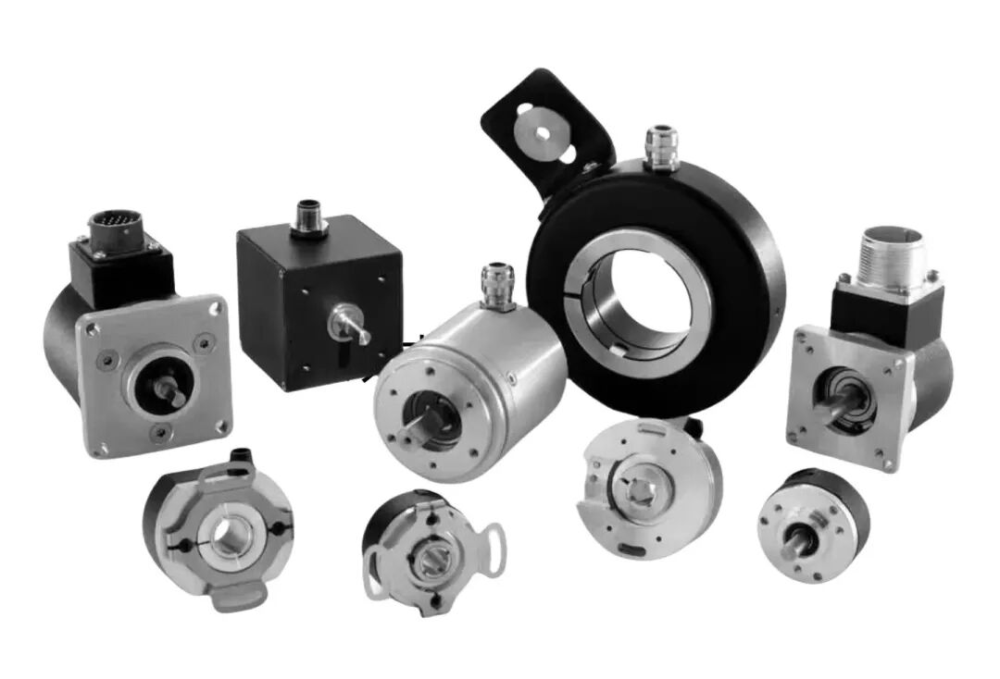
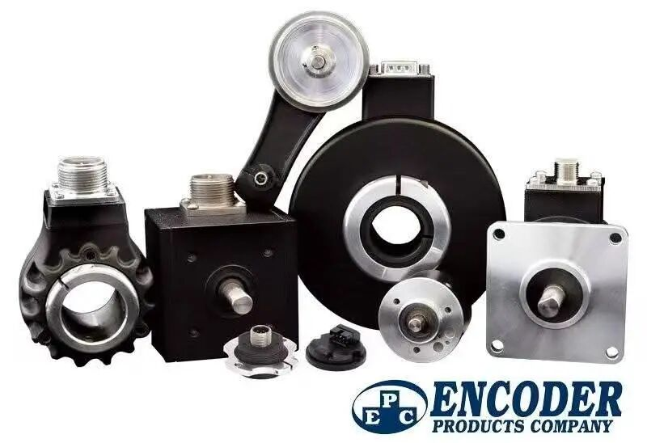
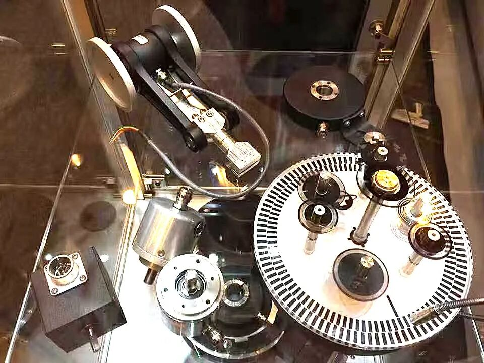
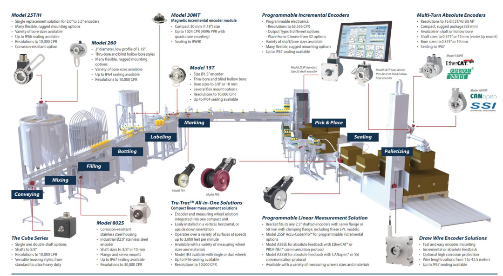

“工控选型不用再高价采购进口编码器！得尔堡 DEL-CODER 搭配 ACCU-CODER 系列，机械尺寸、电气接口兼容，可直接替代 Dynapar、BEI、多摩川、内密控、欧姆龙等欧美日韩品牌，实现国产化替代。”

在自动化、伺服、起重重载等设备项目里，进口编码器交货周期长、采购成本高，一直是很多设备厂商、集成商的痛点。 得尔堡 DEL-CODER 编码器，对标 ACCU-CODER 美标规格，覆盖美标 Size1.5"/2.0"/2.5" 以及通用 Φ58 欧标编码器，实心轴、盲孔空心全结构覆盖，**安装无需改机，可直接替换多款进口型号**。

🎯全系列型号替代对照表

| 得尔堡 DEL-CODER 型号 | ACCU-CODER 型号 | 产品定位 | 可直替欧美型号 | 可直替日韩型号 |
|---|---|---|---|---|
| JYI/N | 725 | Size25 2.5" 方壳实心重载 | Dynapar H25/HS25、BEI HS25、Avtron AV25、Northstar H25 | 多摩川 TS5000、SUMTAK LB、光洋 TRD-GK |
| RZS/RZH | 702 / 702bore | Size20 2.0 英寸外壳，702 实心 / 702bore 空心 | Dynapar H20、BEI HS20、Northstar H20 | 多摩川 TS5200 空心、内密控 NE-2000 空心 |
| JZS | 755Ashaft | Size15 1.5" 美标伺服实心轴 | Dynapar F15 实心、BEI L15 | 多摩川 TS5300、SUMTAK LF、内密控 OEW2、光洋 TRD-SH |
| JZH | 755Abore | Size15 1.5" 盲孔空心，Flex 浮动安装 | Dynapar F15 空心、BEI XH15 | 多摩川 TS5214、内密控 OVW2 空心、光洋 TRD-TH |
| JRS | 15S | Size15 1.5"薄型实心伺服 | Dynapar F15、BEI 15 系列 | 多摩川 TS5312、SUMTAK LE、内密控 OEW2、欧姆龙 E6C3 |
| JRT/H | 15T | Size15 1.5"薄型盲孔空心伺服 | Dynapar F15 空心、BEI X15 | 多摩川 TS5208、内密控 OVW2 空心、光洋 TRD-NH |
| RYS | 758 | Φ58mm 欧标 夹紧法兰实心轴 | Dynapar H58、Hengstler RI58、Kübler 5800、Sick DFS60、Baumer BHG | 多摩川 TS5013、内密控 OEW2、光洋 TRD-N、欧姆龙 E6B2/E6C2 |

## 📌 产品核心优势

免改机直替

机械安装尺寸、电气信号协议与进口款匹配，原有设备不用修改结构，直接替换，快速完成国产化改造。

**覆盖多场景应用**

Size25 重载款：适合起重、工程机械等恶劣工况

Size15 薄型伺服款：适配伺服电机、小型自动化设备

Φ58 欧标通用款：国内设备最常用标准编码器规格

**大幅降本 + 短交期**国产自研生产，缩短交付周期，相比进口品牌，有效降低设备 BOM 成本，解决进口货期不稳、涨价难题。最快3天交付。

**结构齐全**实心轴、盲孔空心、浮动安装等多种结构，覆盖欧美美标、欧标两大体系，兼容多摩川、SUMTAK、内密控、欧姆龙等日系主流编码器。

## 🎯 可替代进口品牌汇总

欧美品牌：Dynapar、BEI、Northstar、Avtron、亨士乐 Hengstler、库伯勒 Kübler、Sick、堡盟 Baumer日韩品牌：多摩川、SUMTAK、内密控、光洋、欧姆龙
