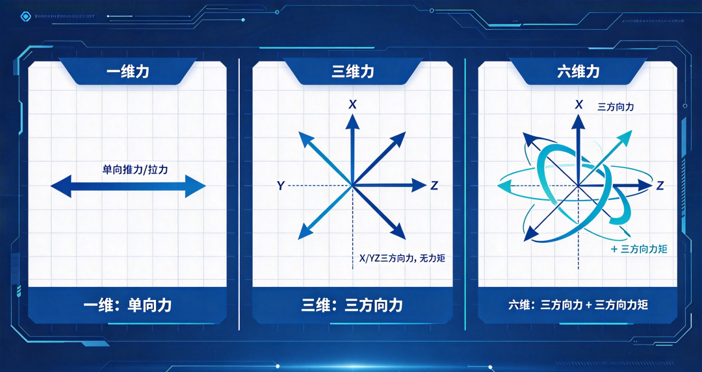
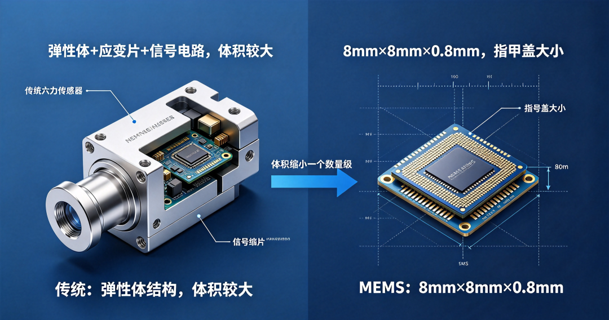
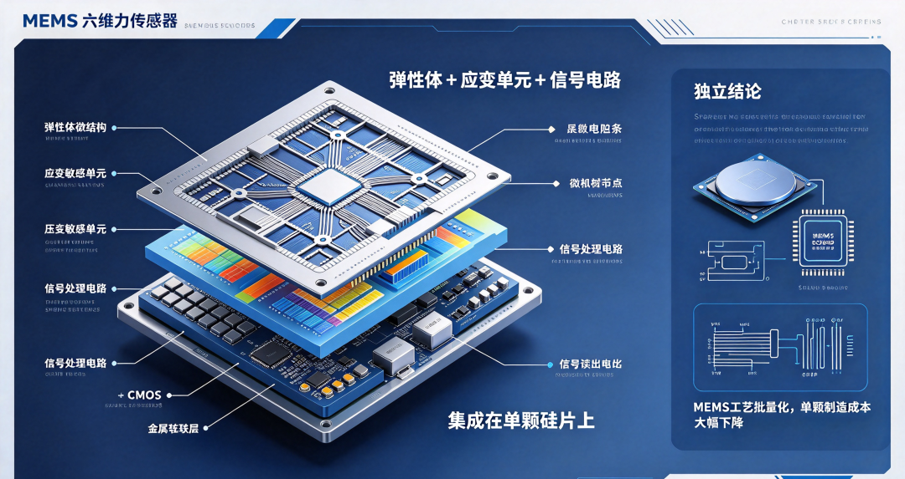
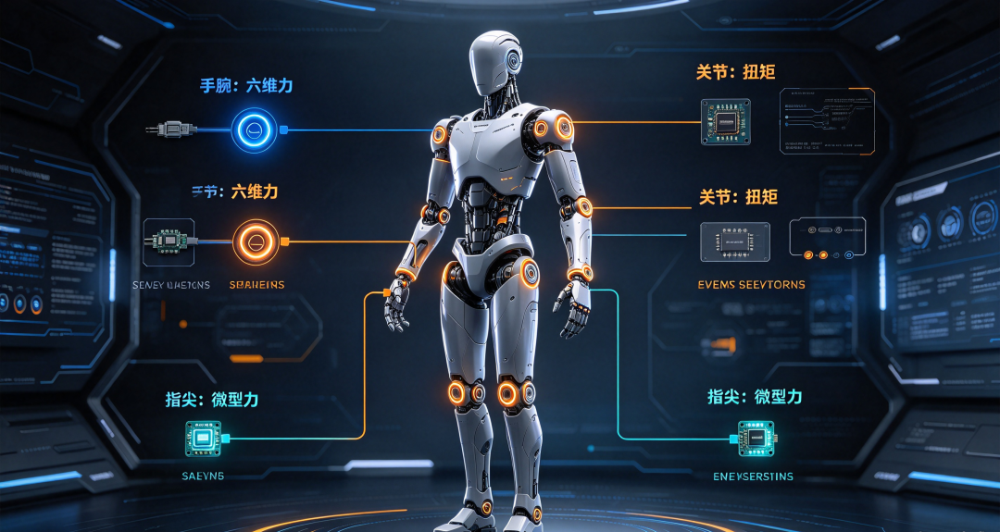
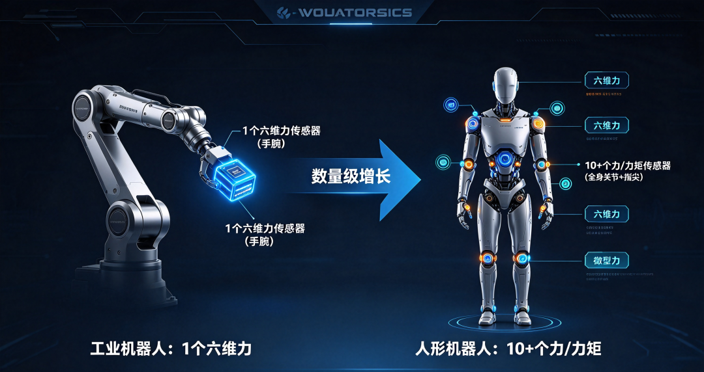
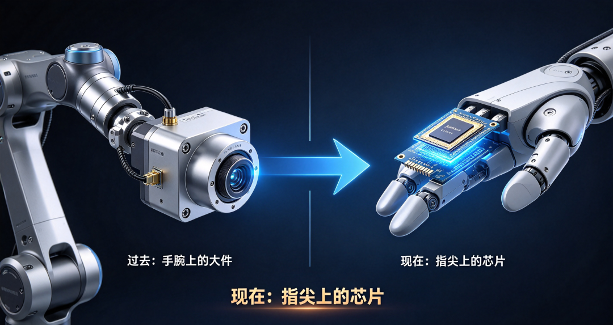

**6万元一套的传感器**

**被一颗芯片取代了**

一台协作机器人要完成精密装配，需要知道自己手腕上施加了多大的力、来自哪个方向。

测量这个“力”的元件，叫六维力传感器。它能同时感知空间中三个方向的力和三个方向的力矩。

过去，这个元件装在机器人手腕上，体积不小，价格不低。进口产品一套要6到7万元，国产同类产品也要2到3万元。

现在，它被做进了一颗指甲盖大小的芯片里。

## 01 六维力是什么

机器人的“力觉”分很多层级。

最简单的是一维力传感器，只能测一个方向的推力或拉力。三维力传感器能测X、Y、Z三个方向的力，但测不了力矩。

六维力传感器是“满配”——同时测量三个方向的力和三个方向的力矩。

力矩和力不一样。你推一个物体，力是线性的；你拧一个螺丝，施加的是力矩。机器人要完成拧螺丝、打磨、精密装配这类动作，必须同时感知力和力矩。

六维力传感器的核心价值，是让机器人“知道自己在用多大的力，往哪个方向用力”。

没有它，机器人只能按预设轨迹运动，遇到阻力不会调整，遇到精密装配就会把零件压坏。

## 02 难在哪

六维力传感器的技术门槛，不在“做出来”，在“做准”。

六个方向的数据容易相互干扰。你施加一个X方向的力，Y和Z方向的传感器可能同时产生读数。这叫维间耦合。

要把六路“互相串扰”的数据一条条“捋顺”，需要两个核心能力：高精度的标定技术，和复杂的解耦算法。

标定是给传感器建立“标准答案”的过程。六轴联合加载标定，需要在六个方向同时施加已知的力和力矩，记录传感器的输出，建立映射关系。

这个过程的精度，直接决定传感器最终能不能测准。

解耦算法负责把耦合在一起的信号分离开。多项式高精度解耦算法、神经网络解耦算法，都是行业里在用的方案。

算法越复杂，对处理器的要求越高，成本也越高。

传统六维力传感器受限于体积和成本，主要用在工业机器人等大型设备上。

人形机器人、灵巧手这些新兴场景，对手腕或指尖的传感器体积有严格限制。拳头大的传感器装不进去。

## 03 把六维力装进芯片

淄博高新区企业港智创信在做的事，是用MEMS技术解决体积问题。

MEMS是微机电系统，用半导体工艺在硅片上制造微米级的机械结构。加速度计、陀螺仪、麦克风都是MEMS技术的产物。

把MEMS用到力传感器上，意味着把传统传感器的弹性体、应变片、信号处理电路，全部集成到一颗硅基芯片里。

港智创信正在研发的芯片级硅基MEMS六维力传感器，内部芯片尺寸只有8毫米×8毫米，厚度0.8毫米。

这个尺寸意味着什么？传统的六维力传感器，弹性体结构、应变片粘贴、信号调理电路，每个部分都需要空间。

MEMS方案把机械结构和电路做在同一片硅上，体积缩小了一个数量级。

体积缩小带来的不只是“装得进去”。MEMS工艺的批量化特性，让单颗传感器的制造成本大幅下降。

孙启萌的原话是：“这款芯片级的硅基MEMS六维力传感器实现量产后，制造成本将大幅下降，应用面会更广”。

## 04 从工业机器人到灵巧手

体积缩小之后，应用场景打开了。

传统六维力传感器装在机器人手腕和底座之间，用于测量末端执行器受到的力和力矩。

芯片级MEMS方案让传感器可以装到更小的部位——灵巧手的指尖、协作机器人的关节、外骨骼的接触面。

港智创信的规划是：硅基MEMS六维力传感器量产后，应用场景从大型工业延伸向人形机器人、灵巧手等精密领域。

同时，公司还在推进机器人关节扭矩传感器的研发，目标是人形机器人、协作机器人及智能装备领域。

关节扭矩传感器和六维力传感器不是一回事。六维力测的是末端执行器受到的力，关节扭矩测的是关节电机输出的力矩。两者配合，机器人才能实现完整的力控。

目前，港智创信的硅基MEMS六维力传感器尚处于样品阶段，公司正加快推进量产。

## 05 机器人的“力觉”需求有多大

人形机器人的关节数量在增加。

一台人形机器人有几十个关节，每个关节都需要扭矩传感器来感知力矩变化。

灵巧手有多个手指，每个指尖可能需要一维或三维力传感器。

协作机器人的力控精度要求在提升。传统的电流环力控精度有限，加装关节扭矩传感器后，力控精度可以提升一个量级。

精密装配、打磨、抛光这些场景，对力控精度的要求越来越高。

人形机器人对力觉传感器的数量需求，远大于工业机器人。

工业机器人通常只在手腕装一个六维力传感器，人形机器人可能需要十几个甚至几十个力/力矩传感器分布在全身关节和指尖。

这意味着，如果人形机器人进入量产，力觉传感器的市场规模会出现数量级的增长。

而芯片级MEMS方案，正好匹配这个需求——体积小、成本可控、适合批量制造。

六维力传感器不是新东西。工业机器人用了几十年，技术路线成熟，进口产品性能稳定。

但人形机器人和灵巧手需要的，是一种完全不同的力觉传感器。体积要小到能塞进指尖，成本要低到能装几十个，精度要够到能感知细微的装配力。

MEMS方案把六维力传感器从“手腕上的大件”变成了“指尖上的芯片”。这个变化，不只是尺寸的缩小，是应用场景的重新定义。

**机器人的力觉，正在从手腕走向指尖。**

