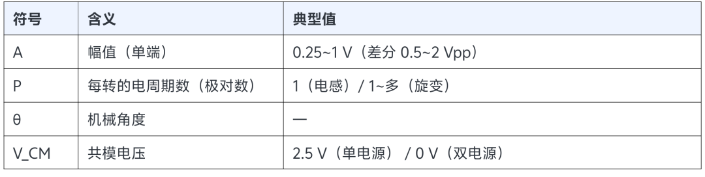
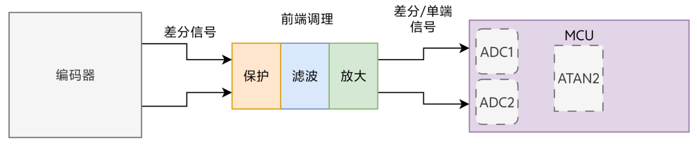
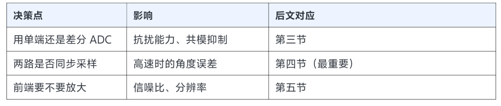
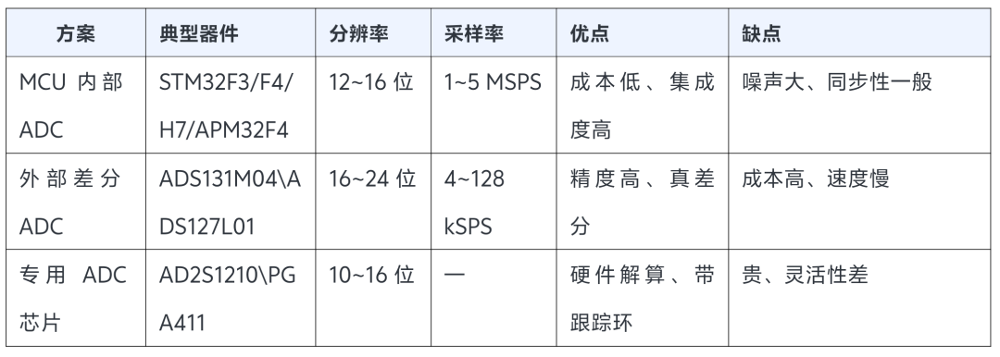
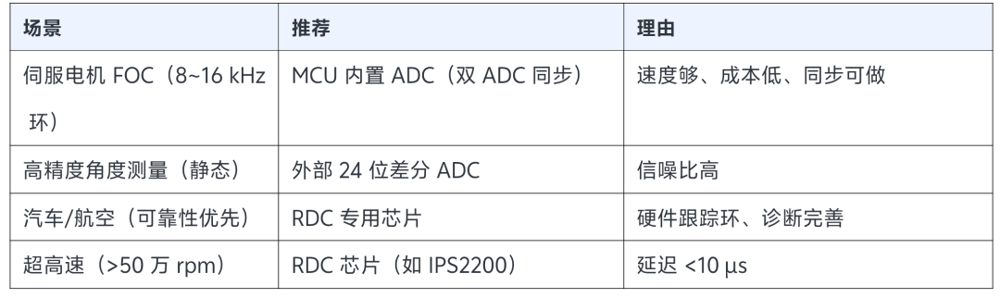
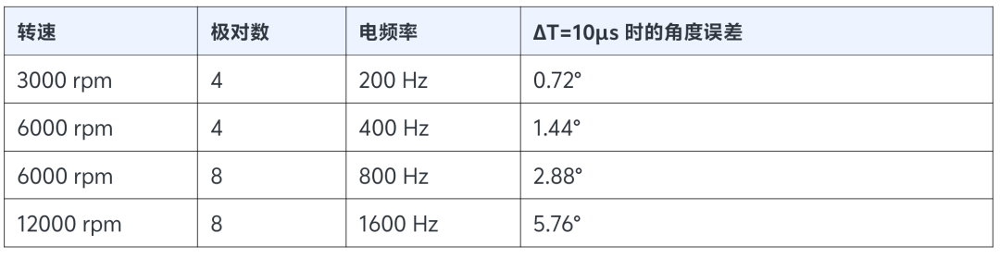
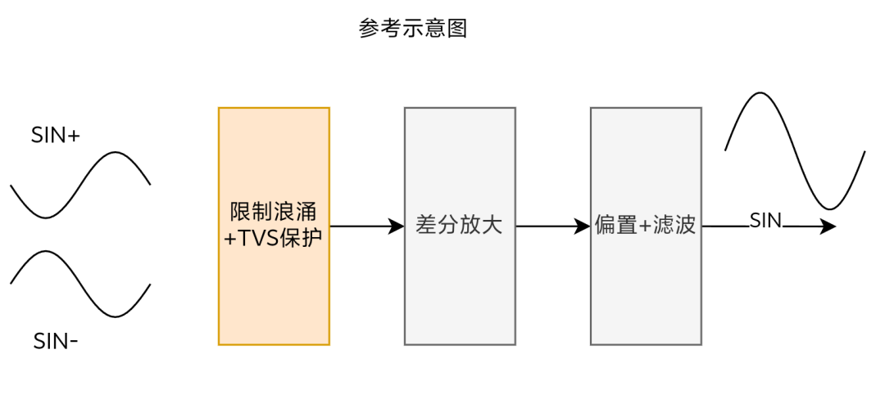
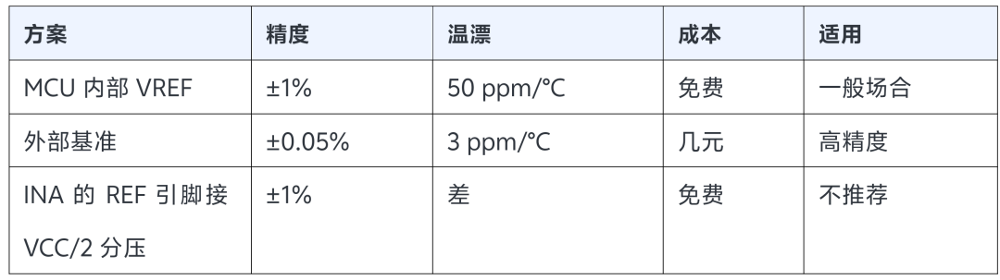

做伺服、做机器人关节，绕不开一类编码器：它不给你数字，它给你两路模拟信号。sin 和 cos，一对差分信号。你把它们送进 ADC，自己算 arctan，才得到角度。听起来简单，但工程上问题很多：采样不同步、共模噪声、幅值不匹配、正交误差、温度漂移。每一个都能让位置数据跳动，而且很难查。这篇从信号源头讲起，把整条模拟链路的每个环节拆开，讲清楚"为什么这么设计"。

一、先搞清楚：什么编码器输出模拟 sin/cos

1.1 四类主流器件

| 类型 | 原理 | 输出 | 特点 |
|---|---|---|---|
| 旋变 | 电磁感应 | 差分正余弦 | 耐高温，军工 |
| 电感编码器 | 涡流效应 | 差分正余弦 | 抗污染 |
| 磁编码器 | 霍尔/AMR | 差分正余弦 | 成本低 |
| 光电编码器 | 光电接收+光栅 | 差分正余弦 | 高精度，成本高 |

共同点：它们都输出模拟正余弦信号，都需要外部做"细分"（interpolation）才能得到高分辨率角度

1.2 为什么要输出模拟信号

因为分辨率可以靠电子细分无限提升，一个正弦周期，用 16 位 ADC 采样，理论上可以细分出 65536 个点远远超过同尺寸的光电码盘能做到的线数。而且：sin/cos 模拟信号的基频很低（通常是 kHz 级），不像高分辨率数字编码器那样在高速时输出 MHz 级脉冲，长距离传输的信号完整性问题小得多。这是模拟方案在高精度伺服里长期存在的原因。

1.3 信号长什么样

理想情况下：

V_SIN = A · sin(P·θ) + V_CM

V_COS = A · cos(P·θ) + V_CM

其中：

差分信号则是：

SIN+/SIN-= V_SIN_DIFF=(SIN+) - (SIN-)

COS+/COS-= V_COS_DIFF=(COS+) - (COS-)

注意：差分的幅值是单端的 2 倍，这点在算增益时容易算错

二、整体链路：信号从编码器到角度

先看全景，再逐段拆

四个关键决策点：

三、ADC 方案选型

3.1 方案对比

3.2 怎么选

按场景分：

3.3 一个残酷的现实：MCU 内置 ADC 的噪声

12 位 ADC 在 3.3V 下，1 LSB = 0.8 mV.如果你的 sin/cos 信号幅值是 1 Vpp（差分），那么：有效位数 ≈ log2(1000mV / 0.8mV) ≈ 10.3 位理论 12 位，实际有效只有 10 位左右被噪声吃掉了 2 位。这就是为什么伺服系统里，"ADC 前端设计"比"ADC 本身"更重要。

四、最关键的坑：两路必须同步采样

4.1 为什么不同步会出错

角度是从 sin 和 cos 的比值 算出来的：θ = atan2(V_SIN, V_COS)

如果两路不在同一时刻采样，那么：

采样 V_SIN 时，转子在 θ₁

采样 V_COS 时，转子已经转到 θ₂ = θ₁ + ω·ΔT

算出来的角度，是两个不同时刻的混合值

4.2 误差公式与量化

Δθ = ω × ΔT,其中 ω 是电角速度（rad/s），ΔT 是两路采样的时间差

举个例子（这个数字很有说服力）：4 对极电机，6000 rpm电角频率 = 6000/60 × 4 = 400 Hz，即 ω = 2513 rad/s如果 ADC 两通道转换间隔 ΔT = 10 µsΔθ = 2513 × 10e-6 = 0.025rad ≈ 1.44°,1.44° 的电角度误差对 FOC 来说，这已经足以让电流环出现明显谐波了。

4.3 速度越高、极对数越多，误差越大

结论：低速时看不出来，高速时是灾难

4.4 三种同步方案

方案 A：双 ADC 同步采样

STM32 / APM32 的 ADC1 和 ADC2 工作在双重同步模式（Dual Regular Simultaneous），两路同时采样：

`/* STM32 双重 ADC 同步规则转换 */``ADC_MultiModeTypeDef multi;``multi.Mode = ADC_DUALMODE_REGSIMULT; /* 双重同步 */``multi.DMAAccessMode = ADC_DMAACCESSMODE_2;``multi.TwoSamplingDelay = ADC_TWOSAMPLINGDELAY_5CYCLES;``HAL_ADCEx_MultiModeConfigChannel(&hadc1, &multi);`

关键：TwoSamplingDelay 设到最小（5 cycles）。即便如此，两路之间仍有约 几十纳秒的错位但相比 10 µs 已经好了两个数量级。

方案 B：采样保持同时锁存

部分 ADC 支持"同时采样、分时转换"（sample-and-hold 同步），这是最理想的采样时刻完全一致。

方案 C：单 ADC 交替采样的补偿

如果硬件已经定了，只能用单 ADC 交替采：

`/* 采样后按速度补偿角度 */``float dt = 1.0f / ADC_SAMPLE_RATE;``float comp = omega * dt;/* 两路时间差对应的角度 */``theta = atan2f(v_sin, v_cos) - comp;`

但这个方法有硬伤：omega 本身是从角度差分算出来的，有噪声、有延迟，补偿反而不准。

所以：能硬件同步就硬件同步，别靠软件补

五、前端调理电路：这才是设计的核心

5.1 示意图

5.2 增益怎么算

原则：让信号占满 ADC 量程，但留 20% 余量。

举例：

sin/cos 差分幅值 = ±500 mV（1 Vpp）ADC 输入范围 = 0~3.3 V，中点 1.65 V可用摆幅 = ±1.32 V（留 20% 余量）

G = 1.32V / 0.5V = 2.64

取 G = 2.5

如果 INA 增益公式是 G = 1 + 50k/RG：

RG = 50k / (2.5 - 1) = 33.3 kΩ

RG 必须用 0.1% 精密电阻增益误差会直接变成幅值误差，进而变成角度误差

5.3 抗混叠截止频率怎么定

f_c ≤ f_sample / 2.5

伺服电流环 8 kHz → ADC 采样 8 kHz → f_c ≤ 3.2 kHz

但 sin/cos 信号的基频只有 400 Hz（6000 rpm 4 对极），所以：

f_c 取 2~3 kHz 是安全的

按 R= 1 kΩ：

C= 1 / (2π × 1000 × 3000) ≈ 53 nF → 取 47 nF

5.4 共模电感很关键

测试经验：

第一版硬件没在 ADC 前端加够共模滤波，小角度静止时角度码跳动达到 ±5 LSB。换成共模滤波器 + 低噪声基准源后，跳动降到 ±1 LSB

±5 LSB 到 ±1 LSB，是 5 倍的改善只是加了两个无源器件

六、电源与基准：被忽视的精度杀手

6.1 为什么基准这么重要

ADC 的转换结果是：

CODE = 4096 × V_IN / V_REF

V_REF 抖 1%，角度就偏 1%，而角度误差会直接传到位置环

6.2 基准源怎么选

如果是伺服应用，建议用外部基准。

内部基准的温漂会让角度在温度变化时缓慢漂移，而这种漂移

很难在现场发现

七、PCB 布局：差分电路的生死线

7.1 规则参考

1. SIN± / COS± 经量各自等长

长度差 < 5 mil（0.127 mm）

不等长 → 共模抑制失效 → 噪声直接进 ADC。

2. 差分对下方必须有完整地平面

不要跨分割，跨了分割，回流路径断裂，共模抑制直接崩掉。

3. 模拟地和数字地单点连接

4. 远离干扰源

差分信号走线避开：

DC-DC 开关电源

晶振

PWM / 电机驱动线

大电流回路

5. 去耦电容贴引脚

0.1 µF 距离 < 2 mm。

6. 编码器进来的第一级要靠近接口

保护和滤波放在连接器附近，不要让干扰先进板子再滤

7.2 踩坑记录

某项目，sin/cos 采集角度在小角度静止时抖动 ±5 LSB。排查过程：

1. 换了更贵的 ADC没好

2. 加了软件滤波好一点，但响应变慢

3. 检查 PCB 发现差分对跨了地平面分割解决：重新铺铜，让差分对下方地平面连续，加了共模滤波。结果：抖动降到 ±1 LSB，教训：布线问题，换芯片是解决不了的。

最后

1. sin/cos 输出的编码器，分辨率靠 ADC 位数 + 电子细分决定，不是靠码盘线数

2. 两路必须同步采样Δθ = ω×ΔT，6000 rpm 下 10 µs 错位就有 1.44° 误差

3. 12 位 ADC 实际有效只有 10 位左右，前端设计比 ADC 选型更重要

4. 差分对必须等长、下方要有完整地平面这是共模抑制的前提

5. 误差呈周期性：每转 1 次是偏置，2 次是正交误差，4 次是谐波

6. 伺服用 PLL 跟踪观测器比 atan2 好抗噪、自带速度输出

参考文献

1. Eltra《What is an inductive encoder?》sin/cos 接口与细分原理

2. ADI《AD2S1210 数据手册》RDC 跟踪环架构

3. TI《PGA411-Q1》旋变接口方案

4. Renesas《IPS2200 电感编码器》技术资料

5. ST《STM32 参考手册》ADC 双重同步模式

6. 工业驱动 SoC 模拟位置传感器接口设计实践（社区技术分享）

*本文以伺服/电机关节场景为主。不同编码器的幅值、极对数、共模电压差异较大，设计前请以具体器件手册为准。*
