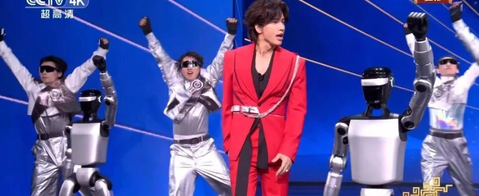
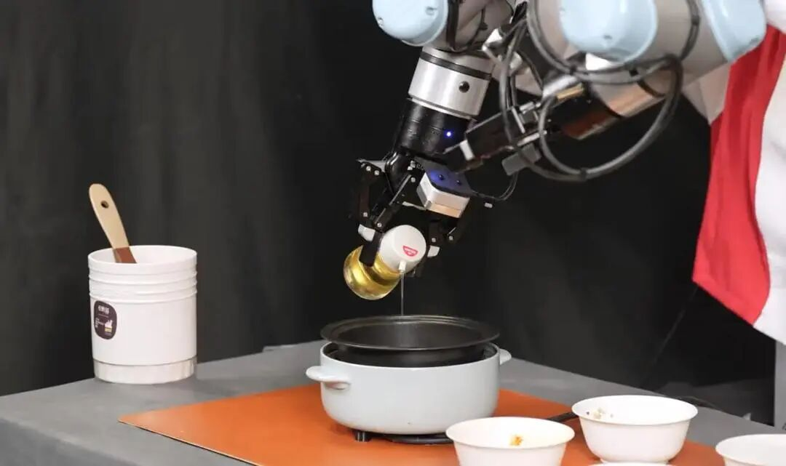
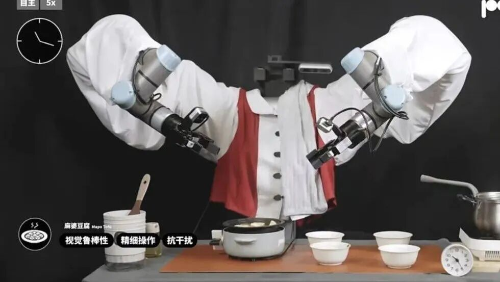
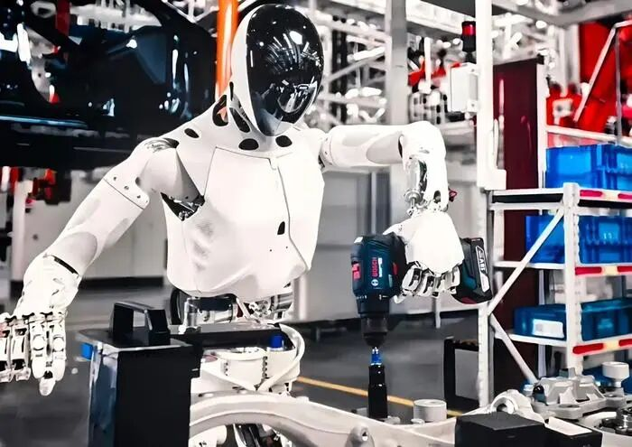
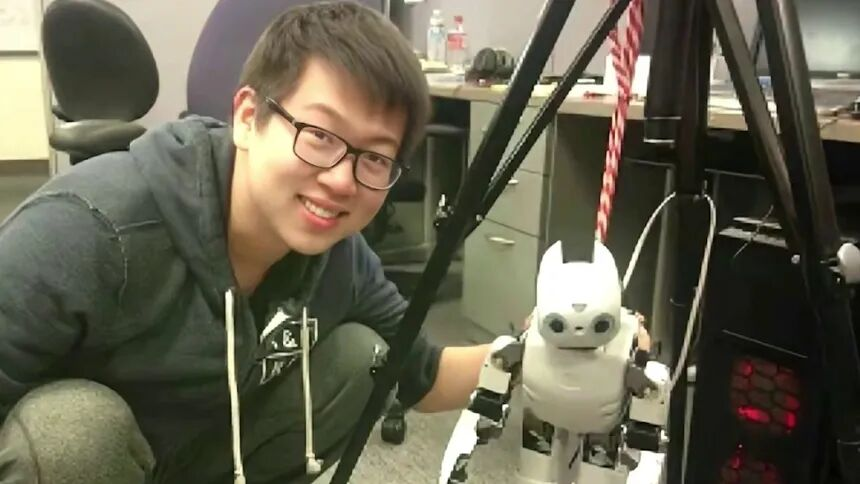

过去半年，具身智能有两种繁荣。

一边是钱涌进来。2026年上半年国内具身智能融资总额935亿元，是去年同期的5倍，融资322起，同比增长137%，百亿独角兽从3家增加到至少22家。

另一边，是一批最懂行的人正在离开。从创始人、首席科学家，到CTO、COO、CFO，几乎每个关键岗位都在换人。铅笔道做过一份不完全统计，2026年以来，至少有十几位具身智能公司的核心高管离职。

公司越来越值钱，最懂行的人却下了船。

## 01 造出一万台，卖给谁

最先走的，是创始人。

2026年央视春晚，**魔法原子**的6台人形机器人和易烊千玺、陈小春同台，宜宾分会场上百只机器熊猫完成全球首次百台四足集群表演。公司成立两年，一夜出圈。

热度还没散，3月，技术总裁吴长征被曝已经离职创业。而此时公司刚释放最快2026年IPO的信号。

魔法原子登上2026央视春晚，公司成立两年一夜出圈

6月，小鹏机器人产品一号位施晓鑫辞职，随后创办家庭机器人公司艾莫。据媒体披露，他和何小鹏在量产节奏上有分歧。何小鹏想加快量产，施晓鑫问了一句很现实的话：「1万台机器人造出来，放在哪里？」

7月，小鹏机器人核心业务负责人米良川也确认离开，何小鹏随后亲自兼任机器人业务CEO。4月，逐际动力COO张力离职；越疆科技CFO王勇、穹彻智能副总裁毛崇兆也先后离开。

吴长征是追觅前高管，2023年带着团队加入魔法原子，从四足机器人切入，很快做到和宇树、云深处同台竞争。他伴随公司一路走到春晚亮相、冲刺IPO的阶段，在这个节点选择离开，也成为行业里备受关注的人事变动。

这句话是行业的分水岭。前几年，机器人公司的任务是证明「能造出来」；现在，产品一号位要回答更难的问题——造出来谁来买。

## 02 技术灵魂，为什么走

另一批走的人，是各家的技术灵魂。

智元首席科学家**罗剑岚**，在公司官宣赴港上市仅10天后，从官网合伙人名单消失。他是伯克利博士、Google DeepMind前研究科学家，真机强化学习系统SERL的作者之一，加入智元后牵头建成超100万条真机数据的AgiBot World。智元回应是岗位调整，但没说明新职务，他个人主页也删除了智元相关信息。

2月，星海图联合创始人、首席科学家**许华哲**，在公司估值约200亿元、累计融资近30亿元的巅峰时刻离职。鹿明联席CTO丁琰，14个月换了三家公司，他主张UMI无本体数据采集，曾公开判断UMI和遥操作「互为取代」。9月，阿里达摩院具身智能负责人赵德丽也被传出离职。

这些人决定一家公司技术往哪走。他们频繁流动，背后是行业对下一步押哪条路线还没有共识：端到端VLA，还是世界模型，还是融合？数据靠遥操作、无本体采集，还是仿真？技术路线一旦和公司、股东的判断不一致，技术负责人往往只能选择离开。

## 03 走了以后，都去了家庭

看这些人走了以后去哪，方向高度一致——家庭。

许华哲4月创办**破壳机器人**，放弃主流VLA路线，专攻家庭场景。他直言，大量厂商把人形机器人送进工厂做机械臂就能完成的搬运，「本质上是在用新的人形做旧时代的事」。

破壳机器人演示长时序做饭，专攻家庭场景

破壳发布了9分钟麻婆豆腐真机演示，验证长时序、柔性物体的处理。公司一个月内拿到数千万美元天使轮，8月完成亿美元级Pre-A。

破壳的双臂厨房系统，面向家庭长时序作业

施晓鑫的艾莫团队里，也有不少前小鹏成员。当工厂场景「卖给谁」一时答不清，一批人转向了空间更大、也更难的家庭。家庭场景对安全、成本、长时序的要求更高，但一旦跑通，是真正的亿级市场。

家庭和工厂是两套逻辑。工厂里，机器人只要在固定工位上重复几个动作，旁边有人盯着；家庭里，环境是开放的，锅碗瓢盆、老人小孩、宠物都在动，机器人要连续干几十分钟不出错，还要足够便宜、足够安全。这也是为什么很多人把它看作比工厂更难、但天花板更高的方向。

## 04 不是牌桌撤了，是座位重排

高管走得这么密，是行业转冷吗？恰恰相反，公司还在重金抢人。

4月，优必选招聘具身智能首席科学家，年薪1500万元起，最高1.24亿元。国务院研究室披露，机器人行业技术人才需供比达5.2:1，缺口百万级。顶尖人才跳槽往往还能涨薪。

小鹏IRON进入工厂，车企正成建制地进入具身赛道

这一轮，多数人只是离开某家公司，很快又在行业里重新出现。他们换了一家公司，没有离开这个行业。

门口还有成建制的新人涌入：自动驾驶的蔚来前智驾负责人肖中阳创立日冕、小米汽车前智驾负责人刘方创立阿米奥；上汽、奇瑞、蔚来、理想都在布局。老团队拆开，新团队组队，座位在重新排。

为什么离职集中在今年爆发？前两年行业处在「从0到1」，大家目标一致，先把机器人做出来、把融资拿到。进入2026年，问题变成「从1到10」，要不要量产、押工厂还是家庭、走哪条技术路线，每一个选择都有代价，创始团队和股东、技术负责人之间的分歧，这时才真正摆到台面上。

许华哲早年在实验室，技术人仍在赛道里重新组队

## 05 看复购的阶段

但全行业赚钱的仍寥寥无几。优必选2025年营收20.01亿元、净亏7.9亿元；宇树2026年一季度扣非净利润同比下滑52.55%。华盖资本判断，2027年或成量产兑现元年，拿不出订单的企业会面临生存危机。

新鼎资本的判断更直接：现在行业里有近千家公司，最后能活下来的可能只有10到20家。梅卡曼德创始人邵天兰也公开批评过「攒局型」团队，靠讲故事和拼装开源方案拿融资。

水分正在被挤。融资文件里开始出现客户名单、复购数据，尽调从看论文和演示，转向看产线和订单复购。

对投资人来说，高管流动也成了一个新的观察指标。一家公司如果核心技术人员成批离开、又没有合理的交接，往往比少融一轮钱更值得警惕。反过来，一个人愿意在这个时点离开高薪岗位、自己出来创业，也说明他对这个方向还有信心，只是对原来的打法没了信心。

看懂每一位高管为什么走，比记住哪家又融了多少钱，更能看清这个行业的下一步。

潮水没退，只是换了一批人在游。
