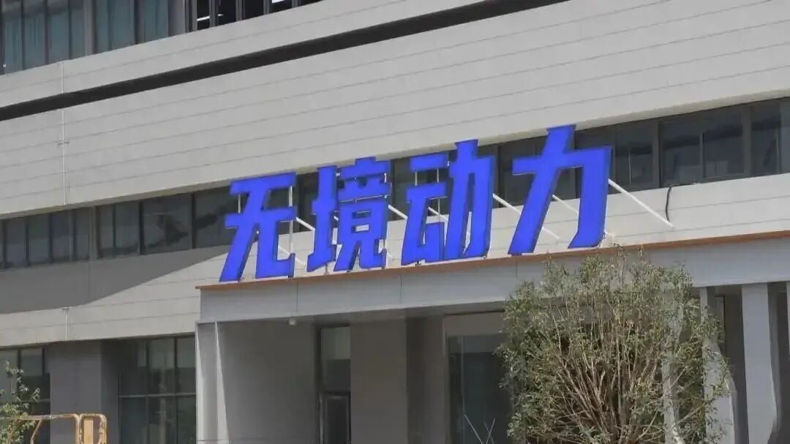
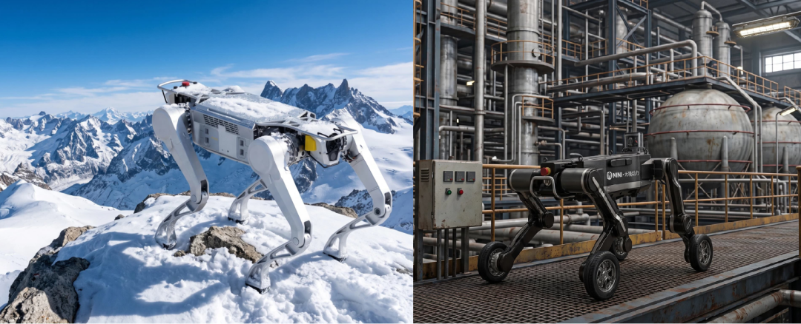
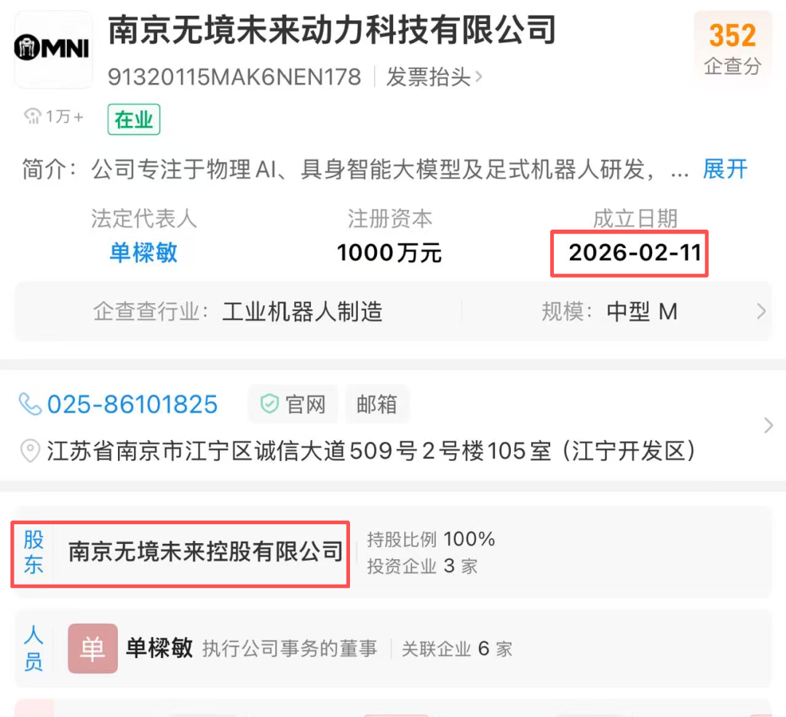
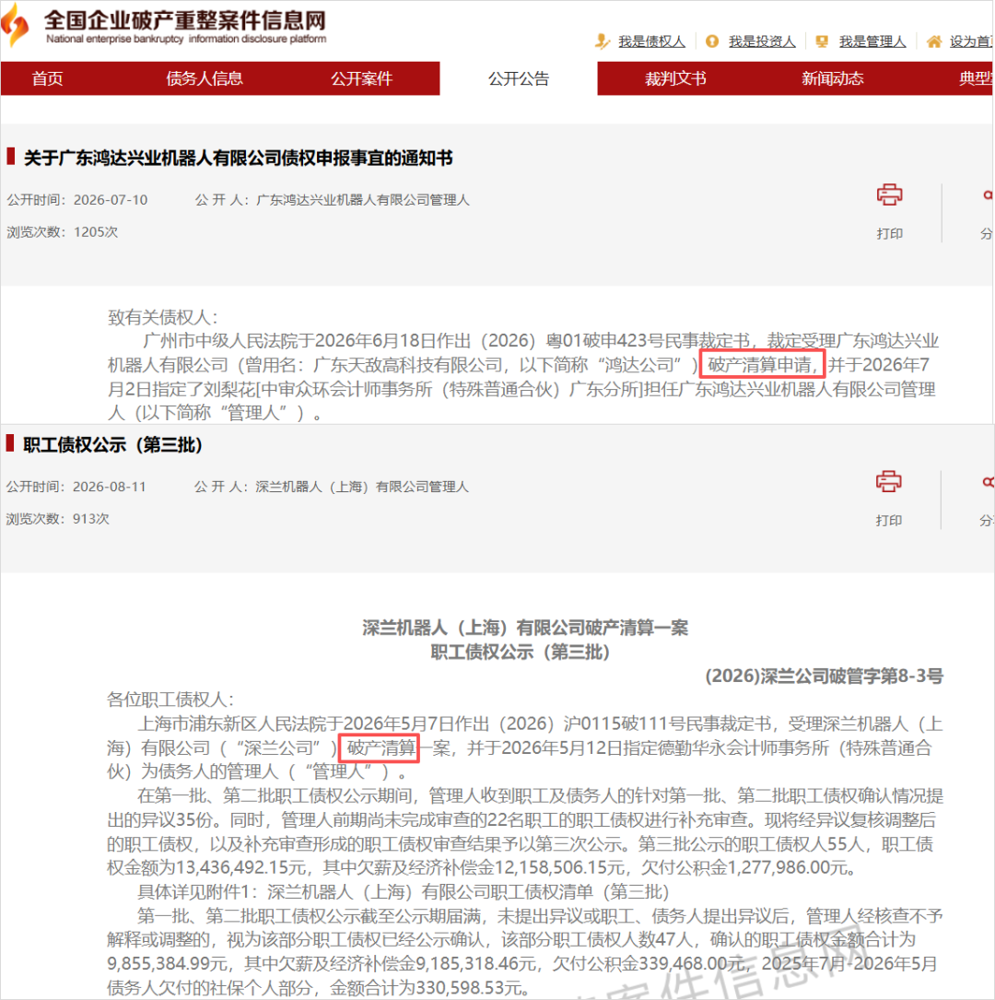
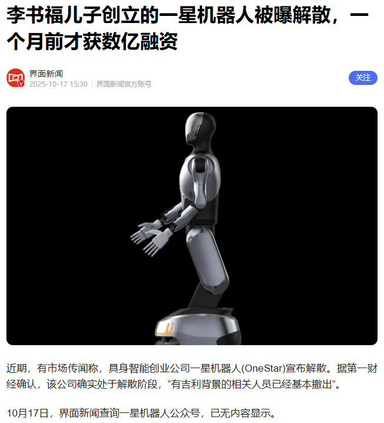

没想到2026年，机器人独角兽们，已经开始一个接一个倒下。

曾手握10亿订单的机器人明星公司，如今连员工薪资都负担不起了。

没错，南京一家具身智能企业无境未来动力，被员工爆出停薪风波，实控人也联系不上了。

据了解，无境未来动力是今年8月开始拖欠工资，结果情况一直没有好转，9月停缴公积金，10月停缴社保。

就目前统计的数据来看，欠薪涉及三四十名员工，累计欠薪近800万，公司也已经停工了。

更惨的是，部分员工想讨薪，结果却发现实控人崔小飞，早已联系不上。

而从官宣10亿订单、融资到位，再到员工停摆、老板失联，前后不过四个多月。

这家机器人独角兽，曾光速崛起，融资过亿，但也光速停摆，面临风险。

谁能想到，机器人行业的洗牌，居然来得这么快。

更震惊的是，无境未来动力今年2月才成立，算下来，成立时间刚好8个月，非常年轻的公司。

并且，无境未来动力目前只有两款产品公布，且都是四足机器人（上图），至于人形机器人暂时不见身影。

无境未来动力的机器人是否量产？这就更不用说了，压根没提到。

而它背后的实际控制人崔小飞，在成立无境未来动力前，他的创业经历均和医疗光学设施等相关。

他同时是上海臻辉医疗器械、苏州聚光医疗、光谱医疗以及超光微医疗的股东。

截至目前，就连无境未来动力CEO、总经理袁海辉，都联系不上崔小飞。

要知道，4个月前，那还是无境未来动力的高光时刻。

地方官媒报道，成立仅4个月就拿下10亿订单，其中一半是央企框架合同，一半是储备订单，还拿到了1.1亿的融资。

而公司研发团队成员，都是来自清华、上交、浙大等的人才。

回看它的高光时刻，和如今发不出工资，实控人失联的局面相比，反差大得刺眼。

其实，无境未来动力遭遇发展困境，并不是孤例。

今年国内赛道里，广东鸿达兴业机器人裁定破产清算；

深兰机器人也同样被法院裁定破产清算，职工债权多达两千多万；

盈合机器人进入破产程序，曾经顶着字节、美团投资光环，估值5亿美元；

而吉利旗下的一星机器人以及不少小型人形项目，被爆出内部裁撤、团队就地解散，而在解散前还拿到了数亿融资。

实在是唏嘘，热钱来得快，去得也快。

除了国内，海外机器人赛道也在同步降温。

美国K‑Scale Labs，曾经靠开源低成本人形机器人火遍全网，今年上半年资金耗尽、退款解散；

Cartwheel Robotics，前波士顿动力团队做家庭陪伴机器人，融资失败直接关门。

一边是资本还在往头部集中，大额融资持续流向宇树、智元这类已经跑出产品和稳定客户的玩家；

另一边，一大批靠PPT、框架订单、明星团队背书的初创公司，拿不到下一轮融资的钱，就只能停摆、裁员、欠薪。

机器人行业天生有一个致命矛盾：技术门槛高，但商业化周期极长。

很多初创公司，前期靠融资组建团队，扩大规模，再考虑订单落地，但一旦融资收紧，就面临资金链爆雷，活下去都成问题。

潮水褪去，或许才知道，谁在裸泳。

你怎么看机器人？来评论区聊聊
