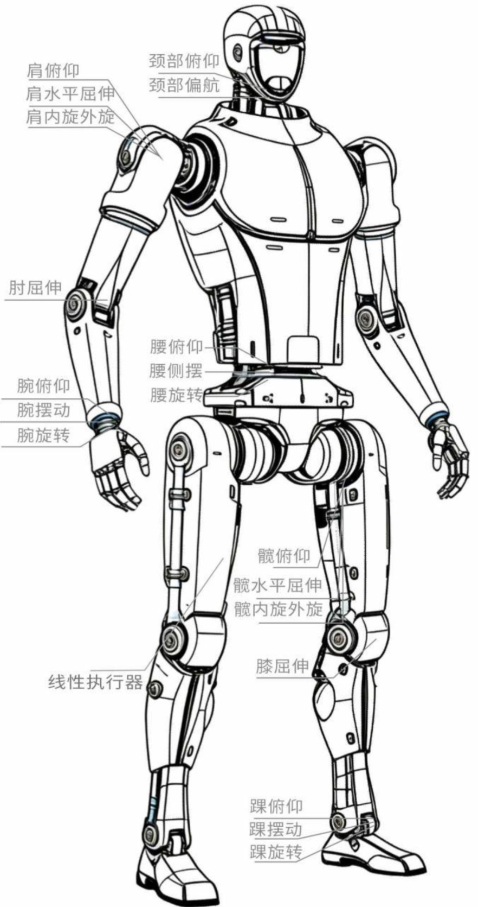
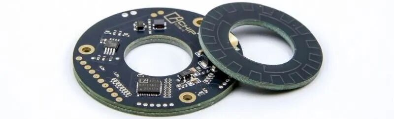
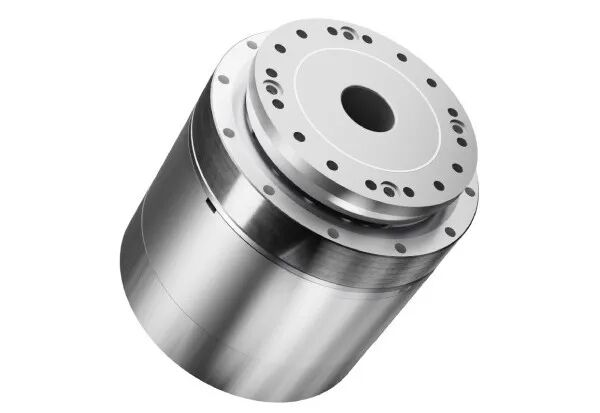
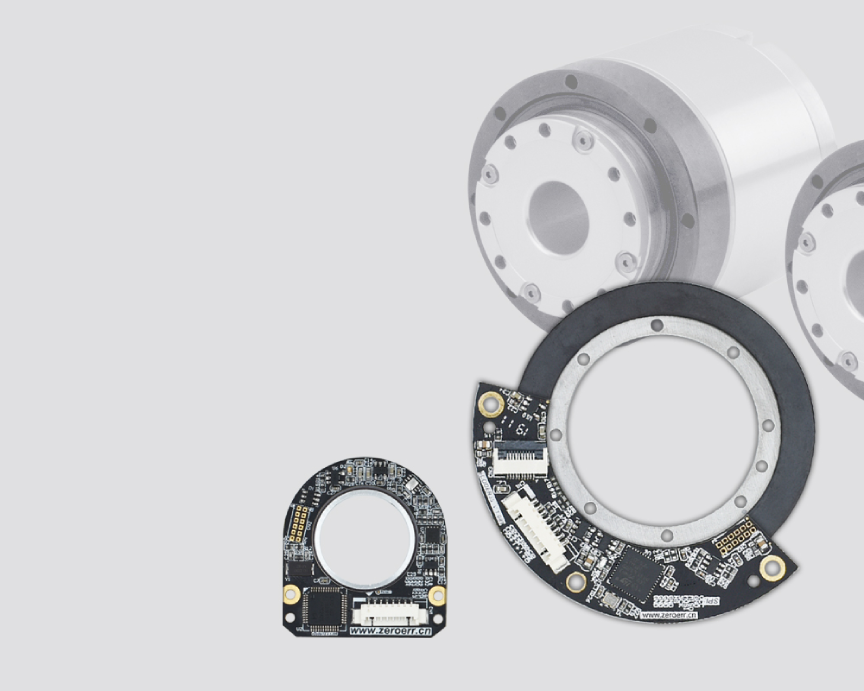
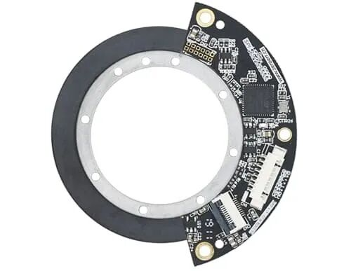

## 01 引言：为什么编码器如此重要？

机器人关节模组是构成机器人运动系统的核心部件，而编码器则是这个核心中的关键一环。它就像是机器人关节的“眼睛”和“神经系统”，实时反馈电机的转速和位置，让控制器能够精确地执行每一个动作。无论是工业机械臂的精准焊接，还是人形机器人的平稳行走，都离不开它的精确反馈。

那么，编码器到底有哪些类型？不同的技术路线有何优劣？如何为机器人项目选择合适的编码器？本文将为您详细解析。

## 02 编码器的核心作用

在机器人关节模组中，编码器主要承担三个关键角色：

位置反馈：精确测量关节的绝对或相对角度位置。这是机器人完成点到点运动、轨迹规划和重复定位精度的基础。

速度反馈：通过计算单位时间内的角度变化量来获取转速，用于速度环控制，实现平稳的速度调节和启停。

力控与安全：编码器结合电流检测、力矩传感器及控制算法，可为柔顺控制和碰撞检测提供支持。在双编码器架构中，两路位置反馈还可用于一致性监测和故障诊断，但系统安全性仍需结合诊断机制与安全控制设计确定。

## 03 三大核心技术路线对比

当前机器人关节模组主要采用光学编码器、磁性编码器和电感编码器三种技术路线。

1. 光学编码器

光学编码器利用光学刻度和光电检测原理工作，可实现很高的角度测量精度与分辨率，技术较为成熟。

优点：

•精度高，典型值可达±20角秒以内

•分辨率极高，主流16-24位，可达27位以上

缺点：

•对灰尘、油污等污染物非常敏感，不适用于恶劣环境

•结构复杂，体积较大，成本较高

•抗振动能力相对较弱

适用场景：高端工业机械臂、半导体设备、精密测量仪器、洁净环境

2. 磁性编码器

磁性编码器利用霍尔效应或磁阻效应（如AMR、TMR）检测磁场变化来测量位置，是近年来发展迅速的技术路线。

优点：

•体积小、重量轻，可做到芯片级集成

•抗污染能力强，不怕灰尘和油污

•抗震性能好，成本较低

缺点：

•精度相对较低，典型值在±0.1°至±1°之间，通常需要校准

•易受外部强磁场干扰，在电机应用中需注意磁屏蔽设计

适用场景：AGV/AMR移动机器人、服务机器人、对成本敏感的应用

3. 电感编码器

电感编码器基于电涡流原理工作，可以看作是光学和磁性编码器之间的“第三极”，兼顾了精度和鲁棒性。

优点：

•精度较高，可达±50角秒（约±0.014°）

•抗环境干扰能力极强，同时抗污染和外部磁场干扰

•可做成分体式PCB，支持超薄中空设计，便于集成

缺点：

•技术相对较新，供应链成熟度不如光学编码器

•成本介于光学和磁性之间

适用场景：人形机器人、协作机器人、户外自动化、恶劣环境下的高精度应用

核心参数对比

特性光学编码器磁性编码器电感编码器精度高（±20角秒）中等（±0.1°~1°）较高（±50角秒）分辨率极高（16-27位）中等（12-18位）高抗污染/油污差良好极佳抗外部磁场极佳差极佳抗振动中等良好极佳体积较大极小较小成本高低中等

## 04 关键选型参数

在选择编码器时，以下几个核心指标需要重点关注：

分辨率：编码器转一圈能识别的刻度数，用“位（bit）”表示。它决定了理论上能分辨的最小角度，直接影响低速运动时的平稳性。对于高性能关节模组，建议选择不低于17位的编码器。

精度：测量值与真实值之间的偏差，通常用角秒或度表示。这是衡量编码器“准不准”的核心指标。光学和电感编码器的精度通常更高。

重复精度：多次运动到同一位置时测量值的一致性。这一指标对机器人的稳定运行至关重要，通常远优于其标称精度。

通信协议：编码器与控制器“对话”的语言。绝对值编码器是机器人的主流选择，常用协议包括SPI、SSI、BiSS-C、EtherCAT等。增量式编码器仅提供相对位置变化，断电后位置丢失，除低成本应用外已较少使用。

机械结构：对于机器人关节模组，中空结构非常重要，方便线缆、气管等从关节中心穿过。编码器是否支持中空安装，直接影响关节的紧凑程度。

## 05 架构选择：单编码器 vs 双编码器

根据编码器的数量，机器人关节可分为两种架构：

单编码器架构：通常只在电机端安装一个编码器，结构简单、成本低、体积小。但无法补偿减速器（如谐波减速机）的回差和传动误差，适用于对精度要求不高的搬运、AGV移动等场景。

双编码器架构：在电机端和输出端各安装一个编码器。电机端编码器负责速度环控制，快速响应；输出端编码器负责位置环控制，消除减速器误差。这种架构精度极高，可补偿机械传动误差；安全性高，两个编码器互为备份；还可实现精确力控。缺点是成本较高、结构复杂。

选型建议：对于高精度、高安全性的机器人应用（如人形机器人、协作机器人），双编码器架构是目前的行业主要方案。

## 06 选型参考

根据不同的应用场景，可以参考以下选型逻辑：

应用场景推荐编码器类型推荐架构关键指标建议高端工业机械臂光学编码器双编码器18-24位绝对式，高速总线，多圈记忆人形/协作机器人电感编码器双编码器17-20位，超薄中空，±0.05°精度AGV/移动机器人磁性编码器单编码器12-16位，CANopen，低成本恶劣环境自动化电感编码器单/双编码器高抗扰，小体积，宽温范围

## 07 技术趋势

真正决定编码器价值的，不仅仅是参数表上的数字，更是它与应用场景的契合度：

工业场景（高温、振动、油污）：电感编码器的鲁棒性优势远超纸面参数。在恶劣环境下，光学编码器可能因污染而失效，而电感编码器能够持续稳定工作。

人形机器人（空间极限、多关节耦合）：中空、超薄、抗干扰成为硬性指标。磁性编码器虽然体积小，但易受电机磁场干扰；电感编码器在精度和抗扰之间取得了良好的平衡。

成本敏感项目：磁性编码器配合算法校准，可在预算内逼近更高精度。对于许多服务机器人来说，这可能是最优解。

技术趋势：双编码器架构正成为高端关节的标准配置，可有效补偿减速器回差。电感编码器凭借“精度+抗扰”特性，正在人形机器人和协作机器人领域快速普及。

总结

选择编码器本质上是在精度、成本、体积和可靠性之间做平衡。

•追求高精度、环境洁净：光学编码器是优选

•追求性价比、环境较好：磁性编码器足够用

•需要高精度且抗干扰：电感编码器是最佳平衡点

随着机器人向高集成度和智能化发展，高精度、超薄中空、支持双编码器架构的编码器方案正成为市场的主流选择。
