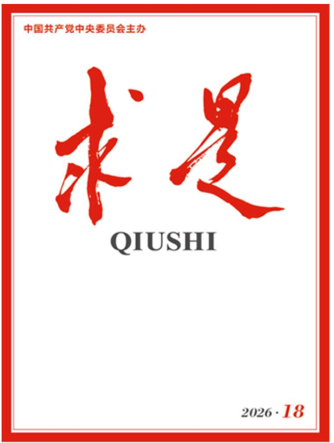

几天前，《求是》杂志刊发了科技部党组书记、部长阴和俊的署名文章《以更大力度更实举措加强基础研究》。

这不算一则“新闻”，却很快在科研圈里被反复转发。原因不在文章本身有多长，而在它罕见地点破了几个平时少有人公开提的问题。

**文章直指科研生态里长期存在、却总被一笔带过的顽瘴痼疾：不少机构仍把“高水平期刊论文数”“项目数”“经费数”“帽子”当考核指标，导致学术造假、项目申请“打招呼”屡禁不止；“圈子文化”“学阀”做派依旧存在，劣币驱逐良币，学术风气异化。**

在一位部长级官员的署名文章里，把这些词逐条摆上台面，本身就值得读三遍。

## 01 文章到底说了什么

这篇署名文章的主题，是基础研究。全文围绕四个方向展开：解决体系化协同不足、破解高水平人才不足、补齐长周期支持短板、破除科研生态顽瘴痼疾。

真正引发讨论的，是其中对现状的坦率描述——这不是一份“成绩单”，更像是一份“问题清单”。

文章承认，我国基础研究人才规模已是世界第一，科研论文总数、PCT国际专利申请量连续多年居世界第一，高被引论文数多年保持世界第二。

但成绩之外，短板同样清楚：**基础研究人员占全部研发人员的比重仅8%左右，远低于欧美发达国家15%—25%的水平**；高水平人才“有高原、少高峰”；青年人才“内卷”压力大，倾向选“短平快”方向，难以潜心做原创探索。

最重的一段，落在科研生态上。文章原话是：学术不端惩戒震慑作用尚未充分发挥，部分单位学风作风主体责任落实不到位，联合惩戒、终身追责机制效能释放不足，科研诚信约束有待强化。

这段话的指向很明确：**单靠发文件、喊口号，治不了科研圈的“圈子”和“学阀”。**

## 02 为什么说“圈子文化”值得被点名

要理解这段话的分量，得先回到它背后的数据。

2025年，我国基础研究经费达到2778亿元，占全社会研发投入的比重首次突破7%，达7.08%，创历史新高。这个数字本身在涨，但对照之下仍有差距——世界科技强国的这一比重普遍在15%—20%。

更关键的是投入结构。据文章披露，**我国企业基础研究投入占全部基础研究经费的比例低于10%，而美国约为35%、日本约为45%**。

换句话说，基础研究目前仍高度依赖财政，多数龙头企业把钱花在产品迭代与工艺改进上，真正沉下心做底层创新的内生动力不足。

资金流向只是表层。深层的，是评价指挥棒问题。

当一个体系把论文数、项目数、经费数、“帽子”当作硬指标，科研人员最理性的选择，就是去做那些“容易发论文、容易结项、容易攒帽子”的短平快课题，而不是去啃那些十年八年不一定有结果的真问题。

这解释了文章里那句“劣币驱逐良币”：当捷径成为主流，坚持做难事的人反而成了异类。长此以往，真正能做出原创突破的人被边缘化，学术圈子则被擅长“经营”的人占据。

## 03 “学阀”“帽子”，问题出在评价机制上

“圈子文化”“学阀做派”这些词，放在公开署名文章里，语气已经相当重。

所谓“学阀”，不只是一个道德问题，更是一个制度问题。当资源分配、项目评审、人才评价过度依赖少数人和小圈子的意见，权力就容易被垄断，新的声音、年轻的声音就进不来。

文章对此给出的药方是改革评价制度：建立以成果原创性和学术价值为导向的评价机制，完善代表成果评价、长周期评价、国际同行评价、团队评价；持续深化对“四唯”“帽子”“学阀”等顽疾的治理，抓好评审专家被“打招呼”的专项整治。

这些措辞背后，是对评价体系逻辑的一次重新校正——**从“数得出”转向“看得出价值”**。

对真正做基础研究的人而言，这或许是文章里最有信息量的一句承诺。

## 04 对青年人才，文章放了怎样的信号

文章专门谈到青年人才，措辞同样直接：对具备创新潜力的青年人才，职业早期支持力度不足；不少具备科研潜质的青年学生，过早转向热门应用方向。

这背后是一组略显矛盾的事实：一方面，国家自然科学基金超80%的项目已由45岁以下青年承担，青年已是科研主力；另一方面，青年恰恰是最容易“卷”起来、也最容易被“帽子”绑架的群体。

文章提出的方向包括：加大青年人才职业早期支持保障，探索竞争择优基础上的延续资助、里程碑考核基础上的长周期资助；健全在一线遴选发现优秀青年人才的机制，赋予优秀青年人才更多“挑大梁”“当主角”的机会。

通俗地说，就是**既要在起步阶段给够支持，也要在评价上给人松绑**，让愿意做难事、做长线的年轻人，不必因为发不出“热论文”就被边缘化。

## 05 几个值得记住的数字

**·2778亿元**：2025年我国基础研究经费，占研发投入比重7.08%，首次破7，创历史新高。

**·59.7万人年**：2024年我国基础研究人员全时当量，约是2012年的2.8倍。

**·低于10%**：我国企业基础研究投入占全部基础研究经费的比例，而美国约35%、日本约45%。

**·45个**：我国已建成散裂中子源等世界领先的国家重大科技基础设施。

## 06 写在最后

一篇署名文章能改变多少，现在还很难说。评价体系的改革、学术生态的重塑，从来不是一朝一夕的事。

但值得注意的是：高层把这些问题用书面形式、在党刊上公开点出，本身就释放了一种信号——这些问题不能再被当作“房间里的大象”了。

对于科研人员，尤其是青年科研人员来说，这些表述至少意味着：**那些困扰他们多年的“内卷”和“圈子”，已经被看见，也已经被正式列为要解决的问题。**

后续真正值得关注的，不是文章本身，而是配套的政策能否落地——评价改革能否从纸面走进实验室，青年支持能否从文件变成可感的资源，打击学术不端能否从表态变成机制。

这些，才是检验这篇文章分量真正的标尺。
