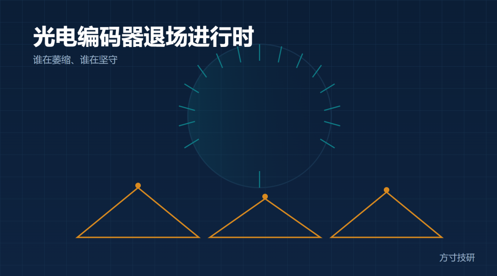
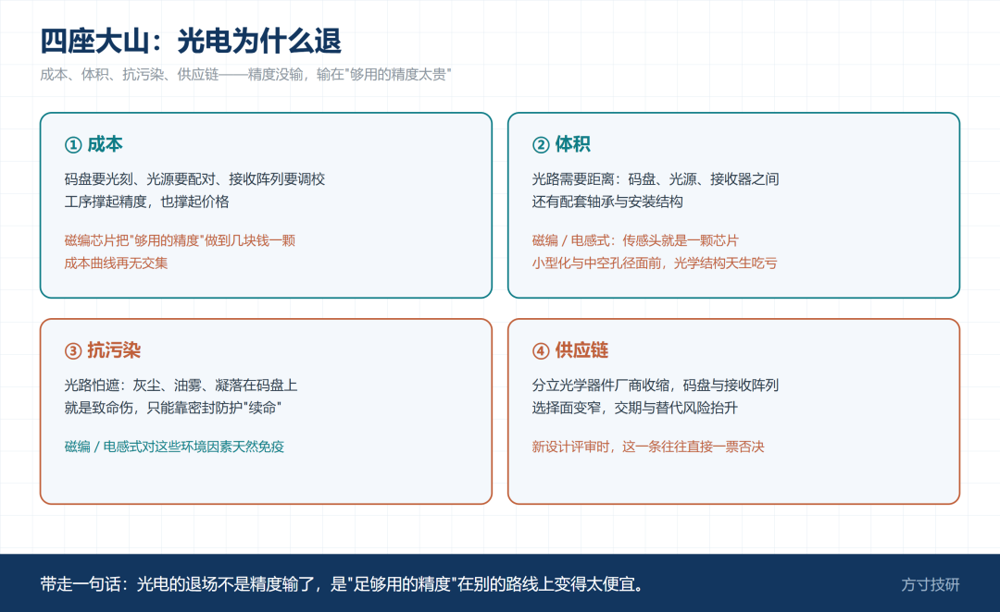
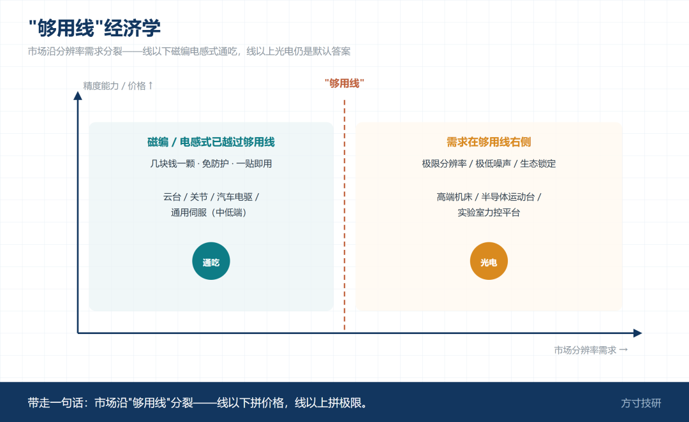
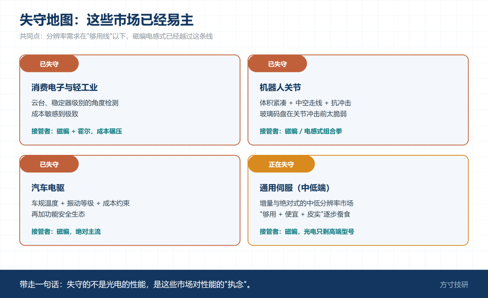
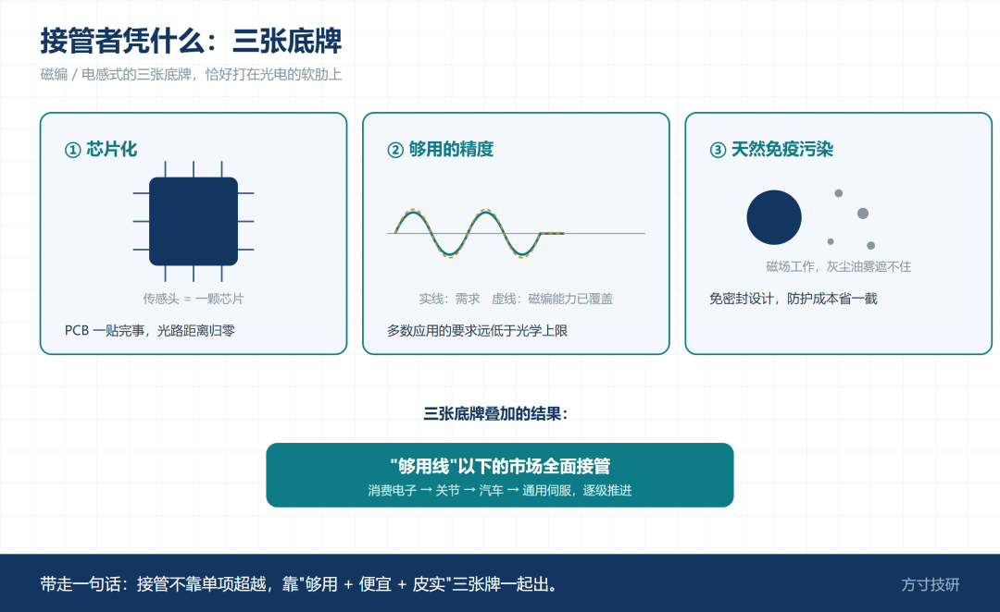
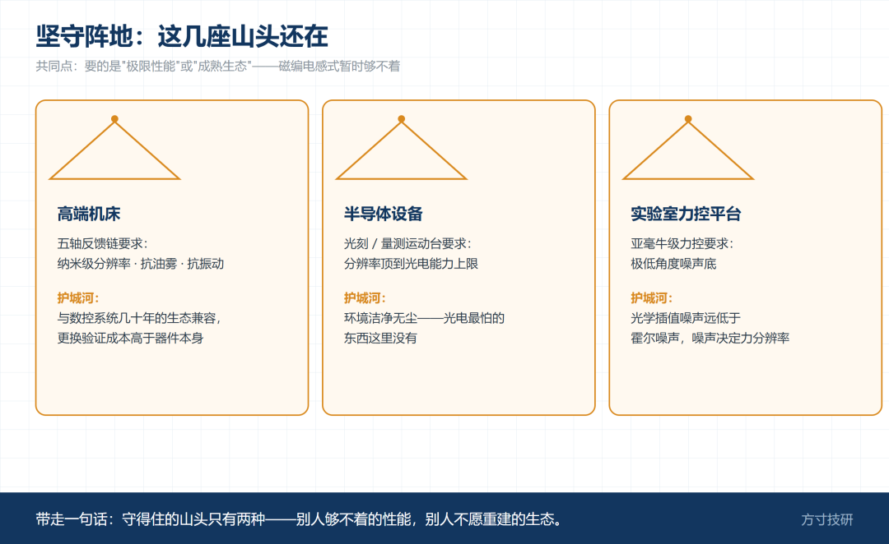
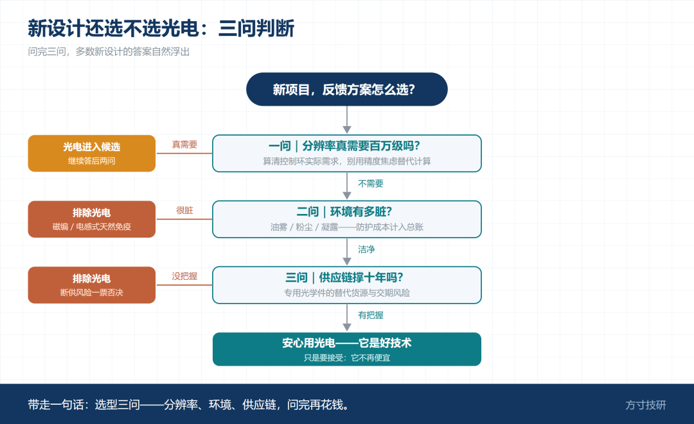
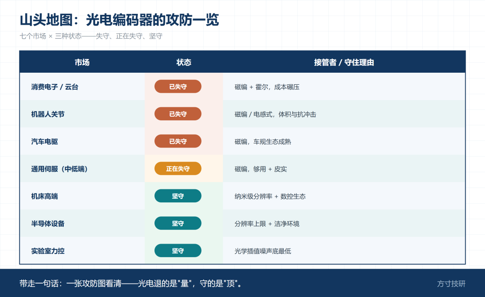
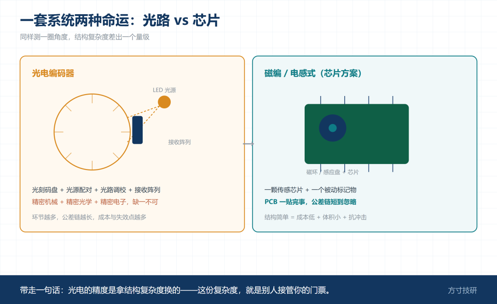

精度最高的编码器正在退场——这话听着矛盾，却在真实发生。十年前新设计的伺服电机，反馈几乎清一色光电编码器；如今拆开一台协作机器人，关节里全是磁编；新能源车的电机位置反馈，也基本看不到光电的影子。

但另一边，五轴机床的选型清单上光电依然在列，半导体设备的位移台更是非光电不选。**退场是真的，坚守也是真的**——关键是搞清楚：它退的是哪些市场，守的又是哪几座山头。

图 1｜成本 / 体积 / 抗污染 / 供应链，各配一句机理

### 一、四座大山：为什么退

**成本。** 光学系统是"精工出细活"的典型：码盘要光刻、光源要配对、接收阵列要调校，这些工序撑起了它的精度，也撑起了它的价格。当磁编芯片把"足够用的精度"做到几块钱一颗，成本曲线就没有交集了。

**体积。** 光学系统需要光路——码盘、光源、接收器之间要有距离，还有配套的轴承与码盘安装结构。磁编和电感式把传感头做进一颗芯片，PCB 一贴完事。小型化和中空孔径需求面前，光学结构天生吃亏。

图 2｜分辨率需求轴上磁编电感式越过线、光电在上

**抗污染。** 光路怕遮：灰尘、油雾、凝露落在码盘上就是致命伤。工业现场的油烟、户外场景的粉尘，光电都需要额外的密封防护来"续命"，而磁编电感式对这些天然免疫。

**供应链。** 分立光学器件的厂商在收缩，专用码盘和接收阵列的选择面变窄，交期与替代风险抬升。新设计团队评估供应链时，这一条往往直接一票否决。

一句话：**光电的退场不是精度输了，是"足够用的精度"在别的路线上变得太便宜。**

图 3｜消费电子 / 机器人关节 / 汽车 / 通用伺服

### 二、失守地图：这些市场已经易主

**消费电子与轻工业**：云台、稳定器级别的角度检测，成本敏感到极致，磁编和霍尔方案通吃。

**机器人关节**：体积紧凑 + 中空走线 + 抗冲击，磁编与电感式的组合拳正中要害；光电的玻璃码盘在关节冲击面前太脆弱。

图 4｜芯片化、够用精度、抗污染三点

**汽车**：车规级的温度范围、振动等级和成本约束，加上功能安全生态，磁编方案已是绝对主流。

**通用伺服**：中低分辨率的增量与绝对式市场，磁编方案用"够用 + 便宜 + 皮实"逐步蚕食，光电只剩高端型号在撑。

这些市场的共同点：**对分辨率的要求存在一条"够用线"，而磁编电感式已经越过这条线。**

图 5｜机床 / 半导体 / 实验室力控，各配坚守理由

### 三、坚守阵地：这几座山头还在

**机床。** 高端五轴的反馈链要的是纳米级分辨率、抗油雾、抗振动，还要与数控系统几十年的生态兼容。光电在这套体系里深耕太久，更换的验证成本高于器件本身。

**半导体设备。** 光刻与量测平台的运动台，分辨率要求直接顶到光电能力的上限，而且环境洁净无尘——光电最怕的东西这里没有。这是一块几乎不会被攻占的阵地。

**实验室力控平台。** 极低的角度噪声需求：光电的光学插值噪声底远低于磁方案的霍尔噪声，做亚毫牛级力控的设备，编码器噪声直接决定力分辨率。

这些阵地的共同点：**要求的是"极限性能"或"成熟生态"，磁编电感式暂时够不着。**

一句话：**市场沿"够用线"分裂——线以下磁编电感式通吃，线以上光电仍是默认答案。**

图 6｜分辨率？环境？供应链？→ 落点

### 四、新设计还要不要选光电：三问判断

**一问：分辨率真需要百万级吗？** 把控制环的实际需求算清楚，别用"精度焦虑"替代计算。

**二问：环境有多脏？** 油雾、粉尘、凝露任何一项存在，光电的防护成本要计入总账。

**三问：供应链撑十年吗？** 专用光学件的替代货源画出来，交期风险评估一遍。

三问之后，多数新设计会自然落到磁编或电感式；剩下的，安心用光电——它是好技术，只是不再便宜。

图 7｜七个市场的状态与理由

### 山头地图：光电编码器的攻防一览

图 8｜光路 vs 一颗芯片

| 市场 | 状态 | 接管者 / 守住理由 |
|---|---|---|
| 消费电子 / 云台 | 已失守 | 磁编 + 霍尔，成本碾压 |
| 机器人关节 | 已失守 | 磁编 / 电感式，体积与抗冲击 |
| 汽车电驱 | 已失守 | 磁编，车规生态成熟 |
| 通用伺服（中低端） | 正在失守 | 磁编，够用 + 皮实 |
| 机床高端 | 坚守 | 纳米级分辨率 + 数控生态 |
| 半导体设备 | 坚守 | 分辨率上限 + 洁净环境 |
| 实验室力控 | 坚守 | 光学插值噪声底最低 |

### 总结

· 光电退场是"够用线"经济学：成本、体积、抗污染、供应链四座大山，压垮的是通用市场；

· 失守的都是分辨率需求在线以下的市场，坚守的都是极限性能或生态锁定场景；

· 新设计用"三问"决策：分辨率真需要吗、环境多脏、供应链撑多久——多数答案已不是光电。

💬 **互动提问**：你的领域里光电编码器还在涨姿态吗？还是已经被磁编换掉了？评论区报个到。

**关注方寸技研，下一篇把镜头拉到荒野和戈壁——风电与光伏的编码器工况是另一个星球：-40℃、沙尘、二十年免维护，什么样的位置反馈能在那儿活下来？**

—— 方寸技研 · 下期预告：《风电光伏的编码器工况：-40℃、沙尘、二十年免维护，谁能在荒野里活下来》
