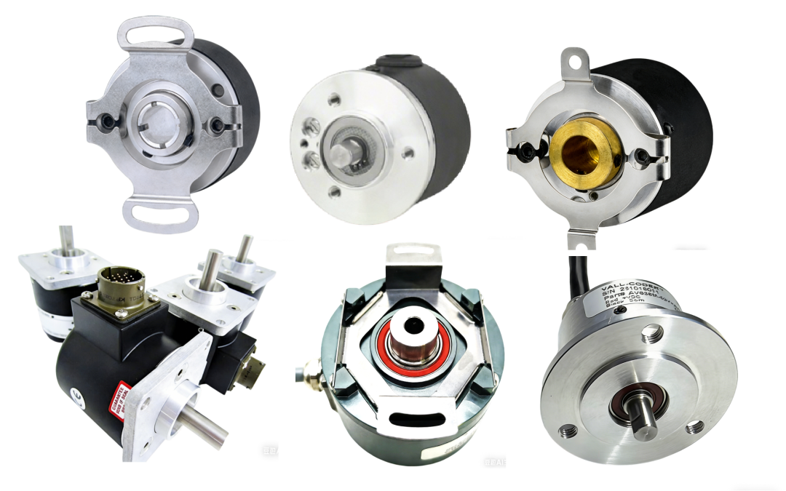
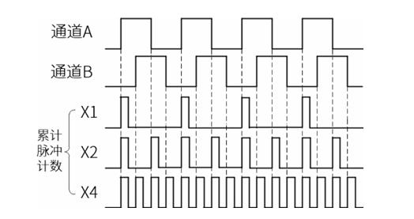

增量式编码器是相对式脉冲传感器，转动时输出脉冲，靠控制器计数得到位移、转速、转向；不直接输出绝对角度，断电丢失位置，上电需要回零。

## ✅ 基本结构（光电型最常用）

光源 + 光栅码盘（玻璃 / 金属 / 塑料）+ 接收管 + 信号整形电路

玻璃码盘：精度高、温漂小，伺服常用；易碎

金属码盘：耐冲击，分辨率上限低

塑料码盘：低成本，经济型设备

## ✅ 信号定义（标准 A/B/Z 正交）

**A 相、B 相**：正交脉冲，相位差 90°（1/4 周期）

A 超前 B → 正转

B 超前 A → 反转

脉冲数量 = 转过的角度；脉冲频率 = 转速

Z 相（零位）：每转 1 个脉冲，作为一圈的基准零点，用来校准、消除累计计数误差电子发烧友...

差分版本：A /A，B /B，Z /Z（长线驱动、抗干扰强，工业伺服常用，TTL/RS422）

倍频：X1（单沿）、X2（双边沿）、**X4（AB 四个边沿都计数，分辨率 ×4）**，比如 2500PPR 四倍频后一圈 10000 计数电子工程世...

## ✅ 核心参数

**PPR（脉冲 / 转）**：一圈 A 相输出脉冲数，即分辨率（200、500、1000、2000、2500、5000PPR 最常见）

**最高响应频率 kHz**：决定能跑的最大转速

**输出类型**：集电极开路、推挽、差分 RS422、正弦波（Sin/Cos，可细分插值，超高精度）

供电：5V / 24V

## ✅ 优缺点

**优点**

结构简单、成本低、寿命长

高分辨率可选、信号稳定、适合长距离差分传输

测速反馈响应快，伺服电机标配居多

**缺点**

断电位置丢失，上电必须**回原点（找 Z 相）**

脉冲丢数、干扰会造成位置偏移，无法自检

只能测**相对变化量**，没有天然绝对坐标

## ✅ 和绝对式编码器快速对比

表格

| 项目 | 增量式 | 单圈绝对式 |
|---|---|---|
| 输出 | A/B/Z 脉冲 | 格雷码 / 串行数字（SSI/BiSS/CANopen） |
| 断电位置 | 丢失 | 保留 |
| 上电 | 需要回零 | 直接读取角度 |
| 价格 | 低 | 高 |
| 适合 | 伺服速度环、传送带、普通定位 | 刀库、转台、断电不能跑原点 |

## ✅ 典型应用

伺服电机反馈、变频器测速、输送线、切割机、旋转台、气缸位移、PLC 高速计数定位；国产如得尔堡、堡盟、西克、EPC 都有全系列增量型号。

## ✅ 选型要点

伺服电机优先 **差分 RS422、2500PPR**

强干扰、长线 → 差分输出，不要集电极开路

只测速、不定位、允许回零 → 增量性价比最高

断电不能动原点、停机后人工盘车 → 选绝对式
