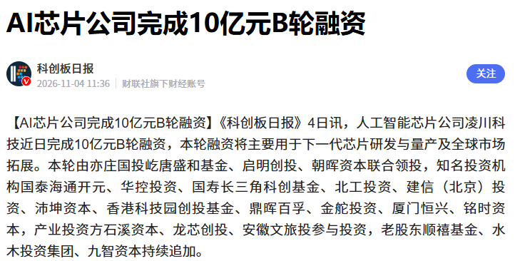
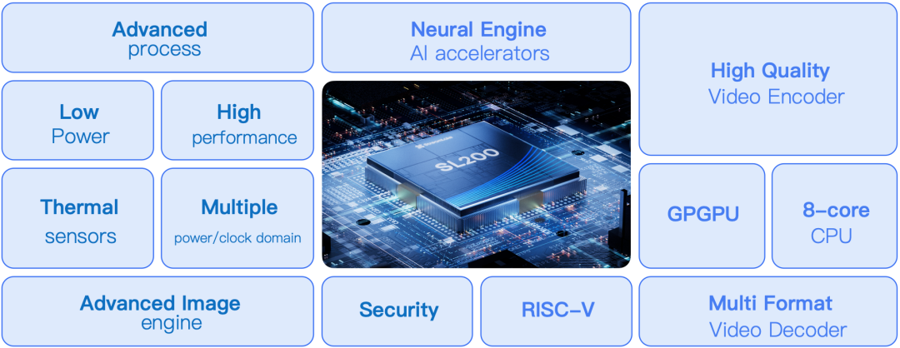
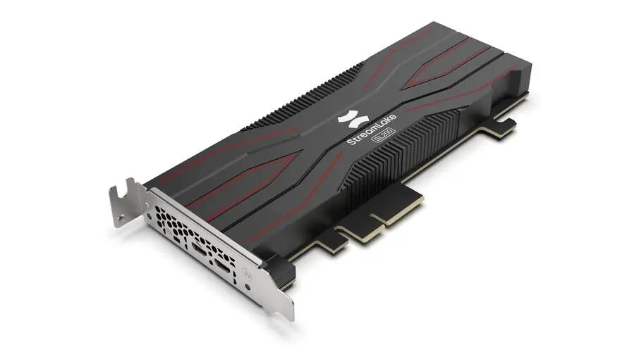
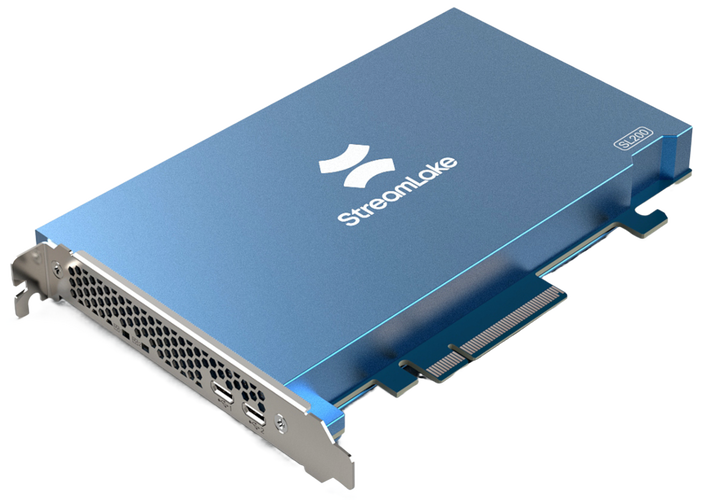

快手系AI芯片公司凌川科技近日完成10亿元B轮融资，本轮由亦庄国投屹唐盛和基金、启明创投、朝晖资本联合领投，石溪资本、龙芯创投、安徽文旅投等产业资本参与，老股东顺禧基金、水木投资集团、九智资本持续追加；此外还有国泰海通开元、华控投资、国寿长三角科创基金、北工投资、建信（北京）投资、沛坤资本、香港科技园创投基金、鼎晖百孚、金舵投资、厦门恒兴、铭时资本等多家机构参投。资金将主要用于下一代芯片研发、量产及全球市场拓展。

这笔融资释放两个信号：一是AIGV专用算力正在从概念走向商业验证；二是国产AI芯片赛道正在从“通用GPU替代”分化出更细的垂直路线。

## 认识凌川科技

凌川科技前身为快手异构计算与芯片事业部，2024年3月独立运营。它的第一款产品SL200已经卖出近十万颗，部署在快手、阿里云、百度云、B站等平台，覆盖快手99.7%的直播相关业务。在MSU世界视频编码大赛商业化赛道中，SL200连续三年获得商业化赛道第一，相比英伟达最新AV1方案压缩效率提升30%—35%。

这很关键。

很多AI芯片公司的问题不是技术讲不清楚，而是缺少真实业务负载验证。凌川科技的优势在于，它先在一个高并发、高带宽、高成本压力的视频业务里跑通了产品，再向外扩展。对芯片行业来说，这种“先有场景、再做芯片”的路径，比纯融资驱动更有说服力。

## 下一代3D芯片回片

凌川科技今年4月完成流片的下一代芯片已回片，预计明年规模出货。它采用全国产3D堆叠技术，主打3D近存架构，通过混合键合和先进封装实现异构集成。

这个方向并门槛很高。

3D堆叠、近存计算、混合键合、NUMA访存优化，每一项都涉及封装、散热、一致性、良率和软件调度。凌川科技选择这条路，本质上是在解决多模态大模型和视频生成场景里最头疼的问题：显存带宽、数据搬运和推理成本。

从架构看，它没有走通用GPU路线，而是提出延迟确定性DiPU架构，强调编译器对存储和调度的控制，试图把视频生成、推理、转码这类负载做成更可控的数据流执行。这与当下全球大厂自研AI芯片的趋势一致——在特定负载上，专用架构往往比通用GPU更有能效优势。

## AIGV的算力账变了

视频生成和传统文本模型不同。文本推理主要消耗的是语言模型计算，而视频生成涉及时序、空间、分辨率、帧率、画面一致性，算力需求呈指数级上升。对数据中心来说，这意味着GPU小时成本、存储成本和带宽成本都会被迅速放大。

凌川科技判断，AIGV相关算力市场目前仍是数百亿元级，未来三到五年可能扩展到数千亿甚至万亿元。这个判断是否完全兑现仍需观察，但方向是清晰的：视频生成正在从“演示功能”变成“生产负载”，而生产负载一定会倒逼专用芯片。

更现实的一点是，国内短剧、互动视频、AI广告、文旅内容制作等场景正在放量。凌川科技已与湖北长江电影数字传播等产业方签署战略合作，推动AIGV平台Nebula进入内容制作和文旅场景。需要说明的是，公开信息目前主要确认了签约合作，实际部署规模与商业化深度仍有待后续披露。这说明它不只想卖芯片，也在尝试把芯片、软件栈和行业应用打包成解决方案。

## 资本挑算力，挑的是落地

我们来看下这轮融资的阵容。亦庄国投、国寿长三角科创基金、北工投资、建信投资等国资背景资金参与，石溪资本、龙芯创投等产业资本跟进，老股东继续追加。

石溪资本背后有存储芯片产业资源，龙芯创投代表国产CPU生态，亦庄国投则强调产业链落地。这些投资方不是单纯看“AI故事”，而是在押注一条更完整的链条：存储、封装、指令集生态、数据中心落地。

尤其石溪资本近年来在3D芯片赛道布局较多，已投资谦合益邦、算苗科技、凌川科技等公司。这说明3D堆叠、近存计算、存算协同正在成为资本关注的新焦点。

## 三道关：量产、生态、客户

凌川科技的优势在于已有SL200的商业化基础，但下一代3D芯片能否顺利量产，仍是关键节点。3D芯片的良率、散热、封装成本、软件适配，都需要在真实客户环境里验证。

另一个挑战是软件生态。它自研了统一计算平台LUCAS，并已适配Qwen、通义万相、Hunyuan Video、MiniMax等模型，同时提供CUDA兼容层。这对降低客户迁移成本很重要，但通用GPU生态仍然强大，专用芯片要想真正替代，不能只靠单点性能优势，还要让客户愿意重构工作流。需要补充的是，CUDA兼容层本身也是一把双刃剑：它能降低入门门槛，却未必能让客户发挥专用架构的全部性能优势；如果客户长期停留在兼容层上跑原有工作流，专用芯片的能效优势可能被稀释。兼容层是过渡手段，不是生态护城河。

此外，云端AI加速卡市场竞争正在加剧。燧原、摩尔线程、沐曦、壁仞等企业已陆续登陆资本市场，通用GPU和DSA路线都会继续扩张。凌川科技如果只停留在视频转码，空间有限；但如果能在AIGV推理、视频生成、具身智能视觉等场景形成稳定订单，差异化就会更明显。

## AI芯片进入“垂直负载定义”阶段

过去十年，AI芯片的主线是通用GPU。未来几年，主线可能会转向“谁更懂某一类负载”。视频生成、语音交互、推荐系统、工业视觉、具身智能，每一类负载对带宽、延迟、精度、功耗的要求都不同。

凌川科技这轮融资，是产业资本愿意为“有真实业务验证、有明确负载边界、有量产路径”的专用芯片买单。对国内芯片公司来说，这比单纯追逐通用GPU更有现实意义。

接下来要看明年3D芯片能否如期规模出货、能否进入更多非快手客户的数据中心，以及AIGV平台是否真的能把视频生成成本降下来。这些才是检验一家AI芯片公司从“可用”走向“必用”的硬指标。
